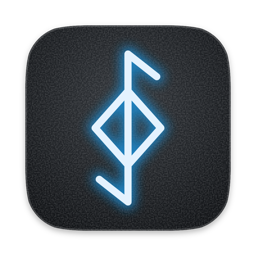
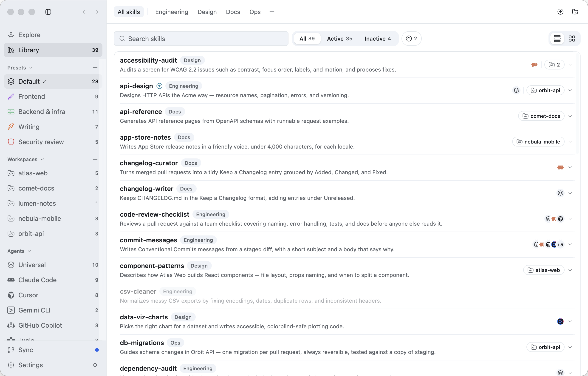
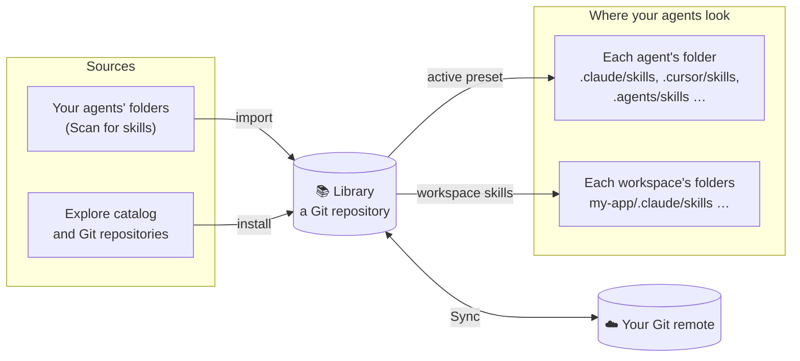

<div align="center">



# SkillBinder

### One library to bind them all.

A native desktop app that keeps every agent skill you use in one library<br>
and puts the right ones in front of the right agents, on every computer you own.

[](https://github.com/mastro993/SkillBinder/actions/workflows/checks.yml?query=branch%3Amain)
[](https://github.com/mastro993/SkillBinder/actions/workflows/native.yml?query=branch%3Amain)
[](https://github.com/mastro993/SkillBinder/releases)
[](LICENSE)


[**Download**](#install) · [**Features**](#features) · [**How it works**](#how-it-works) · [**Contribute**](#contributing)

<br>

<picture>
  <source media="(prefers-color-scheme: dark)" srcset="docs/readme/library-dark.png">
  
</picture>

<sub>Every skill, project, and agent setup in the screenshot is made up.</sub>

</div>

## Contents

- [Why SkillBinder?](#why-skillbinder)
- [Features](#features)
- [How it works](#how-it-works)
- [Supported agents](#supported-agents)
- [Install](#install)
- [Your first five minutes](#your-first-five-minutes)
- [From a terminal](#from-a-terminal)
- [Your data stays yours](#your-data-stays-yours)
- [Build from source](#build-from-source)
- [Contributing](#contributing)
- [License and credits](#license-and-credits)

## Why SkillBinder?

[Agent skills](https://agentskills.io) are folders of instructions that teach a coding agent how you work: how you write commits, review SQL, ship a release. They are wonderful, until you have a few dozen of them.

Claude Code reads `~/.claude/skills`. Cursor reads `~/.cursor/skills`. Codex, Cline, and Zed share `~/.agents/skills`. Every project keeps its own folder too. Soon the same skill lives in five places, in three versions, and nobody remembers which one is the good one.

SkillBinder gives your skills **one home**. You keep a single library, decide which skills each agent and project should have, and SkillBinder writes exactly those, and nothing else, where your agents look for them.

## Features

<table>
<tr>
<td width="50%" valign="top">

### 📚 One library
Every skill you own, listed once, with search and Active, Inactive, and Updates filters. Each row shows the agents and workspaces it is active in. Sort skills into folders as you like.

</td>
<td width="50%" valign="top">

### 📥 Import what you already have
**Scan for skills** finds the skills already sitting in your agents and projects. Review each one, choose between versions when two copies differ, and import them in a single step.

</td>
</tr>
<tr>
<td valign="top">

### 🎛️ Presets
A preset is a set of skills for all your agents, or for specific ones. Keep a *Frontend* preset, a *Writing* preset, and a *Default* one, and switch between them with one click. Clone, rename, color, and reorder them.

</td>
<td valign="top">

### 🗂️ Workspaces
Add a project folder, or a whole `~/Projects`, and each project gets its own page and its own skills, written into its agent folders as the project expects.

</td>
</tr>
<tr>
<td valign="top">

### 🧭 Explore
Browse a curated catalog of skills: Trending, Popular creators, and search, which also asks [skills.sh](https://skills.sh) for the long tail. Add your team's Git repositories and install their skills one by one or all at once.

</td>
<td valign="top">

### ⬆️ Updates from their sources
Skills remember the Git repository they came from. When the source changes, an update appears on the skill; **Update** or **Update all** brings it in.

</td>
</tr>
<tr>
<td valign="top">

### 🔄 Sync through Git
Your library is a Git repository. Connect any remote, public or private, and Pull, Push, or Sync to carry your skills to every computer you use. Presets and workspaces stay local to each device.

</td>
<td valign="top">

### 🪄 Lives in your menu bar
Close the window and SkillBinder keeps running behind its icon: switch presets, update skills, and install app updates without opening it. It updates itself, on the Stable or Beta channel.

</td>
</tr>
</table>

## How it works



- **The library is the source of truth.** Agents get *managed copies*: SkillBinder writes a copy when you turn a skill on and removes it when you turn it off.
- **It never touches files it does not manage.** A same-name skill you put there yourself is replaced only after you confirm, and nothing else in those folders is ever changed.
- **Agents that share a folder share a copy.** Codex, Cline, Zed, and the other agents that read `~/.agents/skills` get one copy between them.

## Supported agents

SkillBinder knows the skill folders of **79 agents**, including Claude Code, Codex, Cursor, GitHub Copilot, Gemini CLI, Windsurf, Cline, Zed, Amp, OpenCode, Goose, Junie, Kiro CLI, Roo Code, Qwen Code, Trae, Warp, and Devin for Terminal. It detects the ones installed on your computer and asks which of them it should manage.

The full list, with every folder each agent reads, is in [supported agents](docs/supported-agents.md).

## Install

SkillBinder is in active development: today every build is a nightly **beta**. Grab the newest from [Releases](https://github.com/mastro993/SkillBinder/releases).

| Platform | Download | Good to know |
|---|---|---|
| **macOS 26+**<br><sub>Apple silicon and Intel</sub> | [Disk image (`.dmg`)](https://github.com/mastro993/SkillBinder/releases) | Signed and notarized. Drag it to Applications so it can update itself. |
| **Windows** | [Setup program (`.exe`)](https://github.com/mastro993/SkillBinder/releases) | Installs for your user, no administrator prompt. SmartScreen warns once: choose **More info**, then **Run anyway**. |
| **Linux** | [AppImage](https://github.com/mastro993/SkillBinder/releases) | `chmod +x` it and run it from a folder you can write, such as `~/Applications`. Needs FUSE (`fuse3`). |

On macOS you can also use [Homebrew](https://brew.sh):

```sh
brew install --cask mastro993/tap/skillbinder@beta   # nightly betas
brew install --cask mastro993/tap/skillbinder        # stable, once the first one ships
```

The app checks for updates on its own and installs them when it quits.

> [!TIP]
> **Git is optional.** Without Git 2.39 or newer, everything works except Sync, skill updates, and installing from Explore. Install it later and your library becomes a repository on its own.

## Your first five minutes

1. **Open SkillBinder.** It sets up a fresh library and asks only for what is missing.
2. **Choose your agents.** It lists the agents it found and manages only the ones you tick.
3. **Import your skills.** It offers the skills your agents already have, so nothing you made is lost.
4. **Add your projects.** Under **Workspaces**, pick a project, or a folder of projects.
5. **Make a preset.** Turn skills on for every agent or a few, then switch presets from the sidebar or the menu bar.
6. **Sync, if you like.** Connect a Git remote on the **Sync** page, then run the same steps on your other computer and Pull.

## From a terminal

SkillBinder ships a `skillbinder` command that talks to the running app, and starts it in the background when it isn't running. Put it on your PATH with **Install** in Settings › General › Command line tool; the Homebrew cask installs it for you. It runs the same actions as the window, under the same rules: list your skills (`skills`, `skill pdf`), turn them on or off (`enable pdf`, `disable pdf --agent cursor`), switch and edit presets (`preset activate Work`), file skills in library folders, answer for copies waiting on you (`copies`), add the project you're in as a workspace and turn skills on there (`workspace add .`, `workspace enable . pdf`), choose your agents (`agent on cursor`), import the skills your agents already have (`scan`, `import --all`), find and install skills from Explore and your repositories (`search pdf`, `install anthropics/skills/pdf`, `repo add <url>`), keep skills current (`updates --check`, `update --all`, `reinstall pdf`), and sync the library (`remote set <url>`, `sync`, `push`, `pull`). It never replaces your own copy of a skill without asking, or without `--replace`. Add `--json` for scripts and agents.

```sh
skillbinder status
```

Agents can use the same actions as typed tools: `skillbinder mcp` is an MCP server over stdio. Connect Claude Code with `claude mcp add --scope user skillbinder -- skillbinder mcp`, or add `{"mcpServers": {"skillbinder": {"command": "skillbinder", "args": ["mcp"]}}}` to any agent's MCP settings. Its tools read your library and switch and edit presets; replacing your own copy of a skill asks you first.

## Your data stays yours

- **Local first.** Your library, presets, and settings live in a `SkillBinder` folder in your system's application data directory. There is no account and nothing to sign in to.
- **Only skill folders.** SkillBinder reads your agents' skill folders and writes only the managed copies you asked for.
- **What reaches the network**, and only when you use it: Git for Sync and updates, through your own credentials; the Explore catalog; skills.sh when you search Explore; and the update check.

## Build from source

You need Rust 1.100 through [`rustup`](https://rustup.rs) and the [platform prerequisites](docs/native-gate/checks.md#prerequisites).

```sh
git clone https://github.com/mastro993/SkillBinder.git
cd SkillBinder
cargo run -p skillbinder --locked
```

To try it without touching your own agents, build the [synthetic world](fixtures/synthetic/README.md), a small fictional machine, and launch on it:

```sh
cargo run -p xtask --locked -- fixture /tmp/skillbinder-world
cargo run -p skillbinder --features native-test --locked -- \
  --data-dir /tmp/skillbinder-world/data --home /tmp/skillbinder-world/home \
  --catalog-dir /tmp/skillbinder-world/catalog
```

A `native-test` build refuses to run on your real home or without an isolated `--data-dir`.

## Contributing

Contributions are welcome, from a typo fix to a new feature. Here is how to make yours land smoothly.

**Find something to work on.** Browse the [issues](https://github.com/mastro993/SkillBinder/issues), or open one to discuss an idea before you build it.

**Get to know the code.** SkillBinder is pure Rust on [GPUI](https://www.gpui.rs) and [GPUI Kit](https://github.com/longbridge/gpui-kit), split into small crates with clear jobs:

| Crate | Owns |
|---|---|
| `apps/desktop` | the executable and the native app lifecycle |
| `crates/ui` | screens, interactions, and dialogs |
| `crates/design` | the design system: tokens and generic components |
| `crates/client` | projections and subscriptions that feed the UI |
| `crates/proto` | the typed contracts everything shares |
| `crates/engine` | domain operations, files, SQLite, and Git |
| `xtask` | verification, packaging, and generators |

Read [architecture](docs/architecture/native.md), [feature coverage](docs/features/native.md), and [`DESIGN.md`](DESIGN.md), the source of truth for every color and size.

**Turn on the hooks** once per clone:

```sh
git config core.hooksPath .githooks
```

**Check your change** the way CI does:

```sh
cargo fmt --all --check
cargo clippy --workspace --all-targets --all-features --locked -- -D warnings
cccc .
cargo test --workspace --all-targets --locked
cargo run -p xtask --locked -- verify
cargo build -p skillbinder --release --locked
```

**A few house rules:**

- Keep modules small and focused. Filesystem, process, and network work belongs in `crates/engine`; Clippy enforces it.
- Take sizes and colors from the design system, never raw values.
- Test against the synthetic world and isolated data directories, never your real library.
- Update the behavior docs in `docs/` that your change affects.
- For UI changes, add before and after screenshots to your pull request.

The full guide is in [CONTRIBUTING.md](CONTRIBUTING.md), and [verification status](docs/native-gate.md) records what has been checked on real machines.

## License and credits

SkillBinder is released under the [MIT License](LICENSE).

It stands on the shoulders of [GPUI](https://www.gpui.rs), [GPUI Kit](https://github.com/longbridge/gpui-kit), and icons from [Hugeicons](https://hugeicons.com). Agent logos belong to their owners and only identify their agents; SkillBinder is not affiliated with any of them. Every dependency and asset license is listed in [third-party notices](THIRD_PARTY_NOTICES.md).

<div align="center">
<br>

<br>
<sub>Made with care for everyone who teaches their agents new tricks.</sub>
</div>
