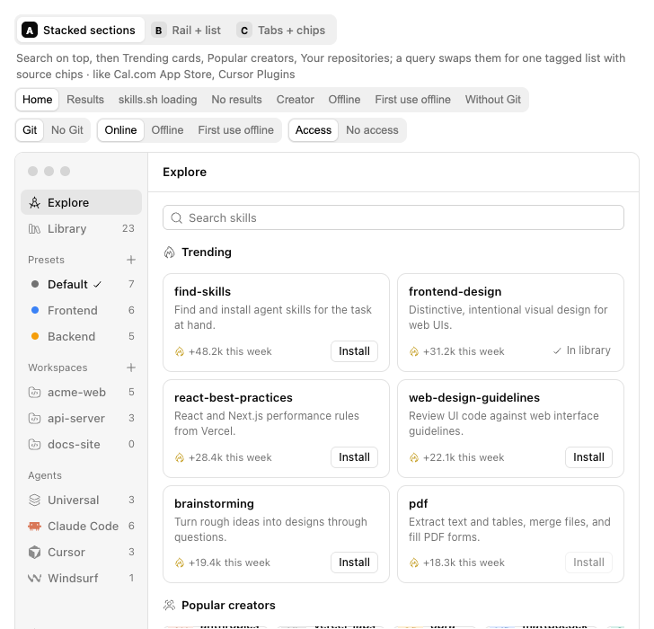
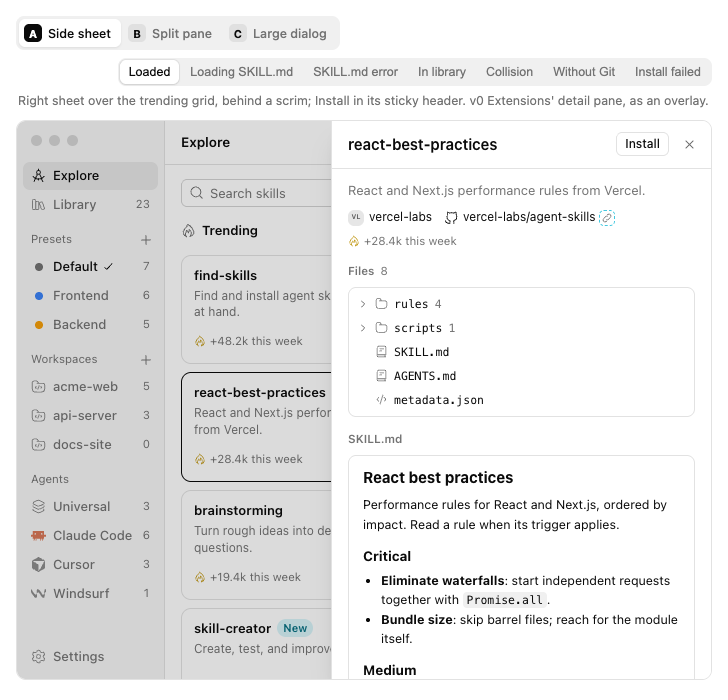
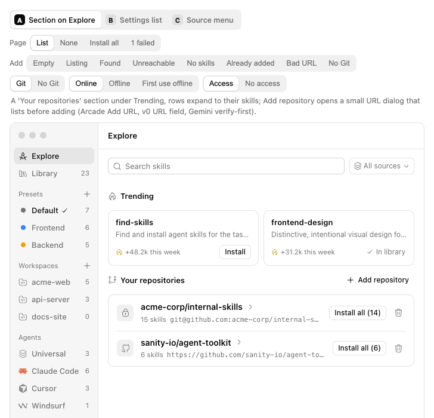
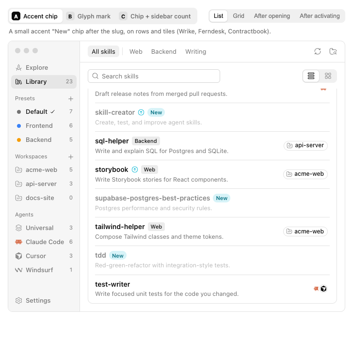

# Explore design reference

This folder holds the four prototypes the user approved on 2026-11-19 for [the explore-and-install spec](../../specs/explore-and-install.md). Build the same layout, hierarchy, copy, icons, states, and behavior, using GPUI Kit components and the design system's components first, styled through their public API. Small visual differences from Kit's defaults are fine. The rules are in [decisions.md](decisions.md), and the Mobbin references behind each variant are in [references.md](references.md). Where a prototype and decisions.md disagree, decisions.md holds. Paths below are relative to this folder.

## Chosen variants

| Area | Prototype | Variant the user picked | Screenshot |
|---|---|---|---|
| Explore page | `prototypes/explore-page.html` | A "Stacked sections" |  |
| Skill detail | `prototypes/skill-detail.html` | A "Side sheet" |  |
| Repositories | `prototypes/repositories.html` | A "Section on Explore" |  |
| New mark | `prototypes/new-mark.html` | A "Accent chip" |  |

- **Explore page A:** the header holds the title "Explore". Under it, one full-width search field, "Search skills". The quiet offline line and the Install Git line come next, only when they apply (C4, I7). With no query and no source picked, the page stacks three sections, each a header with a glyph. Trending (fire) is a grid of six cards: the name, a two-line description, and a footer with "+48.2k this week" on the left and the Install action on the right. Popular creators (people) is one horizontal row of creator chips, each an avatar, the creator's name, and "N skills". Your repositories (git-branch) has Add repository at its end and lists your repositories. Typing a query, or clicking a creator, swaps the three sections for results: a row of source chips ("All", then each source with its count, then skills.sh), a scope header when one source is picked, and one bordered list of rows. A row shows the name, the description, a meta line with the source tag and this week's installs, and Install at its end. A list narrowed to one source drops the source tag each row would repeat. skills.sh results arrive below the local ones after "Searching skills.sh" (C5). A creator's scope header shows a 32-point avatar, the name, "N skills", and a clear button. A repository's shows its glyph, its name, its URL, and Install all.
- **Skill detail A:** clicking a card or a row opens a sheet on the right, 380 points wide, over the page behind a scrim. Its sticky header holds the skill's name, Install, and Close. The body stacks the description, the install error line (I6) and a meta line: the creator (avatar and name; a click narrows Explore to them), the repository (github or lock glyph, `owner/repo`, and a link glyph; a click opens it in the browser), and this week's installs. Then "Files" with its count, a tree whose folders collapse and come first, and "SKILL.md" with the text rendered as Markdown, front matter dropped. A skeleton stands in while SKILL.md loads; a failure reads "Couldn't load SKILL.md" with Retry. The card behind the sheet shows as selected.
- **Repositories A:** the Your repositories section sits under Popular creators on the Explore page; the prototype shows it under Trending only. Its header ends with a ghost "Add repository" with the plus glyph. A row shows a glyph tile (lock for an SSH or scp-style URL, github otherwise; the app cannot tell which repositories are private), `owner/repo` with a chevron, then "N skills" and the URL in mono. Its end holds the Install all control and a remove button. Clicking the row, or Enter or Space on it, expands its skills under it as indented rows, each with the New chip when it applies and its own Install. Install all shows "Installing 3 of 14" with a spinner, then "Installed 14" or "Installed 13 · 1 failed" in the danger tone, whose tooltip names the failure (R5). With no repository, the card reads "No repositories yet" with an outline Add repository. Add repository opens a standard dialog with one mono URL field. The app lists the repository's skills before adding it: "Listing…", then `owner/repo · N skills` over a short scrolling list of slugs, and Add turns primary. Remove asks first, then toasts with Undo (R4).
- **New mark A:** in Library's list and grid, a skill installed from Explore shows a small accent "New" chip after its name, after the update glyph when both apply, and before the folder tag. An inactive skill is dimmed, but its chip keeps full opacity. Opening the skill's page or turning it on clears the chip at once (N1). The Explore prototypes show the same chip on the cards and repository rows of such skills.

Open a bundle in a browser. Its variant bar opens on the picked variant and still switches to the rejected ones. Its state bar and demo controls step through the states:

- `explore-page`: Home, Results, skills.sh loading, No results, Creator, Offline, First use offline, Without Git, and the Git, network, and access toggles.
- `skill-detail`: Loaded, Loading SKILL.md, SKILL.md error, In library, Collision, Without Git, and Install failed.
- `repositories`: List, None, Install all, and 1 failed for the page; Empty, Listing, Found, Unreachable, No skills, Already added, Bad URL, and No Git for the dialog.
- `new-mark`: List, Grid, After opening, and After activating.

The prototypes predate some rules. Build these from decisions.md instead:

- The offline line reads "Offline · showing the last catalog" (C4); the prototypes say "saved catalog".
- First use offline still shows Your repositories (C4); the prototype shows only the line and Retry.
- On first use, while the catalog loads, Trending shows six skeleton cards and Popular creators skeleton chips (spec); the prototype has no loading state.
- Without Git, the detail sheet shows "Preview needs Git" in place of the files and SKILL.md (I5); the prototype still shows them.
- Install all installs one skill after another (R5); the prototype runs three at once.

## Sources

`source/` holds the editable pages, kept as `.parts/` folders under the repository's per-file size limit, plus:

- `catalog.js` (in parts): the fixture and the rules. It holds the creators with their skills and weekly installs, two repositories (one private), the skills.sh long tail, the library's skills, and the rules: search, sources, install states, collisions, the access failure, New, and listing a repository.
- `explore-kit.js`: the shared controls: the sidebar with Explore first, avatars, creator chips, the Install action, the error line, Install all, the installs meta, source tags, the New chip, section headers, the sheet, and the offline and unavailable states.
- `skill-detail.js`: the detail sheet's pieces, the file tree, and the Markdown rendering.
- `explore.css`: the shared styles, on the kit's tokens.

The pages link the shared kit in `../scoped-pages/source/kit/`. Each page's body carries `data-first-variant="a"`, so its bundle opens on the pick. Rebuild a bundle from the repository root with:

```sh
python3 -I docs/design/scoped-pages/source/kit/inline.py docs/design/explore/source/<name>.html docs/design/explore/prototypes/<name>.html
```

Two kit changes came with these prototypes:

- `gen_icons.py` retains the Hugeicons glyphs Explore uses: fire, star, users (UserGroupIcon), github, globe, sparkles, lock (SquareLock02Icon), cloud, arrow-up, copy, and package. Rerun it to regenerate `icons.js.parts/2-generated.js`.
- `inline.py` prunes the generated icon block: a bundle keeps only the icons whose name the page quotes somewhere (`'name'`, `"name"`, or `` `name` ``). A pruned icon that is still drawn shows the kit's visible "?" box and logs an error, so a miss cannot pass unseen.

The link glyph beside the repository is the kit's hand-drawn `link` from `NEW_ICONS`, not retained artwork.

## Component map

| Element | Renders with |
|---|---|
| Sidebar row | The first `nav_row`, with the `compass` glyph, already registered |
| Search field | `SearchField`, placeholder "Search skills", filling the toolbar row (`library::TOOLBAR_HEIGHT`) |
| Section headers | `SectionHeader` through `custom`, with an `Icon` glyph before the label; Add repository in its `action` |
| Trending and result cards | New `SkillCard` organism, lifted from Library's tile: a `Surface` at `Level::Flat` in a grid on Library's grid metrics (`library::GRID_MIN`, `GRID_GAP`, `TILE_PADDING`, `TILE_GAP`). **Ask before building.** |
| Result rows | `ListRow` in a `CardList`; Install in the row's trailing slot, so its clicks stay out of the row |
| Install | `Button` `Secondary` `Sm`, with Kit's loading state and "Installing" while it runs; `inactive` with a `tooltip` for a collision or a missing Git |
| In library | `Icon` `check` `Xs` and `Text` `caption`, muted |
| Installs this week | `Icon` `fire` `Xs` in the warning text tone and `Text` `caption`, muted, with a `tooltip` |
| Source tag | A Kit `Avatar` (creator), or the `github` glyph, `lock` for an SSH or scp-style URL, or `globe` for skills.sh, and `Text` `caption`, muted, with a `tooltip` naming the repository |
| Source chips | `ToggleChip`, on while picked, each with its `Count` |
| Creator chip | A `Surface` `Flat` button holding a Kit `Avatar`, the name, and "N skills"; in a horizontal scroll row |
| Creator avatar | Kit `Avatar` with `name` (initials fallback) and `src` set to the cached local image, as the workspace image icons do (`workspace_icons.rs`) |
| Scope header | Kit `Avatar` or glyph tile, `Text` title and muted subtitle, `Button::close` labeled "Clear filter" |
| New mark | `Chip` `ChipVariant::Accent`, "New", added to `name_marks` in `library_items.rs` |
| Offline line | `Notice` muted, with the `cloud` glyph |
| Install Git line | `Notice` muted, with the `git-branch` glyph, and `Button` `Secondary` `Sm` running the app's existing Install Git action (`without_git.rs`) |
| Install error line | `Notice` `Status::Danger`, with the `alert-circle` glyph |
| Unavailable and no results | `EmptyState` with the `cloud` or `search` glyph and an outline Retry or Clear search |
| Searching skills.sh | `Spinner` and `Text` `caption`, muted |
| Detail sheet | Kit `Sheet` through `open_sheet` at the right, with `overlay` and `overlay_closable`; header: `Text` `title-md`, Install, `Button::close`. A `Sheet` wrapper in `crates/design` may follow; **ask before building** |
| Detail meta links | `Button` `Ghost` `Sm`: creator (`Avatar` and name), repository (glyph, `owner/repo`, link glyph) |
| File list | Kit `tree` with the `folder`, `book`, and `code` glyphs and `chevron-right`; folder counts as `Count` |
| SKILL.md | Kit `TextView::markdown`; Kit `Skeleton` lines while it loads |
| Repository rows | `ListRow` in a `CardList`: a glyph tile leading, title `owner/repo` with `chevron-right`, subtitle "N skills" and the URL in `mono-sm`; trailing Install all and a ghost `delete` `Button` labeled "Remove <owner/repo>". Expanded skills are indented `ListRow`s |
| Install all | `Button` `Secondary` `Sm`; while running, `Spinner` and `Text` `caption` with tabular figures; the summary as `Notice`, danger when an install failed |
| Add repository dialog | `DialogFrame` `Standard` with `DialogHeader` "Add repository" and `DialogFooter` (Cancel, primary Add); Kit `Input` in `mono-sm`; status lines as `Notice`; the found slugs in a flat `Surface` of `mono-sm` lines, scrolling past five |
| Remove confirmation | `DialogFrame` `Compact`, `DialogFooter` with a danger Remove |
| Toasts | Kit `Notification` through `toasts.rs`. "Show in Library" is a new action beside its Undo |

Glyphs: compass, fire, people (UserGroupIcon), git-branch, github, globe, cloud, check, alert-circle, plus, delete, close, folder, book, code, and chevron-right are retained and registered in `crates/ui/src/assets.rs`. `lock` (SquareLock02Icon) is retained but not registered; the slice that shows private repositories adds `icon!("lock", "SquareLock02Icon")`. The link glyph is not retained. Adding the Hugeicons link artwork needs its asset and an inventory entry, and **asks before building**. Until then, the repository link shows the github glyph with the tooltip "Open in browser".

## Tokens

Every color, size, radius, and shadow uses existing `skillbinder_design` and Kit tokens. Muted foreground is for descriptions, counts, meta, and quiet lines; the accent soft fill and its text tone for the New chip; the warning text tone for the fire glyph; the danger text tone for error lines and a failed summary; `muted` for the glyph tiles and the skeleton; `hairline` for dividers. No new token is added. The page's own measurements, such as the sheet's 380-point width, the creator chip's width, the avatar sizes (14, 16, 28, and 32), and the skill rows' indent under a repository, go in a new `crates/design/src/explore.rs` feature module as aliases of scale tokens. A measurement no scale token matches is listed as an exception in [off-token.md](../../design-system/off-token.md#exceptions).

## Copy

| Where | Text |
|---|---|
| Sidebar and header | Explore |
| Search placeholder | Search skills |
| Sections | Trending · Popular creators · Your repositories |
| Installs | +12.4k this week · tooltip: Installs over the last 7 days |
| skills.sh installs | <N> installs · tooltip: All-time installs on skills.sh |
| Creator chip | <creator> · N skills |
| Install action | Install · Installing · In library |
| Install accessible labels | Install <slug> · Installing <slug> |
| Install tooltips | Your library has another skill named <slug> · Installing needs Git |
| Install toast | Installed <slug> · Show in Library |
| Install error | Couldn't install. Check your access to <owner/repo>. · Couldn't install: no connection. · Couldn't install <slug>: it is blocked. · Couldn't install <slug>: its SKILL.md metadata is invalid. · Couldn't install <slug>: its folder has no files. · Couldn't find this skill in <owner/repo> |
| Source chips | All · <creator> · <owner/repo> · skills.sh |
| Source tag tooltips | <owner/repo> · <owner/repo> · skills.sh |
| Scope header | <creator> · N skills · <owner/repo> · <url> · skills.sh · Clear filter |
| skills.sh | Searching skills.sh · skills.sh needs a connection · skills.sh unavailable · Search to find skills on skills.sh |
| No results | No skills match "<query>" · Clear search |
| Offline | Offline · showing the last catalog |
| First use offline | Couldn't load the catalog · Retry |
| Catalog refresh failed | Couldn't refresh the catalog |
| Newer catalog | Update SkillBinder to see the latest catalog |
| Without Git | Installing needs Git · Install Git · Installing Git · toast: Git installed |
| Detail sheet | <name> · Close · Files N · SKILL.md · Open in browser |
| Detail sheet states | Loading SKILL.md (accessible label) · Couldn't load SKILL.md · Retry · Preview needs Git · Couldn't find this skill in <owner/repo> |
| Repositories section | Add repository · No repositories yet · N skills |
| Install all | Install all (N) · Installing 3 of 14 · Installed 14 · Installed 13 · 1 failed |
| Install all toast | Installed N skills · Installed N · M failed · Show in Library |
| Remove | Remove (tooltip) · Remove <owner/repo> (accessible label) |
| Remove confirmation | Remove <owner/repo>? · Installed skills stay in your library. · Cancel · Remove |
| Remove toast | Removed <owner/repo> · Undo |
| Add repository dialog | Add repository · Git URL (HTTPS or SSH) (placeholder) · Repository URL (accessible label) · Cancel · Add · Adding |
| Add repository states | Listing… · <owner/repo> · N skills · Skills found (list label) · Couldn't reach this repository. Check the URL and your Git access. · No skills found · <owner/repo> is already added · Not a Git URL · Adding a repository needs Git |
| Add toast | Added <owner/repo> |
| New mark | New |

## Interactions

- Explore opens from its sidebar row. Focus order: the search field, the Install Git and Retry buttons when shown, then the sections in order: each card, then its Install; each creator chip; Add repository; then each repository row, its Install all, and its remove button.
- A card, a result row, and a repository row are buttons. Click, Enter, or Space opens the detail sheet, or expands a repository row, keeping focus on that row. Install, Install all, and remove are separate controls whose clicks never reach the card or row.
- The detail sheet takes focus when it opens. Escape, its close button, and a click on the scrim close it, and focus returns to the card or row that opened it. Clicking the creator in the sheet closes it and narrows Explore to that creator.
- Search filters the snapshot's and your repositories' skills on each keystroke. skills.sh is asked after 2 characters and a pause of about 300 ms; a newer query drops an older answer, and its results never reorder the local ones (C5).
- A source chip toggles: clicking the picked chip again, or Clear filter, returns to all sources. Clicking a creator chip narrows the page the same way. A repository row expands instead; its source chip narrows to it.
- Enter in the Add repository field lists the repository, and once its skills show, adds it. Listing also starts when typing pauses. Escape and Cancel close the dialog and add nothing.
- Toasts: "Show in Library" opens Library; Undo restores a removed repository. Installing never leaves Explore (I3), and several installs can run at once while the page stays usable (I2).
