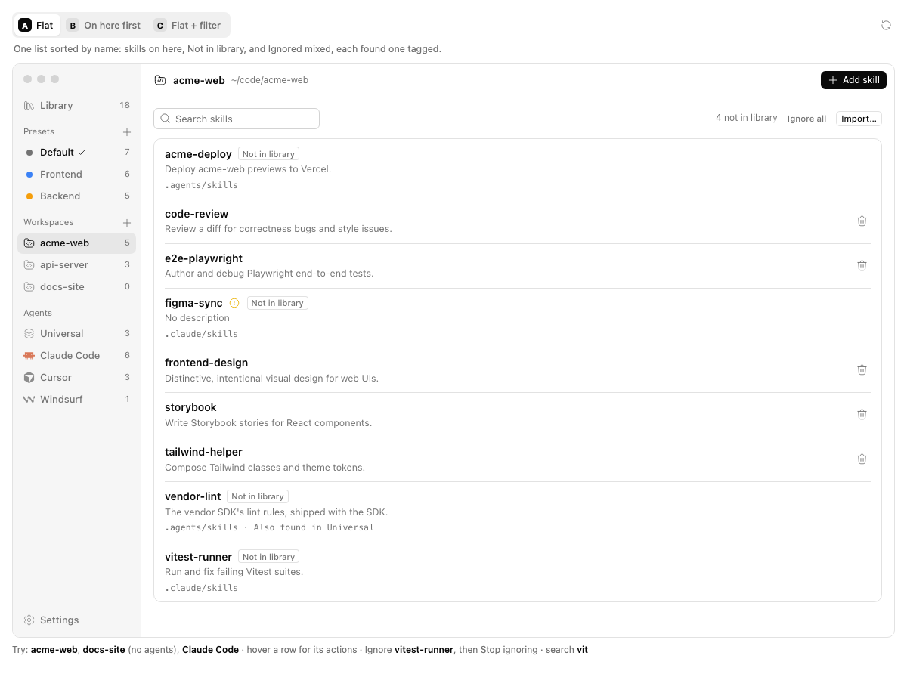

# Found skills on pages: design reference

This folder holds the prototype the user approved on 2026-11-26 for [the found-skills-on-pages spec](../../specs/found-skills-on-pages.md) ([ADR 0036](../../adr/0036-pages-list-their-found-and-ignored-skills.md)). It extends the approved workspace, agent, and Universal pages ([scoped-pages](../scoped-pages/README.md)). Build the same layout, copy, states, and behavior with GPUI Kit and the design system's components first. Small visual differences from Kit are fine. The rules are in [decisions.md](decisions.md), and where the prototype and decisions.md disagree, decisions.md holds.

## Chosen variant

| Area | Prototype | Variant the user picked | Screenshot |
|---|---|---|---|
| Workspace, agent, and Universal pages | `prototypes/one-list.html` | A "Flat" (2026-11-26, replaces `place-pages.html`'s A "Sections") |  |

`one-list.html`'s variant bar still switches to the rejected B "On here first" (the same list with the skills on here first) and C "Flat + filter" (a segmented control beside the search). `place-pages.html`, with its rejected A "Sections", B "Filter", and C "One list" (group headers), and its screenshot `screenshots/workspace-page.png`, stay as the earlier round. The prototypes' Import… opens a placeholder. The real dialog is the Import skills dialog ([ignore-skills](../ignore-skills/README.md)), narrowed to the place.

## Sources

`source/one-list.html.parts/` is the editable chosen page, and `source/place-pages.html.parts/` the earlier one. Each links the shared kit in `../scoped-pages/source/kit/` and keeps its found-skill fixture inline. Rebuild the bundles with:

```sh
python3 -I docs/design/scoped-pages/source/kit/inline.py docs/design/found-skills-on-pages/source/one-list.html docs/design/found-skills-on-pages/prototypes/one-list.html
python3 -I docs/design/scoped-pages/source/kit/inline.py docs/design/found-skills-on-pages/source/place-pages.html docs/design/found-skills-on-pages/prototypes/place-pages.html
```
