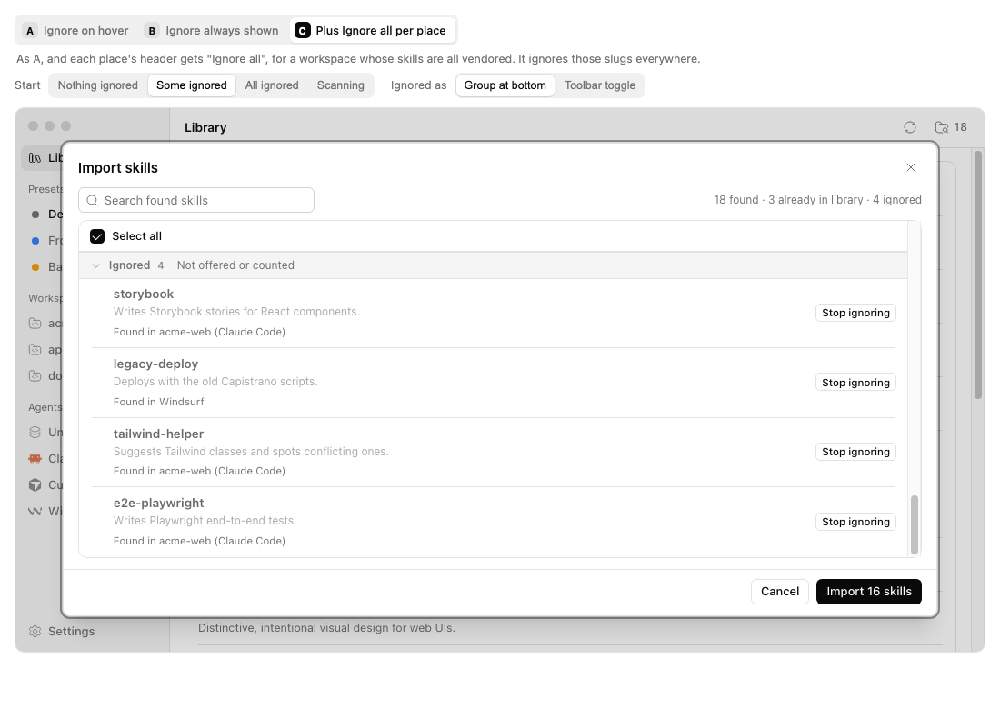

# Ignore found skills: design reference

This folder holds the prototype the user approved on 2026-11-25 for [the ignore-found-skills spec](../../specs/ignore-found-skills.md) ([ADR 0033](../../adr/0033-ignored-skills-are-remembered-per-slug.md)). It extends the approved Import skills dialog, variant C "Grouped by place" ([scan-import](../scan-import/README.md)). Build the same layout, copy, states, and behavior with GPUI Kit and the design system's components first; small visual differences from Kit are fine. The rules are in [decisions.md](decisions.md), and where the prototype and decisions.md disagree, decisions.md holds.

## Chosen variant

| Area | Prototype | Variant the user picked | Screenshot |
|---|---|---|---|
| Ignore control and Ignored group | `prototypes/import-dialog.html` | C "Plus Ignore all per place", Ignored as "Group at bottom" |  |

The variant bar still switches to the rejected A "Ignore on hover" (row button only) and B "Ignore always shown" (row button always visible), and "Ignored as" to the rejected "Toolbar toggle". The Start bar steps through Nothing ignored, Some ignored, All ignored, and Scanning. The prototype shows one version per row and leaves out the versions disclosure, the acknowledgement, the 500 cap, and plan expiry, which are unchanged from [scan-import](../scan-import/decisions.md).

## Sources

`source/import-dialog.html.parts/` is the editable page. It links the shared kit in `../scoped-pages/source/kit/` and the found-skill fixture in `../scan-import/source/found.js`. Rebuild the bundle with:

```sh
python3 -I docs/design/scoped-pages/source/kit/inline.py docs/design/ignore-skills/source/import-dialog.html docs/design/ignore-skills/prototypes/import-dialog.html
```
