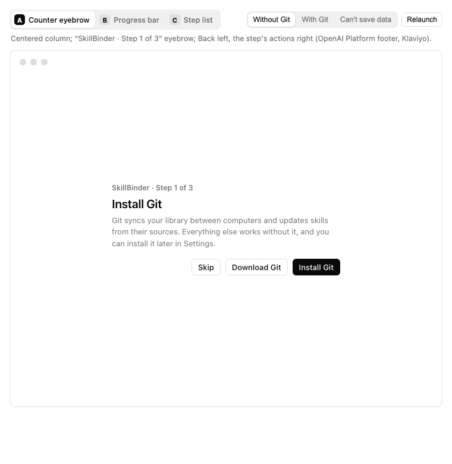
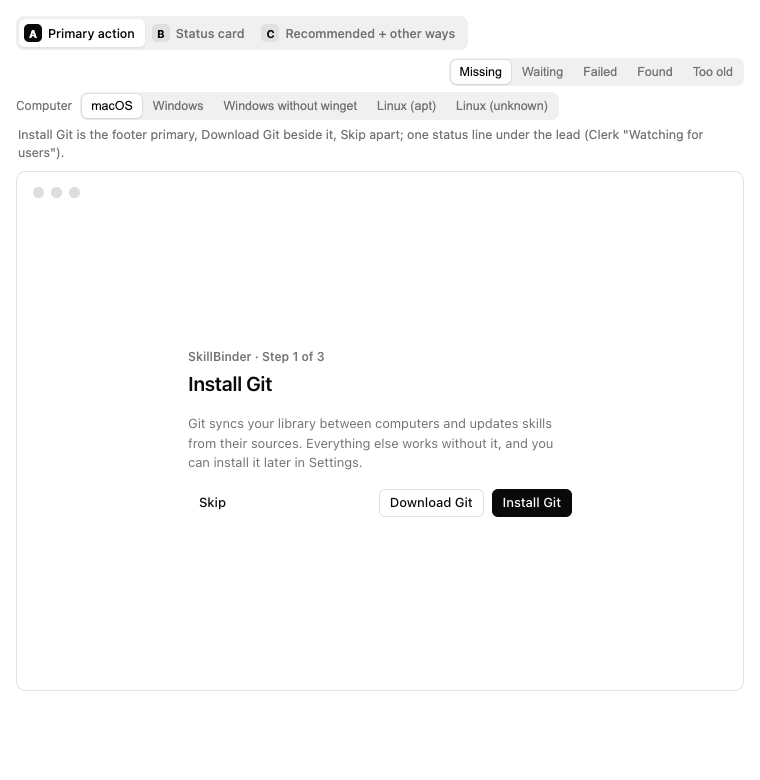
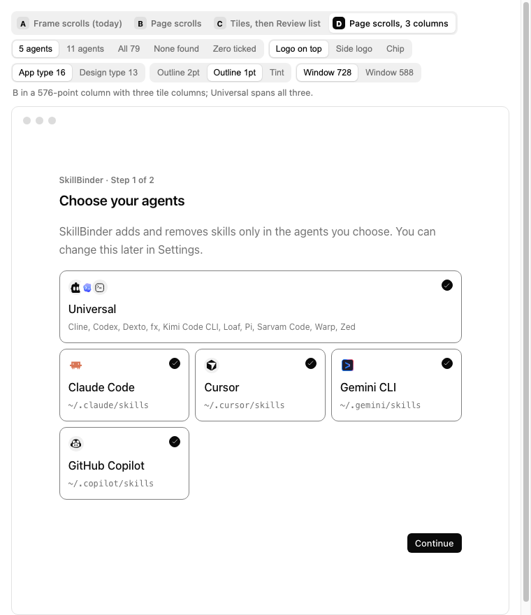
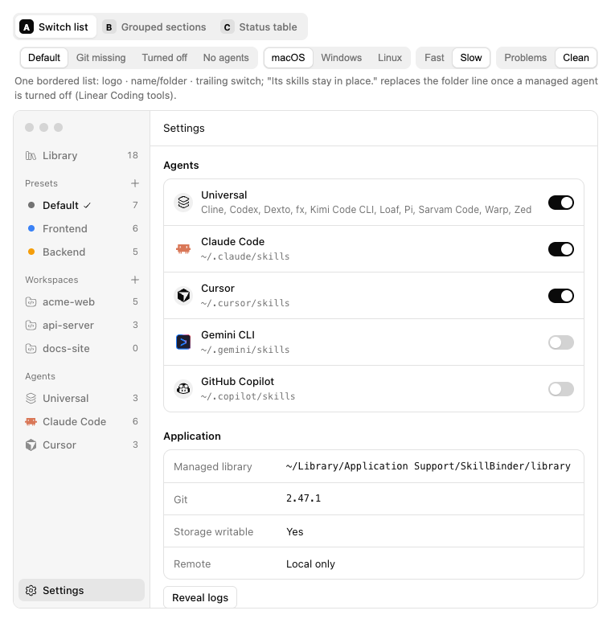
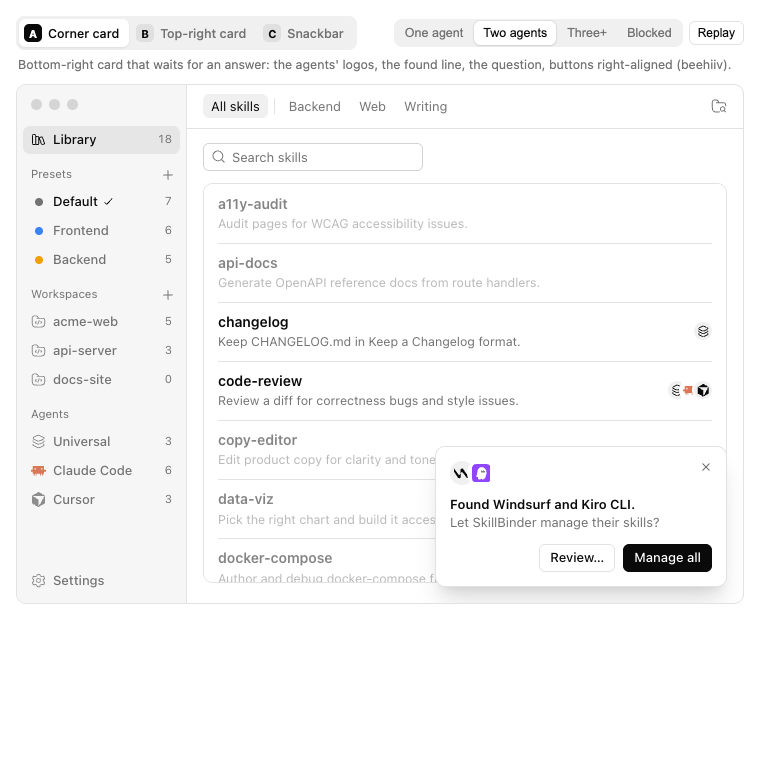

# Onboarding design reference

This folder holds the five prototypes the user approved on 2026-11-17 for [the onboarding spec](../../specs/onboarding.md) ([ADR 0010](../../adr/0010-onboarding-steps-derived-from-state.md), [ADR 0011](../../adr/0011-git-is-optional.md), [ADR 0012](../../adr/0012-chosen-agents.md)). Build the same layout, hierarchy, copy, icons, states, and behavior, using GPUI Kit components first and styling them through their public API. Small visual differences from Kit's defaults are fine. The rules are in [decisions.md](decisions.md), and the Mobbin references behind each variant are in [references.md](references.md). The import step keeps its approved design in [scan-import](../scan-import/README.md) (O1, O2, O4, O5, O7). Paths below are relative to this folder.

## Chosen variants

| Area | Prototype | Variant the user picked | Screenshot |
|---|---|---|---|
| Frame | `prototypes/frame.html` | A "Counter eyebrow" |  |
| Git step | `prototypes/git.html` | A "Primary action" |  |
| Choose your agents | `prototypes/agents.html`, then `prototypes/agents-layout.html` | C "Logo tiles", laid out as D "Page scrolls, 3 columns" |  |
| Settings › Agents | `prototypes/settings.html` | A "Switch list" |  |
| New agent notice | `prototypes/notice.html` | A "Corner card" |  |

- **Frame A:** scan-import's onboarding column, 384 points wide and centered. The eyebrow reads "SkillBinder · Step N of M", then the title, the lead, the step's content, and one button row: Back at its left edge, the step's actions at its right. M counts only the steps that apply, so it drops from 3 to 2 when Git is found (F1). Steps slide in from the trailing edge, and Back slides from the leading edge; reduced motion switches at once (F5). (OpenAI Platform, Klaviyo.)
- **Git A:** the lead, then one status line under it for Waiting, Failed, Found, and Too old. The button row holds Skip at the left, then Download Git and the primary Install Git. Without an installer (Windows without winget, after a winget failure, or an unknown Linux), Download Git is the primary. On Linux with a known package manager the command box with Copy sits in the body, and the row holds Skip and Download Git. (Clerk "Watching for users".)
- **Agents C, laid out as D:** a three-column grid of tiles in a column 576 points wide, wider than the other steps' 384, at the app's own type size. Each tile has the agent's logo at its top left and a round check at its top right, then the name and the skill folder in muted monospace. A chosen tile has a 1-point outline, the foreground mixed into the border, and a filled check; an unchosen one has the hairline border and an empty ring. Universal spans all three columns, shows a stack of its first three members' logos, and names its agents in muted text, truncated with a tooltip. Nothing scrolls inside the column: when the tiles do not fit, the step scrolls with the scrollbar at the window's edge, and the button row stays pinned at the window's bottom, 32 points below the content, with the content fading out under it. (Dropbox Dash's grouped row; the layout came from the second round, `prototypes/agents-layout.html`, P6.)
- **Settings A:** an "Agents" heading above Application, then a bordered list. Each row has the logo, the name, the folder (or Universal's agents), and a trailing Kit Switch. Once a managed agent is turned off, "Its skills stay in place." replaces its folder line; an agent that was never on keeps its folder line. The Git row in Application reads the version, or "Not installed" with Install Git and the waiting line inline. (Linear "Coding tools".)
- **Notice A:** a card at the window's bottom-right corner, over the page: the agents' logo stack, the found line in medium weight, the question in muted text, and right-aligned buttons. With several agents a close button sits in its corner. (beehiiv's persistent corner card.)

Open a bundle in a browser. Its variant bar opens on the picked variant and still switches to the rejected ones. Its state bar and demo controls step through every state.

## Sources

`source/` holds the editable pages, plus `ob.css` and `ob.js` (the onboarding fixture and helpers). The pages link the shared kit in `../scoped-pages/source/kit/`, which gained `arrow-left` and the Gemini CLI, Kiro CLI, and GitHub Copilot logos for this work. Rebuild a bundle with:

```sh
python3 -I docs/design/scoped-pages/source/kit/inline.py docs/design/onboarding/source/<name>.html docs/design/onboarding/prototypes/<name>.html
```

## States

| Area | State | Trigger | Shows |
|---|---|---|---|
| Frame | Without Git | No usable Git | Step 1 of 3: Install Git |
| Frame | With Git | Git found | Step 1 of 2: Choose your agents |
| Frame | Can't save data | Data location not writable | "SkillBinder can't save its data", the path line in the danger color, Check again; no Back, no Skip |
| Git | Missing | Step opens | Lead, actions for the platform |
| Git | Waiting | Install Git, Copy, or Download Git | Spinner line: "Finish in Apple's installer." (macOS), "Installing Git…" (Windows), "Checking for Git…" (after Copy or Download); Install stays available to start again |
| Git | Failed | winget fails | "Couldn't install with winget." in the danger color; Download Git becomes the primary |
| Git | Found | Check finds Git 2.39+ | "Git 2.47.1 is ready" with check-circle in the success color; moves on after about a second |
| Git | Too old | Git under 2.39 | Title "Update Git", line "Git 2.30.1 is too old. SkillBinder needs 2.39 or newer.", same actions |
| Agents | List | Agents found | Tiles, all chosen |
| Agents | Many | More rows than fit | The step scrolls at the window's edge; the button row stays pinned at the bottom |
| Agents | None found | No agent found | "No agents found on this computer. SkillBinder will ask when it finds one." in place of the tiles, Continue |
| Agents | Zero chosen | All unticked | Continue stays available |
| Settings | Default | — | Agents list, Application rows |
| Settings | Turning on | Switch on | Progress strip while the active preset is applied, then the switch shows on |
| Settings | Turned off | Switch off | Switch off at once, "Its skills stay in place." |
| Settings | Git missing | No Git | "Not installed" with Install Git; waiting line inline, then the version |
| Settings | No agents | No agent found | "No agents found on this computer." inside the list frame |
| Notice | One / several | New agents found after onboarding | N1, N2 copy |
| Notice | Blocked | Progress strip running | Notice waits and appears when it ends |

## Component map

| Element | Renders with |
|---|---|
| Step frame, eyebrow, title, lead | The existing onboarding column in `crates/ui/src/native_view/onboarding.rs` |
| Back, Skip, Continue, Install Git, Download Git, Copy, Check again | the design system's `Button` (Kit `Button` with its label); Back keeps the arrow-left glyph |
| Step slide | GPUI animation with the theme's fast duration, skipped under reduced motion |
| Status lines (waiting, found, failed, too old) | The import step's status line with the app's loading glyph animation (`library_updates.rs`), check-circle, or alert-circle |
| Linux command box | A bordered row in the muted surface with monospace text and a small Kit `Button` "Copy"; copying uses GPUI's clipboard |
| Download Git | GPUI `open_url` to `https://git-scm.com/downloads` |
| Agent tile | **New app element** built from Kit pieces, since Kit has no selectable tile: a focusable bordered `div` with the theme radius, a Kit `Avatar` (`library_avatars.rs`), and the check glyph in a ring; Enter and Space toggle. Confirmed 2026-11-17 (P3, P6). |
| Universal tile's logo stack | Kit `Avatar`s in a stack, as the import summary card does |
| Settings Agents rows | A bordered list in `settings.rs` with Kit `Avatar` and Kit `Switch` (`gpui_kit::component::switch`) |
| Settings Git row | The Application section's row, with a Kit `Button` and the waiting line |
| Turning an agent on | The existing progress strip (`progress_strip.rs`) |
| New agent notice | Kit `Notification` anchored bottom-right with its own id, no auto-hide, and a custom body; change toasts keep the bottom center (`toasts.rs`) |

No new artwork. Every glyph is retained in `assets/hugeicons/` (arrow-left, check, check-circle, alert-circle, loading, layers, square-terminal), and every logo is in `assets/agent-logos/`. Register any glyph missing from `crates/ui/src/assets.rs`, since an unregistered path fails explicitly.

## Tokens

All existing `skillbinder_design` and Kit tokens: muted foreground for the eyebrow, leads, folders, and notes; the success color for found; the danger color for failures and the data location line; the theme border, radius, and card color for tiles, lists, the command box, and the notice; the foreground color for a chosen tile's outline and check. Nothing is new.

## Copy

| Where | Text |
|---|---|
| Eyebrow | SkillBinder · Step N of M |
| Data location | SkillBinder can't save its data · <path> isn't writable. · Check again |
| Git title | Install Git · Update Git (too old) |
| Git lead | Git syncs your library between computers and updates skills from their sources. Everything else works without it, and you can install it later in Settings. |
| Git lines | Finish in Apple's installer. · Installing Git… · Checking for Git… · Couldn't install with winget. · Git 2.47.1 is ready · Git 2.30.1 is too old. SkillBinder needs 2.39 or newer. |
| Git buttons | Skip · Download Git · Install Git · Copy |
| Agents | Choose your agents · SkillBinder adds and removes skills only in the agents you choose. You can change this later in Settings. · No agents found on this computer. SkillBinder will ask when it finds one. · Back · Continue |
| Settings | Agents · Its skills stay in place. · No agents found on this computer. · Git · Not installed · Install Git |
| Notice | Found <agent>. · Found <a> and <b>. · Found <a>, <b>, and N more. · Let SkillBinder manage its skills? · Let SkillBinder manage their skills? · Manage · Not now · Manage all · Review… |
| Toasts | <Agent> is on · <a> and <b> are on · N agents are on |

## Interactions

- Tab order in a step: content first (tiles row by row, or the command box's Copy), then Back, Skip, the secondary action, and the primary. Enter on a focused button activates it; Escape does nothing in onboarding.
- Agents tiles: click, Enter, or Space toggles; the check and outline change at once. Continue saves.
- Git: Install Git starts the installer and the waiting line; pressing it again while waiting starts it again. The step checks every 3 seconds and on focus, and moves on by itself once Git is found.
- Settings switch: click, Enter, or Space; on runs the progress strip and is disabled until it ends; off saves at once.
- Notice: does not take focus or close on Escape; it is reachable with Tab after the page. Manage or Manage all runs the progress strip, then a toast. Not now, Review…, and the close button dismiss it; Review… opens Settings.
