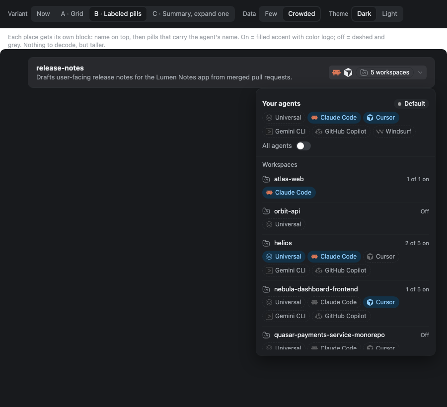

# Placement popover: design reference

This folder holds the prototype the user approved on 2026-11-26 for the Library placement popover, the popover that changes where a skill is on. It replaces the popover's content in the approved Library prototype ([scoped-pages](../scoped-pages/README.md), variant A "Popover"); the trigger, the positioning, the keyboard, and the behavior stay as [Library rows](../../features/native/library-rows.md) describes them. Build the same layout, copy, and states with GPUI Kit and the design system's components first. Small visual differences from Kit are fine.

## Why

With many workspaces the old popover was hard to read: its pills showed only logos, each line right-aligned its own pills so one agent sat at a different place on every line, a long workspace name squeezed its pills into a column, and an off pill differed from an on one only by a dashed outline.

## Chosen variant

| Area | Prototype | Variant the user picked | Screenshot |
|---|---|---|---|
| Placement popover | `prototypes/popover.html` | B "Labeled pills" (2026-11-26) |  |

The variant bar still switches to "Now" (the popover before), the rejected A "Grid" (one column per agent directory, checkboxes in rows), and the rejected C "Summary, expand one" (one line per place, a checklist when opened). "Data" switches between a few places and a crowded machine.

## Decisions

1. **Labeled pills.** Each pill holds its directory's logo and label, as the design system's `ToggleChip`, dashed. The label is the name of the agent whose logo it shows, then `+<N>` for the other agents that read the directory: in a workspace, `.claude/skills` is read by several agents and reads "Claude Code +5" (found in the native check; the prototype shows one agent per pill). On: the `accent-soft` fill, the label in its foreground, and the logo in its own colors. Off: the dashed outline, the label muted, and the logo grayscale at half opacity. A pill's tooltip lists the agents that read its directory, when the label does not name them all.
2. **One block per place.** "Your agents" with the preset chip, its pills, then the All agents switch under them. Each workspace: its glyph and name, cut short with `…`, and at the trailing edge its status, then its pills wrapping across the popover's full width from the leading edge. Hairlines divide the workspaces.
3. **Status.** A workspace's status reads "<N> of <M> on", "Off", "No agents yet" while it uses no agent, or "Folder missing".
4. **Size.** The popover is 360 points wide. The workspaces list scrolls once it is 320 points tall, under the scroll fades, with the Your agents block above it always in view.
5. **Tab order** follows the drawing order: your agents' pills, the switch, then each workspace's pills.

## Sources

`source/popover.html.parts/` is the editable page, standalone, with the agents' logos inlined from `assets/`. Rebuild the bundle with:

```sh
python3 -I docs/design/scoped-pages/source/kit/inline.py docs/design/place-popover/source/popover.html docs/design/place-popover/prototypes/popover.html
```

Append `#v=B&d=few&theme=light` to the bundle's URL to open it on a variant, a data set, and a theme.

## Known differences

- **Keyboard and scrolling:** Tab can move focus to a workspace's pill scrolled out of the list's view; the list does not scroll to it.
- **Add skill picker:** its Selected cards keep the icon-only pills. Labeling them is a separate change.
