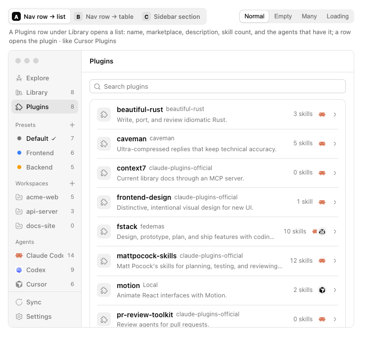
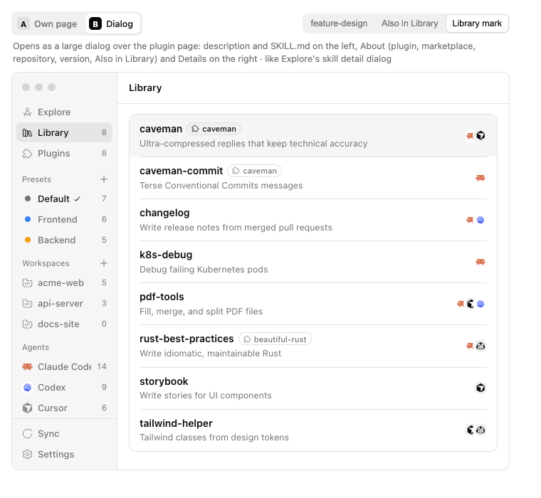

# Plugins: design reference

This folder holds the prototypes for listing and managing the coding agents' plugins in SkillBinder. They follow the decisions agreed with the owner on 2026-11-25 ([decisions.md](decisions.md): P1–P8, A1–A7), and each variant names the reference it draws on ([references.md](references.md)). Build the same layout, copy, states, and behavior with GPUI Kit and the design system's components first; small visual differences from Kit are fine. Where a prototype and decisions.md disagree, decisions.md holds.

## Chosen variants

| Area | Question | Prototype | Variant the user picked (2026-11-25) | Screenshot |
|---|---|---|---|---|
| Sidebar and plugin list | U1 | `prototypes/plugins-list.html` | A "Nav row → list" |  |
| Plugin page | U2 | `prototypes/plugin-page.html` | C "Agents first, stacked" |  |
| Plugin skill view | U3 | `prototypes/plugin-skill.html` | A "Own page" |  |
| Library mark | P3 | `prototypes/plugin-skill.html`, state Library mark | (one design) |  |

Each bundle opens on the picked variant. The variant bar still switches to the rejected ones: list B "Nav row → table" and C "Sidebar section", page A "Tabs" and B "Body + side column", skill view B "Dialog".

Open a bundle in a browser. Its variant bar switches variants in place, and the segmented control beside it switches states. Clicks work: Install, Update, and Uninstall run against an in-memory store, so a change made on one page shows on every other.

## plugins-list.html

Where Plugins sits in the sidebar, and how the plugin list reads.

- **A "Nav row → list"**: a Plugins row under Library, counting plugins, opens a list of rows: name, marketplace, one-line description, skill count, the agents that have the plugin as a logo stack, and a chevron. Like Cursor Plugins.
- **B "Nav row → table"**: the same row opens a dense table with one column per chosen plugin-capable agent, each cell showing that agent's version, Off, or —; a version behind the newest shows the update glyph. Like Supabase Database Extensions and Stripe Apps.
- **C "Sidebar section"**: a Plugins section after Agents lists each plugin with its skill count; clicking one opens its page, and there is no list page.

States: Normal (8 plugins), Empty ("No plugins"), Many (17 plugins, including `enterprise-observability-and-incident-response-toolkit`), and Loading (skeleton rows in A and B, a spinner in C's section). Search filters by plugin name (A5). A row opens the plugin's page in its simple stacked layout; in C, Empty and Loading show Library, since there is no plugin to open.

## plugin-page.html

The page of one plugin, `fstack`: header (name, description, marketplace, repository link, newest version), README, Skills, and one Agents row per chosen plugin-capable agent (A7).

- **A "Tabs"**: README | Skills | Agents as tabs under the header. The header's agent stack jumps to Agents. Like Zoho CRM extension and VS Code extension detail.
- **B "Body + side column"**: README then Skills in the main column; Agents (compact rows) and Details (marketplace, repository, version) in a 206-wide side column. Like VS Code's Installation column and Vercel's fact column.
- **C "Agents first, stacked"**: one scroll with the Agents card, then Skills, then README. Like Linear's Slack Connections and Cursor plugin detail. plugins-list.html and plugin-skill.html also use this layout for any plugin page they open.

Agent rows: Claude Code "Installed · 0.9.0" with Uninstall; GitHub Copilot "Installed · 0.8.0" with Update and Uninstall (P8); Droid "Not installed" with Install, which opens the P6 dialog showing `droid plugin marketplace add mastro993/fstack` and `droid plugin install fstack@fedemas --scope user`; Codex and Cursor show a hint, with no button (P2). Uninstall asks "Uninstall fstack from Claude Code?" (A1). While a command runs, the row's button shows a spinner (A3).

States: Normal, Off (Claude Code "Installed · 0.9.0 · Off", P7), Install fails (Droid's row shows the agent's error output, and Install fails again), and No marketplace (`motion`, loaded in Cursor from a folder: Install is disabled with "No marketplace to install from", A2).

## plugin-skill.html

The read-only view of a plugin skill (A4), and the Library mark (P3).

- **A "Own page"**: a page like a library skill's: name, description, a "From plugin fstack" chip back to the plugin, "Also in Library" when the library has the same slug, the front matter table, and SKILL.md. There are no activation controls.
- **B "Dialog"**: a large dialog over the plugin page, like Explore's skill detail dialog: description and SKILL.md on the left; About (plugin, marketplace, repository, version, Also in Library) and Details (front matter other than name and description) on the right.

States: feature-design (`fstack/feature-design`), Also in Library (`caveman/caveman`, whose slug the library also has), and Library mark (Library, where `caveman`, `caveman-commit`, and `rust-best-practices` show an "Also in plugin <name>" chip that opens the plugin). "Also in Library" opens Library with that row selected.

## Not in the prototypes

- Plugins scoped to a project (P4: never listed).
- Turning a plugin on or off (P7: read-only).
- An agent that is not chosen (A6: never shown).
- Antigravity CLI, which P2 lists as plugin-capable, is not among the sample's chosen agents.
- Codex and Cursor rows when the plugin is installed there show status only, with no Uninstall and no hint; decisions.md does not say how to remove a plugin from an agent without a command.

## Icons

- Plugins use the Hugeicons puzzle glyph (`assets/hugeicons/PuzzleIcon.svg`) and Sync its refresh glyph (`RefreshIcon.svg`), both retained artwork the prototype kit's generated block lacks, so `source/plugins-data.js` adds them with the same normalization as `gen_icons.py`. The puzzle glyph is retained today only as a preset icon choice (`preset-glyphs.json`), so a preset may show the same glyph as Plugins.
- Marketplace uses the package glyph, the repository link the GitHub glyph, and a plugin without a marketplace the folder glyph.
- Droid has no bundled logo and shows the square terminal glyph (AGENTS.md).

## Sources

`source/` holds the editable pages and their shared files. They link the shared kit in `../scoped-pages/source/kit/`.

- `plugins-list.html`, `plugin-page.html`, `plugin-skill.html`: the pages.
- `plugins.css`: shared styles on the kit's tokens.
- `plugins-text.js`: README.md and SKILL.md sample texts.
- `plugins-data.js`: the sample data from decisions.md and an in-memory store (installs, updates, uninstalls, errors).
- `plugins-kit.js`: the sidebar, header, agent rows, skill rows, markdown, and Library rows the pages share.

Rebuild a bundle from the repository root after editing a source:

```sh
python3 -I docs/design/scoped-pages/source/kit/inline.py docs/design/plugins/source/plugins-list.html docs/design/plugins/prototypes/plugins-list.html
python3 -I docs/design/scoped-pages/source/kit/inline.py docs/design/plugins/source/plugin-page.html docs/design/plugins/prototypes/plugin-page.html
python3 -I docs/design/scoped-pages/source/kit/inline.py docs/design/plugins/source/plugin-skill.html docs/design/plugins/prototypes/plugin-skill.html
```

Keep each source file under about 18 KB; split a growing one into a `<name>.parts/` folder, which the inliner joins in numeric order.
