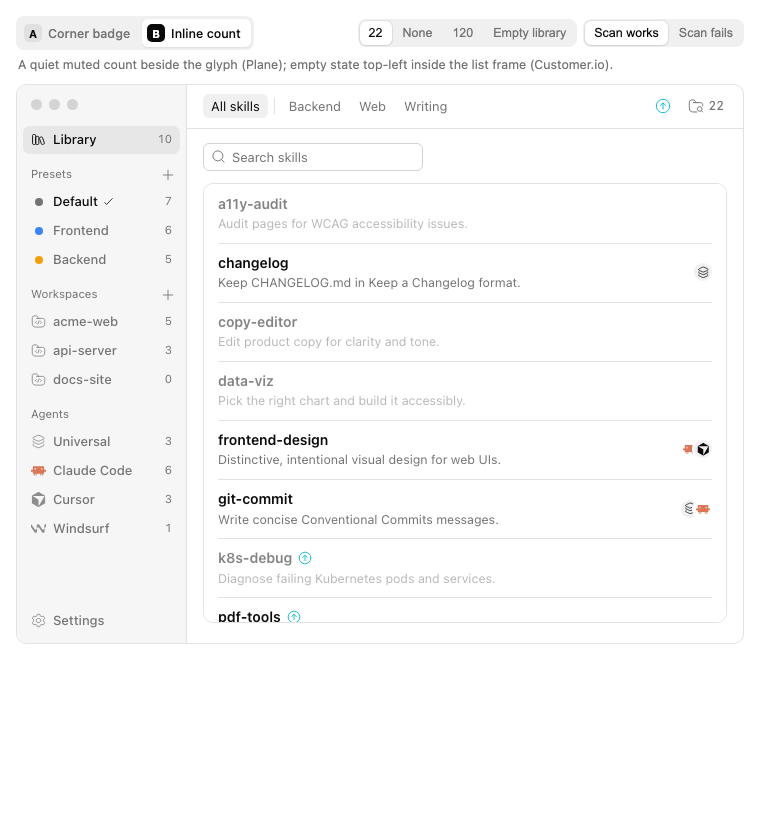
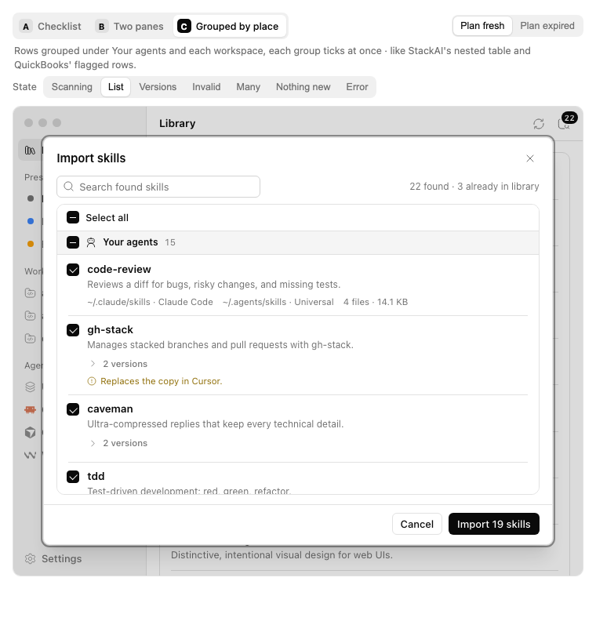
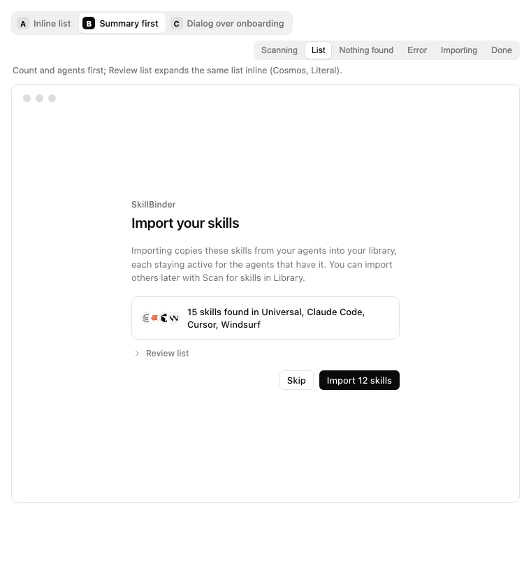

# Scan and import design reference

This folder holds the three prototypes the user approved on 2026-11-16 for [the scan-and-import spec](../../specs/scan-and-import.md) ([ADR 0008](../../adr/0008-import-from-scan-dialog.md), [ADR 0009](../../adr/0009-prepare-once-apply-selection.md)). Build the same layout, hierarchy, copy, icons, states, and behavior, using GPUI Kit components first and styling them through their public API. Small visual differences from Kit's defaults are fine. The rules are in [decisions.md](decisions.md), and the Mobbin references behind each variant are in [references.md](references.md). Paths below are relative to this folder.

## Chosen variants

| Area | Prototype | Variant the user picked | Screenshot |
|---|---|---|---|
| Library entry | `prototypes/library-entry.html` | B "Inline count" |  |
| Import skills dialog | `prototypes/import-dialog.html` | C "Grouped by place" |  |
| Onboarding step | `prototypes/onboarding.html` | B "Summary first" |  |

- **Library entry B:** Library's header ends with the update control, then Scan for skills: a ghost button with the folder-search glyph and a quiet muted count of found skills not in library (Plane's muted count). An empty library shows a top-left empty state inside the list frame, with the glyph, one line, and a primary Scan for skills (Customer.io).
- **Import dialog C:** a large Kit dialog. The top row holds the search, then comes Select all, then the rows grouped under "Your agents" and each workspace. Each group header has a tri-state checkbox and a count (StackAI's nested table, QuickBooks' flagged rows). Rows carry their versions disclosure and replacement lines inline. The footer holds the acknowledgement or the cap note on the left, and Cancel and "Import N skills" on the right.
- **Onboarding B:** the onboarding page with its lead, then a summary card with the agents' avatars and "N skills found in <agents>", then a collapsed "Review list" disclosure that expands the same list inline, then Skip and "Import N skills" (Cosmos, Literal). Review list now opens the Import skills dialog with a Done button instead of expanding inline (decision O7, [the onboarding spec](../../specs/onboarding.md)).

Open a bundle in a browser. Its variant bar opens on the picked variant and still switches to the rejected ones. Its state bar and demo controls step through Scanning, the list, versions, invalid, many (500 cap), nothing new, error, and plan expired. The progress the prototypes show is the kit's modal stand-in. The app keeps its approved inline progress strip ([scoped-pages](../scoped-pages/README.md), #98).

## Sources

`source/` holds the editable pages, kept as `.parts/` folders under the repository's per-file size limit, plus `found.js` (the found-skill fixture and the spec's rules) and `scan-list.js` (the simplified list that the Library entry and onboarding prototypes share). The pages link the shared kit in `../scoped-pages/source/kit/`. Rebuild a bundle with:

```sh
python3 -I docs/design/scoped-pages/source/kit/inline.py docs/design/scan-import/source/<name>.html docs/design/scan-import/prototypes/<name>.html
```

## Component map

| Element | Renders with |
|---|---|
| Scan for skills button and count | Kit ghost `Button` with an `app_icon("folder-search")` icon and a muted label for the count; the existing `library_header_actions` in `crates/ui/src/native_view/library_updates.rs` |
| Library empty state | The existing `empty_state` helper in `library_filters.rs`, with a primary Kit `Button` |
| Import skills dialog | Kit `dialog`, as the existing import plan dialog in `dialogs.rs` uses it, sized like the Add skill picker (`skill_picker.rs`) |
| Search field | Kit `Input`, as in the picker's search |
| Select all, group, row, and acknowledgement checkboxes | Kit `Checkbox` (tri-state for Select all and groups) |
| Versions disclosure | Kit ghost `Button` with the chevron-right glyph turning to arrow-down, as Discovery's "N versions" does today (`discovery.rs`) |
| Version choice | Kit `Radio`, as in `discovery.rs::version_choice` |
| "Matches source" tag | The secondary tag Discovery uses today |
| Replacement line, validation messages | `import_review.rs` lines with the warning-colored alert-circle glyph |
| Group glyphs | Hugeicons robot (your agents), code-folder (workspace) |
| Spinner | The app's existing loading glyph animation (`library_updates.rs`) |
| Onboarding summary card | A bordered card in onboarding's column, with Kit `Avatar`s in a stack (`AvatarStack`) |
| Review list | Kit ghost `Button` with the chevron-right glyph, opening the Import skills dialog with a primary Done in its footer (O7) |
| Progress | The existing progress strip, `Activity::Importing` (`progress_strip.rs`) |

No new artwork: folder-search, robot, code-folder, alert-circle, chevron-right, and arrow-down are all retained in `assets/hugeicons/`. All but folder-search are already registered in `crates/ui/src/assets.rs`; slice 1 adds `icon!("folder-search", "FolderSearchIcon")` there, since an unregistered path fails explicitly.

## Tokens

Every color, size, radius, and spacing uses existing `skillbinder_design` and Kit tokens: muted foreground for the count and locations; the warning color for replacement lines; the danger color for blocked messages; the theme's border and radius for the list frame and the onboarding card; and row height and padding from the Library rows. Nothing is new.

## Copy

| Where | Text |
|---|---|
| Header button tooltip | Scan for skills |
| Header button accessible label | Scan for skills, N not in library |
| Library empty state | No skills in your library yet · Scan for skills |
| Dialog title | Import skills |
| Search placeholder | Search found skills |
| Select all | Select all · N selected not shown |
| Group headers | Your agents · <workspace name> |
| Location | <path> · <readers> |
| Size | N files · B bytes (as Discovery shows it today) |
| Versions | N versions · Modified <relative time> · Invalid · Blocked · Matches source |
| Replacement | Replaces the copy in <place>. |
| Acknowledgement | Import skills with invalid metadata |
| Cap | Import at most 500 at a time. |
| Buttons | Cancel · Import N skills · Close · Retry |
| Loading | Scanning… |
| Nothing new | No new skills found. |
| Error | Couldn't scan: <reason> |
| Plan expired | The list changed since the scan. Check it and import again. |
| Progress | Importing N skills · Imported N skills |
| Onboarding | SkillBinder · Import your skills · the lead in O1 · N skills found in <agents> · Review list · Skip · Import N skills · No skills to import were found in your agents. · Continue |

## Interactions

- Scan for skills: click, or Enter or Space while focused, opens the dialog and starts the scan.
- Focus order in the dialog: search, Select all, then each group checkbox followed by its rows (checkbox, versions disclosure, radios), then the acknowledgement, Cancel, and Import. Escape closes it. Enter in the search field does nothing.
- A row's checkbox toggles on click anywhere on the row except its disclosure and radios, as in the picker.
- Review list on onboarding opens the Import skills dialog with click, Enter, or Space; Done, Escape, and its close button return to the step, keeping the ticks and chosen versions while the step is open.
