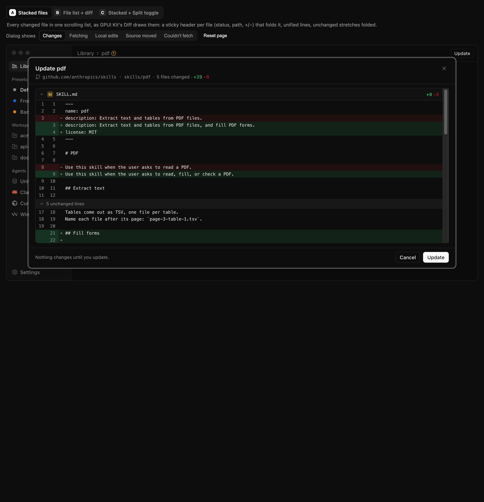

# Skill update review: design reference

This folder holds the prototype the user approved on 2026-11-26 for [the skill-update-review spec](../../specs/skill-update-review.md) ([ADR 0037](../../adr/0037-updating-one-skill-shows-its-changes-first.md)). Build the same layout, copy, states, and behavior with GPUI Kit's `Diff` and the design system's components first. Small visual differences from Kit are fine, and the diff's own look (gutters, change backgrounds, file headers, folds) is Kit's. The rules are in [decisions.md](decisions.md), and where the prototype and decisions.md disagree, decisions.md holds.

## Chosen variant

| Area | Prototype | Variant the user picked | Screenshot |
|---|---|---|---|
| Update review dialog | `prototypes/update-review.html` | A "Stacked files" (2026-11-26) |  |

The variant bar still switches to the rejected B "File list + diff" (changed files on the left, one file's changes on the right) and C "Stacked + Split toggle" (A with a Unified / Split switch). The **Dialog shows** row switches the states: Changes, Fetching, Local edits, Source moved (click Update to see it), and Couldn't fetch. The prototype's line diff is a plain longest-common-subsequence, so its hunks can differ from `similar`'s.

## Sources

`source/update-review.html.parts/` is the editable page: its styles, the `pdf` fixture with its line diff, and the dialog. It links the shared kit in `../scoped-pages/source/kit/`. Rebuild the bundle with:

```sh
python3 -I docs/design/scoped-pages/source/kit/inline.py docs/design/skill-update-diff/source/update-review.html docs/design/skill-update-diff/prototypes/update-review.html
```
