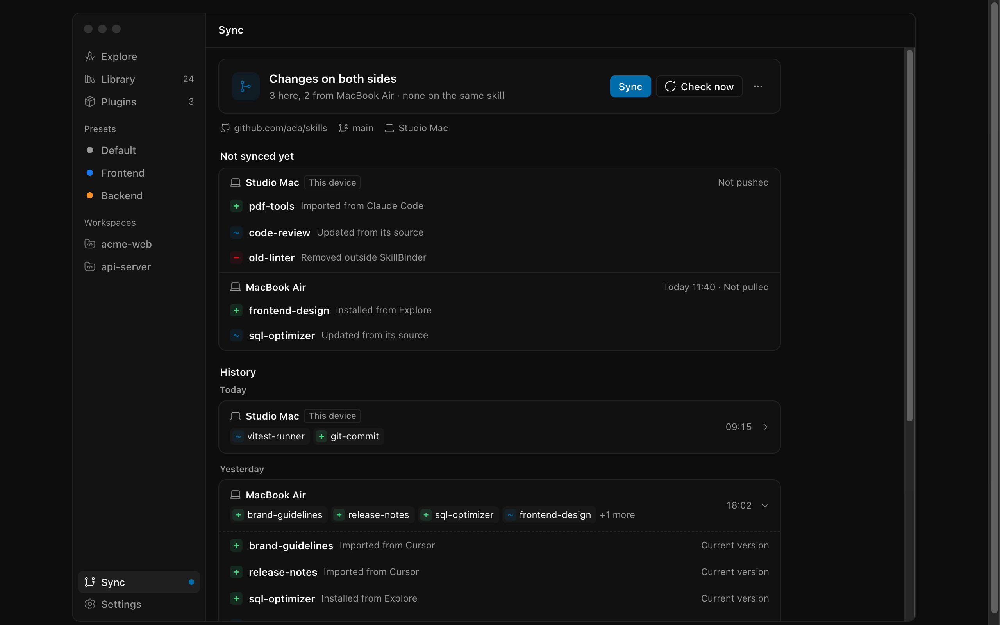

# Sync: design reference

This folder holds the prototype the user approved on 2026-11-26 for [the sync-history spec](../../specs/sync-history.md) (ADRs [0037](../../adr/0037-sync-history-is-the-librarys-git-history.md), [0038](../../adr/0038-sync-merges-per-skill.md), [0039](../../adr/0039-restore-and-discard-add-changes.md)). Build the same layout, copy, states, and behavior with GPUI Kit and the design system's components first. Small visual differences from Kit are fine. The rules are in [decisions.md](decisions.md), and where the prototype and decisions.md disagree, decisions.md holds.

## Chosen variant

| Area | Prototype | Variant the user picked | Screenshot |
|---|---|---|---|
| Sync page | `prototypes/sync.html` | A "Stacked" (2026-11-26) |  |

The variant bar still switches to the rejected B "Tabs" (Not synced yet · History · Remote as tabs) and C "Two columns" (History in a right column, a Remote facts card on the left). Its state control walks Up to date, To push, To pull, Both changed, Same skill, Offline, Not connected, and No Git. Copy, Open in browser, and Install Git show placeholder toasts.

## Sources

`source/sync.html.parts/` is the editable page. It links the shared kit in `../scoped-pages/source/kit/` and three local scripts:

- `sync-data.js`, the fixture and state;
- `sync-view.js`, the page pieces;
- `sync-icons.js`, the Hugeicons the kit lacks, generated from `@hugeicons/core-free-icons` 4.3.5.

The app retains those glyphs in `assets/hugeicons/` when the slice that uses them ships: Clock01, Laptop, ArrowTurnBackward, MoreHorizontal, GitMerge, GitMergeConflict, Download01, Upload01.

Rebuild the bundle with:

```sh
python3 -I docs/design/scoped-pages/source/kit/inline.py docs/design/sync/source/sync.html docs/design/sync/prototypes/sync.html
```
