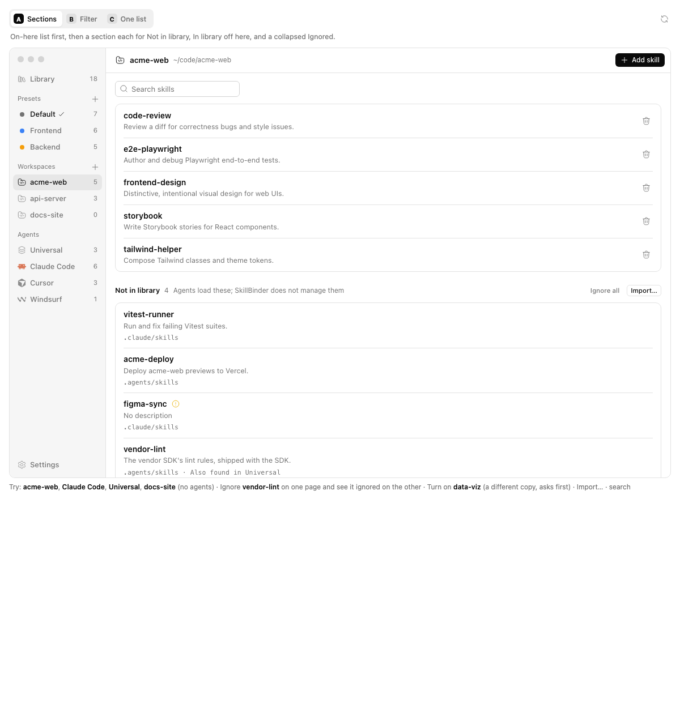

# Skills SkillBinder does not manage: design reference

This folder holds the prototype the user approved on 2026-11-26 for [the unmanaged-skills-on-pages spec](../../specs/unmanaged-skills-on-pages.md) ([ADR 0036](../../adr/0036-pages-list-what-skillbinder-does-not-manage.md)). It extends the approved workspace, agent, and Universal pages ([scoped-pages](../scoped-pages/README.md)). Build the same layout, copy, states, and behavior with GPUI Kit and the design system's components first. Small visual differences from Kit are fine. The rules are in [decisions.md](decisions.md), and where the prototype and decisions.md disagree, decisions.md holds.

## Chosen variant

| Area | Prototype | Variant the user picked | Screenshot |
|---|---|---|---|
| Workspace, agent, and Universal pages | `prototypes/place-pages.html` | A "Sections" |  |

The variant bar still switches to the rejected B "Filter" (a segmented control beside the search) and C "One list" (one card with group headers). The prototype's Import… opens a placeholder. The real dialog is the Import skills dialog ([ignore-skills](../ignore-skills/README.md)), narrowed to the place. Its Turn on asks Replace or Keep itself before a different copy is replaced. The app instead asks through the Skill copies dialog, as Add skill does (U7).

## Sources

`source/place-pages.html.parts/` is the editable page. It links the shared kit in `../scoped-pages/source/kit/` and keeps its found-skill fixture inline. Rebuild the bundle with:

```sh
python3 -I docs/design/scoped-pages/source/kit/inline.py docs/design/unmanaged-skills/source/place-pages.html docs/design/unmanaged-skills/prototypes/place-pages.html
```
