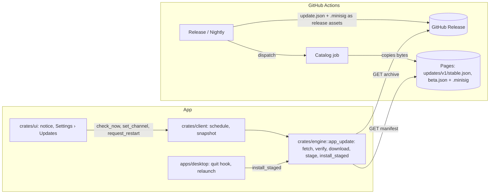

# App updates: design

Companion to [the spec](../app-updates.md). Decisions: [ADR 0017](../../adr/0017-app-updates-download-first-apply-at-restart.md), [ADR 0018](../../adr/0018-signed-update-manifests-on-pages.md), [ADR 0019](../../adr/0019-classic-install-per-platform.md).

## Shape

App updates are a generic subdomain, a solved problem every desktop app has, so they get light depth: no aggregates, one engine feature module, typed state in `proto`, and no new crate. They stay inside SkillBinder's one bounded context (`docs/agents/domain.md`).



## Ownership

| Where | What |
|---|---|
| `crates/proto/src/app_update.rs` | `Channel { Stable, Beta }`; `AppVersion { major, minor, patch, beta: Option<u32> }` with `FromStr`, `Display`, and `Ord` (a beta sorts before its release); `AppUpdateState`; `AppUpdateSnapshot { current, channel, state, last_checked }`, carried on `AppSnapshot.app_update`. |
| `crates/engine/src/app_update.rs` + `app_update/` | `manifest` (the serde shape of `update.json`, private to the engine, translated into `proto`), `fetch` (conditional GET, caps), `verify` (minisign, SHA-256, macOS codesign), `stage` (unpack, copy next to the install, writability), `install` (`install_staged`, cleaning up `.skillbinder-old-*`), `location` (finds the install unit from `current_exe` or `$APPIMAGE`: translocation, read-only, not installed), `relocate` (macOS Move to Applications: `ditto`, Trash, `hdiutil detach`), `desktop_entry` (writes the Linux menu entry and icon). It runs on its own thread like the catalog's, never on the worker. The channel, the automatic-check switch, the last-run version, and the Linux menu answer are device settings the engine owns. |
| `crates/client` | Schedules checks: on `check_app_update()` always, and, while automatic checks are on, after the first snapshot, every hour on its Tokio runtime, after `set_update_channel()`, and when `set_auto_check(true)` turns them on. Publishes the engine's shared update record into the snapshot, as it does progress. Holds the restart request that the desktop reads. |
| `crates/ui` | `native_view/app_update_notice.rs` (the Kit notification with its own id, synced every frame like `new_agent_notice.rs`) and `native_view/settings/updates.rs` (the section). The dismissed flag is in memory only. The "Updated to" toast is a new `ToastAction::ReleaseNotes`. |
| `apps/desktop` | In `on_app_quit`, after the engine drains: `app_update::install_staged()`. On Windows that starts the silent installer, which relaunches when asked. Then, if a restart or a move was requested, it launches the new executable (`open -n` on the bundle on macOS, the AppImage on Linux) once the instance lock is released, and exits. |
| `xtask` | `update-manifest --version <v> --dist <dir>` writes and signs `update.json`. `package` builds the disk image with `dmgbuild` (window layout, background, Applications link), the Inno Setup installer from `packaging/windows/skillbinder.iss`, and the AppImage with `appimagetool`. |
| Workflows | `release.yml` and `nightly.yml` run `update-manifest` in their publish jobs, upload the pair, and dispatch `catalog.yml`. `catalog.yml` mirrors the pair into `updates/v1/`. `build.yml` installs the pinned `dmgbuild`, Inno Setup 6, and `appimagetool`, and sets `SKILLBINDER_RELEASE=1` and `SKILLBINDER_TEAM_ID` when it builds a stamped version. |

The UI never touches the network, the filesystem, or processes. Clippy's policy already confines them to `engine`, `desktop`, and `xtask`.

## State

```rust
pub enum AppUpdateState {
    Off,                                                        // unstamped build
    Idle { last_failure: Option<CheckFailure> },                // up to date, or never checked
    Checking,
    Downloading { version: AppVersion, percent: Option<u8> },
    Ready { version: AppVersion, notes_url: String },
    DownloadOnly { version: AppVersion, notes_url: String, reason: CannotInstall },
}
pub enum CannotInstall { Translocated, DiskImage, NotWritable, NotInstalled }
pub enum CheckFailure { Offline, Failed }                       // kept only for manual checks
```

UI copy is an exhaustive match on the state. The Beta→Stable line derives from `channel == Stable && current.beta.is_some()`.

Device settings, in the `device_settings` table:

- `update_channel`: absent means the build's own channel.
- `update_auto_check`: absent means on.
- `last_run_version`: written at each launch, and read first to decide on the "Updated to" toast.

There is no migration, since `device_settings` is a key-value table.

## Manifest

`update.json`, signed as a whole. Unknown fields are ignored, and a breaking change publishes `updates/v2/`.

```json
{
  "version": "0.2.0",
  "notes_url": "https://github.com/mastro993/SkillBinder/releases/tag/v0.2.0",
  "published_at": "2026-12-01T10:00:00Z",
  "assets": {
    "universal-apple-darwin": { "url": "…/skillbinder-0.2.0-universal-apple-darwin.dmg", "sha256": "…", "size": 41234567 },
    "x86_64-pc-windows-msvc": { "url": "…", "sha256": "…", "size": 0 },
    "x86_64-unknown-linux-gnu": { "url": "…", "sha256": "…", "size": 0 }
  }
}
```

A manifest without the running target's asset is treated as up to date.

## Install unit and location

| Platform | Update file | Unit replaced | Can't install when |
|---|---|---|---|
| macOS | disk image | the `SkillBinder.app` that holds `current_exe`, by rename | the path contains `/AppTranslocation/` (Translocated), is under `/Volumes/` (DiskImage), or the bundle's parent can't be written (NotWritable). Each is normally fixed by Move to Applications. |
| Windows | setup program | everything, by the installer at quit | the app wasn't installed by setup: no uninstall entry under `HKCU` (NotInstalled) |
| Linux | AppImage | the file at `$APPIMAGE`, by rename | `$APPIMAGE` is unset (NotInstalled) or its folder can't be written (NotWritable) |

Writability is proven by creating the staging sibling, never assumed from permission bits.

## Technical decisions

| Decision | Because |
|---|---|
| Classic install per platform: `dmgbuild` disk image with Move to Applications, per-user Inno Setup, AppImage ([0019](../../adr/0019-classic-install-per-platform.md)) | D7–D10: the app must live where it can update itself. |
| The Windows update runs the same installer silently | D9: the installer already replaces files, shortcuts, and the uninstall entry, so Windows needs no swap code. |
| Signed per-channel manifests on the Pages site, mirrored by the Catalog job ([0018](../../adr/0018-signed-update-manifests-on-pages.md)) | D5 needs hourly checks without the REST API's 60/hour limit (ADR 0005/0014). Beta has no "latest" alias. Catalog already owns Pages and its token. |
| minisign signature over the manifest, and SHA-256 of the archive inside it | D2 replaces unsigned Windows executables in place, so the app needs its own proof of the publisher. |
| macOS codesign team check before staging | D2 on macOS: a second, independent check, and the notarized signature Gatekeeper expects. |
| Stage next to the install, swap by rename at quit | D3 installs at quit, so the swap must be fast, atomic, and reversible. Renames on one volume are. |
| The engine's `ureq` client and platform `tar`/`hdiutil`/`ditto`/`codesign` | No new HTTP or archive crates (ADR 0014's dependency rule). The engine already runs system tools under its process policy. |
| The schedule lives in the client's Tokio runtime | The client already owns background loops and snapshot publication. |
| The swap and relaunch run in the desktop's quit hook | Only `apps/desktop` may end the process (Clippy policy), and the instance lock must be released before the new process starts. |
| Compile-time `SKILLBINDER_RELEASE` gate | Unstamped builds must never replace themselves (spec 1). |

## Risks and what gets harder

- **Key loss** stops every future update: losing the minisign key strands every user on their version. Back the key up outside GitHub. Rotation needs one release signed with the old key that carries the new public key.
- **A compromised CI** can sign anything. The key sits in the same place as the notarization secrets, so this adds no new trust root.
- **macOS 26 App Management**: replacing another app's bundle can need the App Management permission, but replacing one's own bundle in a folder the user owns does not. Verify on a non-admin account in slice S2. If it is blocked, that location becomes NotWritable.
- **A newer build's database migrations** make D4's no-downgrade permanent: a user who wants an older version reinstalls it by hand and may lose machine-local data.
- **A Pages outage** pauses updates and the catalog together.
- **Windows SmartScreen** may still warn on first launch of a swapped executable it hasn't seen. Files written by the app's own HTTP client carry no Mark of the Web, so it usually doesn't.
- **AppImage needs FUSE.** Some distributions ship without the FUSE kernel module or `fusermount`. The fallback, `--appimage-extract-and-run`, is documented in the release notes.
- **Inno Setup and `dmgbuild` are new build tools.** Both are pinned. `dmgbuild` needs Python on the macOS runner, which the image has.
- **Testing in place needs two real builds.** The `native-test` overrides (base URL, public key, install root) cover logic, and a packaged smoke test per platform stays manual.
