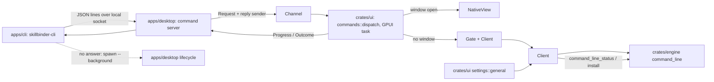

# Command line tool: design

Behavior: [command-line.md](../command-line.md). Decisions: [ADR 0022](../../adr/0022-command-line-tool-talks-to-the-running-app.md), [ADR 0023](../../adr/0023-command-line-tool-covers-domain-actions.md), [ADR 0024](../../adr/0024-install-the-command-from-settings.md).

## Parts



| Piece | Crate | Job | Calls for it |
| --- | --- | --- | --- |
| `skillbinder-cli` binary | `apps/cli` (new) | `clap` builder grammar (the derive allows Clippy's style lints, which the workspace forbids allowing), resolves `.` and paths, connects or starts the app, prompts in a terminal, renders text or JSON, maps exit codes | D1, D3, D4, rules 6–11 |
| `command_line` | `crates/proto` | `Hello`, `Request` (a variant per command, plus `Open` and `Hold`), `Reply` (`Progress`, `Ask`, `Outcome`), typed outputs per command, `CommandError { code, message, hint }`, `PROTOCOL` | ADR 0022 |
| `command_server` | `apps/desktop` | binds the socket after the instance lock, accepts connections on the Tokio runtime, checks `Hello`, forwards `Open` to `open_main_window` and every other request to the dispatch channel, counts connected commands for the no-icon quit | D2, rules 11, 12 |
| `commands` | `crates/ui` | `dispatch(request, replies, cx)`: resolves names against the snapshot, refuses through `Gate::blocked`, runs the window's call or the client's like `tray::dispatch`, builds outputs with `snapshot_query` | rules 1, 2, 6–8 |
| `command_line` | `crates/engine` | `status()`, `install()`, `uninstall()` per platform; Linux refresh at launch | D5, D6, ADR 0024 |
| `settings::general` row | `crates/ui` | the Command line tool row and its toasts | Settings table |

The command server and the dispatch are split by the I/O policy: sockets and process spawning are allowed only in `apps/desktop`, `crates/engine`, and `xtask`, while the `Gate`, the view, and `snapshot_query` live in `crates/ui`. This is the same seam as the tray, whose backends hand events to a GPUI task through a channel (ADR 0021).

## Protocol

- **Transport.** `interprocess` 2.x local sockets with its Tokio feature. macOS and Linux: `<application data>/command.sock`, a filesystem socket, mode 0600, removed and bound again by whoever holds `application.lock`, so a stale file after a crash never blocks the next launch. The macOS path stays under the 104-byte limit for any user name of 40 characters or fewer; a longer data path uses `skillbinder-<digest>.sock` in `$XDG_RUNTIME_DIR` where it is set (per user, so no one else can bind it first, as they could in Linux's shared `/tmp`), else in the temporary folder, per user on macOS, `<digest>` being the FNV-1a of the data folder's path, which both sides compute (`Endpoint::of` in proto). Windows: the named pipe `skillbinder-<digest>`; the data folder is under the user's profile, so the name is per user. `interprocess`'s Windows listener takes a security descriptor, but the default named pipe security already lets only the creating user, administrators, and the system write, so S0 passes none.
- **Framing.** One JSON object per line, UTF-8. The CLI sends `Hello { protocol, version }`; the app answers `Welcome { version }` or `Mismatch { app_version }`, which the CLI reports as exit 5: "This `skillbinder` doesn't match SkillBinder <version>. Repair it in Settings › General." Then the client sends one `Request` and reads `Reply` lines until `Outcome`, then closes. Two requests are not commands and get no `Outcome`: `Open`, which a second launch sends and which closes once the window is asked to open, and `Hold`, which the MCP server sends once per session ([mcp-server.md](../mcp-server.md#design)); the app replies nothing to `Hold` and keeps the connection, counting it as a connected command, until the client closes it.
- **Requests.** One enum variant per command in the spec's table, plus `Open` and `Hold`, with typed arguments: names stay strings, resolved by the app against its snapshot so the CLI needs no library state. `Consent { replace: Ask | Yes | No, confirm: Ask | Yes | No }` rides on every changing request: `Ask` when stdin and stderr are terminals and no flag was passed, `Yes` from `--replace` or `--yes`, `No` otherwise.
- **Asking.** With `Ask`, the app sends `Reply::Ask(Question)` (the copy, the import's replacements, or the deletion's confirmation text) and waits for one `Answer(bool)` line. The CLI shows the question on stderr and reads `y` or `n`. A closed connection counts as no. Questions about copies arrive after the change has landed, from the copies it left waiting, so answering runs `Client::resolve_copy`. Questions before a change (import, delete) carry the revision they were shown for, as the dialogs do, so a change made meanwhile fails stale instead of acting on an old answer.
- **Progress.** `Reply::Progress { activity, done, total }` from `AppSnapshot.activation`, `updating`, `explore.install_all`, and `syncing`, sent when they change.
- **Outcome.** `Ok(Output)` or `Err(CommandError)`. `CommandError.code` is one of `usage`, `not_found`, `ambiguous`, `busy`, `needs_answer`, `unavailable`, `setup`, `git_missing`, `offline`, `conflict`, `failed`, and fixes the exit code. `AppError` maps onto it in one function.

## Output

Text, from the example in the spec's problem:

```
$ skillbinder install anthropics/skills/pdf
Installed pdf into the library.
$ skillbinder workspace add .
Added workspace "invoices-app" (.claude/skills, .agents/skills).
$ skillbinder workspace enable . pdf
pdf is on in invoices-app.
$ skillbinder preset activate Work
Switching to Work… 14/14
Work is active: 3 added, 5 removed.
1 copy needs your answer:
  pdf in ~/.claude/skills differs from the library.
Run again with --replace, or review it in SkillBinder.        (exit 3)
```

`--json` for the last one: `{"ok": false, "error": {"code": "needs_answer", "message": "1 copy needs your answer", "hint": "…"}, "result": {"activated": "Work", "added": [...], "removed": [...], "waiting": [{"slug": "pdf", "directory": "~/.claude/skills", "state": "conflict"}]}}`. A result that partly landed keeps its `result` beside the error.

## Lifecycle (`apps/desktop`)

- `--background` is the first production argument: `configuration()` accepts it and nothing else. `run` then skips `open_main_window` and sets the Accessory policy on macOS. With the tray `Unavailable` or the switch off, the app quits when its connected-command count drops to zero and no window ever opened; `window_closed` keeps quitting as today once a window closes.
- The quit hook's `if !opened { std::process::exit(1) }` changes: it stays only for a launch whose window failed to open in the foreground. A background app quitting without a window, by the no-icon rule or the menu's Quit, drains the engine, exits 0, and still runs `engine.finish_app_update`, so a ready app update installs as at any quit (ADR 0017).
- `instance.rs` keeps the lock and loses the `activate` file and its polling thread: a second launch connects and sends `Request::Open`. With no answer (an app still starting), it retries for up to 12 seconds, then gives up silently as today.
- The CLI finds the app to start: macOS, `Contents/MacOS/skillbinder` beside its canonicalized path; Windows, `..\skillbinder.exe` from `bin\`; Linux, the AppImage path the app writes to `<application data>/app-path` at each launch, since the CLI there is a copy.

## Installing the command (`crates/engine::command_line`)

`CommandLineStatus { state, path, folder }` with `state` one of the spec table's rows. The engine computes it from the files, never caching it.

- **macOS.** Targets `/usr/local/bin/skillbinder`. The cask's `app` artifact puts the bundle in `/Applications`, so its link resolves exactly where Install's does; what tells them apart is where the link lives and the cask's metadata, never the target. For each Homebrew prefix, `/opt/homebrew` and `/usr/local`, the command is Homebrew's when `<prefix>/Caskroom/skillbinder` or `<prefix>/Caskroom/skillbinder@beta` exists and `<prefix>/bin/skillbinder` resolves to this bundle's CLI. On Intel, where that is `/usr/local/bin/skillbinder` itself, the row reads Homebrew and never offers Uninstall, so it never removes `brew`'s link; on Apple Silicon, Install is not offered beside Homebrew's link. Install writes the link with `std::os::unix::fs::symlink` when the folder is writable, else runs `osascript -e 'do shell script "mkdir -p /usr/local/bin && chmod 755 /usr/local/bin && ln -sfn <cli> /usr/local/bin/skillbinder" with administrator privileges'` with the path quoted; error -128 is a cancel. Ours means the link resolves to a `skillbinder-cli` inside a `SkillBinder.app`.
- **Windows.** Reads and writes `HKCU\Environment\Path` (REG_EXPAND_SZ) with `winreg`, adding or removing `{app}\bin` exactly once, then broadcasts `WM_SETTINGCHANGE` with `"Environment"` through `SendMessageTimeoutW`. The Inno script's uninstall section removes the entry too. Not installed by the setup program (no `unins000.exe`, as `app_update::location` reads) is "can't install here".
- **Linux.** Copies the running AppImage's `usr/bin/skillbinder-cli` to `~/.local/bin/skillbinder` through a temporary file and rename, mode 755. Install records the copy's digest in application data. At launch, when that file still has the recorded digest (ours, untouched) and differs from the running AppImage's, the app replaces it and records the new digest; a file with any other digest is someone else's and is never run or replaced. "Not on PATH" when `~/.local/bin` is missing from the app's `PATH`.

## Packaging

- `xtask package` builds `skillbinder-cli` beside the app and places it at `Contents/MacOS/skillbinder-cli` (signed and notarized with the bundle, hardened runtime), `{app}\bin\skillbinder.exe` (a console program), and `usr/bin/skillbinder-cli` in the AppDir.
- `packaging/homebrew/skillbinder.rb` and `skillbinder@beta.rb` add `binary "#{appdir}/SkillBinder.app/Contents/MacOS/skillbinder-cli", target: "skillbinder"`.
- `docs/release.md` lists the new executable.

## Dependencies and policy

- New member `apps/cli`: `skillbinder-proto`, `clap` 4, `interprocess` 2, `directories` (the engine's application data lookup), `serde`, and `serde_json`. `xtask/src/graph.rs` records it; it must never reach `engine`, `client`, `ui`, or GPUI.
- `apps/desktop` gains `interprocess` (Tokio feature). `crates/engine` gains `winreg` and the `winsafe` features for `SendMessageTimeout`, Windows only.
- `xtask/src/clippy_policy.rs` gives `apps/cli` its own `clippy.toml` (stdout, process, filesystem, environment allowed), and `xtask verify` accepts it.
- `THIRD_PARTY_NOTICES.md` gains `clap`, `interprocess`, and `winreg`.
- Docs at implementation: `docs/architecture/native.md` (the transport sentence, the ownership table), a `docs/architecture/native-command-line.md`, `docs/features/native/command-line.md`, `docs/features/native/settings-agents.md` (the row), AGENTS.md's crate list, and README's user-facing section.

## Risks

- **Protocol drift.** Every new app operation needs a request variant to be reachable. Mitigation: dispatch matches requests exhaustively, and proto owns the types.
- **The macOS link breaks when the app moves**; Settings shows Repair, and the CLI's own error names Settings. Obsidian reports links lost after relaunches; the link here points at the bundle path, not a translocated one, because installing is refused outside Applications.
- **Agents with `--replace`** can overwrite the user's copies. The flag is explicit and per command; its help says what it replaces.
- **Windows PATH** only reaches new terminals; the toast says so.
- **Background start on Linux** needs a session bus and display in the CLI's environment; over SSH it fails with exit 5 by design.
- **Same-user access.** Any process running as the user can drive the app through the socket, the same reach it has over the user's files.
