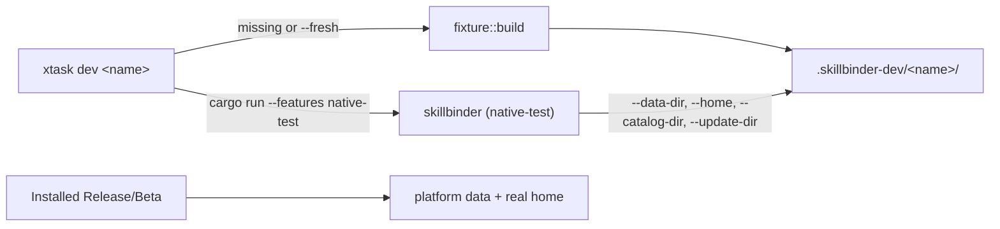

# Development worlds

ADRs: [0029](../adr/0029-development-worlds-per-checkout.md), [0030](../adr/0030-bundle-identifier-dev-fedemas-skillbinder.md) (bundle identifier). Builds on the native-test isolation in [native checks](../native-gate/checks.md) and the [synthetic world](../../fixtures/synthetic/README.md).

## Problem

A contributor who has SkillBinder installed can't run their development build next to it. `cargo run -p skillbinder` uses the platform application data folder, finds the installed app's `application.lock` (`apps/desktop/src/instance.rs`), opens the installed app's window, and exits. The isolated alternative works, but it takes three commands with hand-picked `/tmp` paths, and nothing keeps one checkout's world apart from another's.

## Outcome

With Release or Beta running, a contributor runs one command in any checkout and gets a development build on its own fake machine, alongside the installed app and any number of other development builds. The installed app, the user's library, and their agents never change.

## Scope

In: `cargo run -p xtask -- dev`; the development world's location and lifetime; documentation for contributors; the message a second launch prints; the macOS bundle identifier `dev.fedemas.skillbinder`; a repository skill that teaches coding agents to run and drive the app on development worlds.

Out: running Release and Beta at once; a live catalog or the user's Git credentials inside a world; marking a development window or menu bar icon as "Dev"; any change to how stamped builds find their data; the Windows `AppId` and the Linux app id.

## Decisions

1. **D1** Release and Beta stay one app with one data folder: only one of them runs at a time. Unchanged.
2. **D2** `cargo run -p skillbinder` with no flags uses the normal locations, so it is that one instance too. Unchanged.
3. **D3** A development build that runs beside the installed app runs on a fake machine, the synthetic world, through `native-test`'s existing isolation.
4. **D4** One world per checkout by default, kept across restarts and removed with the checkout.
5. **D5** A new world starts as the synthetic world: fictional agents, projects, a skill source, a Sync remote, a catalog, and app update manifests, with SkillBinder at onboarding.
6. **D6** The macOS bundle identifier becomes `dev.fedemas.skillbinder` (ADR 0030).
7. **D7** A repository skill teaches coding agents to run the app on development worlds and drive it, so an agent working in a checkout never launches on the user's real data by accident.

## Behavior

1. `cargo run -p xtask -- dev [<name>] [--fresh] [-- <app arguments>]` runs the world `<checkout>/.skillbinder-dev/<name>/`, where `<name>` defaults to `default`.
2. A world is complete once it holds `<world>/.complete`, which the task writes after `fixture::build` returns. When the world folder is missing, the task builds the synthetic world there first. When the folder exists without the marker, as after an interrupted build, the task deletes it and builds it again. With `--fresh`, it deletes a complete world and builds it again. Neither deletes a world whose app is running: when `<world>/data/application.lock` is held, the task stops with `The <name> world is running; quit it first.` and changes nothing.
3. It then runs `cargo run -p skillbinder --features native-test --locked -- --data-dir <world>/data --home <world>/home --catalog-dir <world>/catalog --update-dir <world>/app-updates <app arguments>`, with the terminal attached, and exits with the app's status. `-- --mcp` drives it through the bridge, and `-- --app-version 0.1.1-beta.12` runs it as a beta.
4. Before launching, it prints the world's path, its projects folder (to add as workspaces), its Sync remote's `file://` URL, and how to reach it from the command: `cargo run -p skillbinder-cli -- --data-dir <world>/data <command>`.
5. The first launch opens at onboarding on the synthetic agents. Later launches open where the world was left.
6. Launching a world that is already running brings its window forward, and the new process exits. Other worlds, other checkouts, and the installed app are unaffected.
7. Any number of worlds run at once: one per name in each checkout.
8. A second launch of any build that finds the instance lock held, without `--background`, opens the running app's window as today, and prints `SkillBinder is already running; opened its window.` to stderr, so a contributor whose `cargo run` lands on the installed app sees why.
9. The packaged macOS app's `CFBundleIdentifier` is `dev.fedemas.skillbinder`. An installed beta with the old identifier updates to it in place and keeps its library and settings. macOS may ask once more for folder access it had granted to the old identifier.
10. The `skillbinder-dev` skill is offered to agents working in the repository when they need to run, launch, screenshot, or drive SkillBinder, or to check a change in the real app. It tells them to:
    - launch with `cargo run -p xtask -- dev [<name>]`, never a plain `cargo run -p skillbinder`, which opens the user's real library, unless the user asks for real data;
    - use a name per parallel task, and `--fresh` for a clean onboarding;
    - drive the app with `-- --mcp` and `GPUI_MCP_BACKGROUND=1` through the `gpui-skillbinder` MCP server in `.mcp.json`, calling `select_app` when more than one world runs;
    - reach a world from the command with `cargo run -p skillbinder-cli -- --data-dir <world>/data`;
    - find what the synthetic world holds and which states it exercises in `fixtures/synthetic/README.md`;
    - use the world's knobs: `--git-dir` for no Git, `--app-version` to run as a beta, `--update-dir` with `--app-bundle` for app updates, renaming `catalog`/`app-updates` to go offline, `<world>/home/.gitconfig` `insteadOf` rewrites to make catalog installs and Sync reach local repositories, and the `add_workspace` and `hold_activation` app commands;
    - take screenshots without the username (Settings and Sync show paths), and on macOS capture by window ID when MCP screenshots time out.

    It links `docs/native-gate/checks.md` for the details and doesn't copy them.

Edge cases:

- An interrupted build leaves a world without `.complete`, which the next run rebuilds (rule 2). The app itself would launch silently on a partial world, since a missing `catalog` or `app-updates` reads as offline.
- Every world of a checkout runs the same `target/debug/skillbinder`, and so do the worlds of checkouts that share one `CARGO_TARGET_DIR`. After a code change, starting another world rebuilds the binary the running ones use. macOS and Linux keep the running processes. Windows refuses the build while any of them runs, so `xtask dev second` fails there until `default` quits.
- A world can't move with its checkout. The synthetic world records absolute `file://` URLs for its own source and Sync remote (`home/.agents/.skill-lock.json`), and so does the library once onboarded. After `git worktree move` or renaming the folder, skill updates and Sync fail until `--fresh` rebuilds the world.
- A world never reaches the network for the catalog or app updates. Renaming its `catalog` or `app-updates` folder takes it offline, as in the native checks.

## UX

There is no UI change. The only visible text is the task's printed summary and the stderr line in rule 8.

## Design

- **The task lives in `xtask`** (`xtask/src/dev.rs`), which may run processes and touch the filesystem under the Clippy policy and already owns `fixture`. It reuses `fixture::build`. No new crate, no new dependency (ADR 0029).
- **The app doesn't change its identity.** A world is a separate `--data-dir`, so the instance lock, the engine's `library.lock`, and the command socket (whose endpoint comes from the data folder) are separate already. `EngineConfig::isolated` already keeps the command link under `fixture-root`, Git on the world's home, and agents' MCP settings inside the fake home (D3).
- **The world lives in the checkout** at `.skillbinder-dev/`, added to `.gitignore`. It survives `cargo clean` and goes away with its worktree (D4).
- **No cargo alias**, because `xtask verify` rejects aliases in `.cargo/config.toml` (ADR 0029).
- **The stderr line** goes in `apps/desktop/src/main.rs`, beside `command_server::open_running` (rule 8).
- **The bundle identifier** changes in `xtask/src/package/macos.rs`'s `Info.plist`. The Homebrew casks in `packaging/homebrew/` change `uninstall quit:` to it and list both `com.skillbinder.desktop.plist` and `dev.fedemas.skillbinder.plist` under `zap` (ADR 0030, rule 9).
- **The skill** is `.agents/skills/skillbinder-dev/SKILL.md`, where the repository's other skills live. Codex and the other agents that read `.agents/skills` find it there, and a relative symlink `.claude/skills/skillbinder-dev` → `../../.agents/skills/skillbinder-dev` gives it to Claude Code. `.gitattributes` exempts it from `.agents/skills/** linguist-vendored` with `-linguist-vendored`, because agents write it (AGENTS.md), so the 5,000-token size check covers it. AGENTS.md's "Research and verification" points to it in one line. It is written with the writing-for-agents guidance: a description that names its triggers, and a short body that links out. It is not `skills/skillbinder/`, the product's own skill for connected agents (ADR 0028), and SkillBinder never manages it (rule 10).
- **Documentation:** README "Build from source", CONTRIBUTING "Isolated native testing", and checks.md "Launch on the synthetic world" lead with `xtask dev`. `fixtures/synthetic/README.md` names it as the everyday way to launch. The xtask usage string lists `dev`.

## Assumptions

- **A1** The command is `cargo run -p xtask -- dev`, with a name for extra worlds. If you want a shorter command, a shell alias is the user's own, since the repository can't add a cargo alias.
- **A2** Worlds live in `<checkout>/.skillbinder-dev/`. If they should outlive the checkout, they would move under the platform data folder, keyed by the checkout's path.
- **A3** A world uses the synthetic catalog and app update manifests, offline, as the native checks do. Developing against the live catalog stays a plain `cargo run` on real data.
- **A4** Relaunching a running world brings its window forward (today's second-launch behavior).
- **A5** `--fresh` is the way to reset a world.
- **A6** Development windows and menu bar icons carry no "Dev" marking, so with several running, the menu bar shows identical runes.
- **A7** Rule 8's stderr line prints for every build, stamped ones included. A stamped app has no terminal, so nobody sees it there.

## Acceptance

1. With the installed SkillBinder running, `cargo run -p xtask -- dev` in a checkout without `.skillbinder-dev/` builds `.skillbinder-dev/default/` and opens a second SkillBinder at onboarding listing the synthetic agents. The installed app keeps its window and library, and `~/.claude/skills` is unchanged.
2. Two worktrees each running `xtask dev` run two development builds beside the installed app.
3. `xtask dev second` in the same checkout runs a third, on `.skillbinder-dev/second/`.
4. `xtask dev` again while `default` runs brings that window forward, and no extra process remains.
5. After onboarding finishes, quitting and running `xtask dev` again opens Library, not onboarding.
6. `xtask dev --fresh` opens onboarding again on a rebuilt world. Run while that world's app is up, it stops with `The default world is running; quit it first.` and the running app keeps its data. A world whose `.complete` was deleted is rebuilt on the next `xtask dev`.
7. `cargo run -p skillbinder-cli -- --data-dir .skillbinder-dev/default/data status` answers from the running world.
8. `git status` stays clean after any of the above.
9. With the installed app running, `cargo run -p skillbinder` opens the installed app's window, prints `SkillBinder is already running; opened its window.`, and exits successfully.
10. Launching Release while Beta runs, or Beta while Release runs, still opens the running one (unchanged).
11. `xtask` unit tests cover the world path, the name default, the `.complete` marker deciding whether to rebuild, `--fresh` and an incomplete world both refusing while `data/application.lock` is held, and the assembled app arguments; `cargo run -p xtask -- verify` passes.
12. `xtask package universal-apple-darwin` writes `CFBundleIdentifier` `dev.fedemas.skillbinder`, and `osascript -e 'id of app "SkillBinder"'` on the packaged app returns it.
13. A fixture update from a build with the old identifier to one with the new identifier (`--update-dir`, `--app-bundle`) installs through Restart, and the restarted app opens the same library.
14. Both casks `brew audit` cleanly from a local tap, quit `dev.fedemas.skillbinder`, and zap both preference files.
15. Claude Code in a fresh checkout lists `skillbinder-dev` among its skills, and Codex finds it under `.agents/skills`.
16. A fresh agent session asked to "run the app and screenshot Library" uses the skill, launches with `xtask dev` and `--mcp`, takes the screenshot, and never opens the platform data folder or the real home.
17. The pre-commit size check covers `SKILL.md` (it isn't `linguist-vendored`), and `cargo run -p xtask -- verify` passes.

## Slices

1. **Development worlds** (checks 1–8, 10, 11): `xtask dev`, `.gitignore`, and the documentation. Depends on nothing.
2. **Second-launch message** (check 9): the stderr line in `apps/desktop`. Independent of slice 1.
3. **Bundle identifier** (checks 12–14): `Info.plist` and the Homebrew casks. Independent of slices 1 and 2. Land it before the first stable release.
4. **Agent skill** (checks 15–17): `skillbinder-dev`, its Claude Code link, the `.gitattributes` exemption, and the AGENTS.md pointer. Depends on slice 1.

## Open questions

None.
