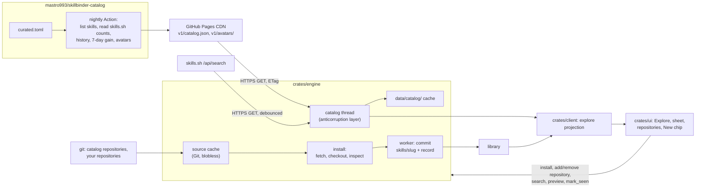

# Explore and install: design

Part of [Explore and install](../explore-and-install.md). ADRs: [0014](../../adr/0014-explore-catalog-over-https.md), [0015](../../adr/0015-install-into-library-only.md). Glossary: [domain.md](../../agents/domain.md).

## Parts



## Technical decisions

Each serves a need named in the [spec](../explore-and-install.md).

- **T1 Catalog repository** (serves D3, D8, D9, D10, A15). A new repository, `mastro993/skillbinder-catalog`, holds `curated.toml`: the creators and their repositories. A GitHub Action runs nightly at about 03:00 UTC and on every push. It shallow, blobless clones each curated repository and finds skills with the `skills` CLI's rules: a root SKILL.md; else `skills/`, `skills/.curated`, `skills/.experimental`, `skills/.system`, and agent project skill directories such as `.claude/skills` and `.agents/skills`, to depth 3; else a recursive search to depth 5. It reads each SKILL.md's frontmatter name and description, and each skill's all-time installs from skills.sh's search endpoint per creator or repository. It appends a dated totals file to `history/` and computes each skill's gain over the last 7 days (fewer while history is shorter). It mirrors each creator's GitHub avatar at 64 px and publishes `v1/catalog.json` and `v1/avatars/<creator>.png` to GitHub Pages, which fixes `max-age=600`. The Action holds the only GitHub token; the app never calls GitHub's API or skills.sh's leaderboard. When skills.sh changes, the job fails loudly and the published file keeps the last counts (ADR 0014). Its contract is under [Catalog repository](#catalog-repository).
- **T2 Catalog format v1** (serves D10). JSON at `<base>/v1/catalog.json`, below. It carries metadata only: no SKILL.md bodies or files, so each skill's content stays under its repository's license and comes from the source through Git. A breaking change publishes `/v2/`; an app that finds no v1 keeps its cache and says "Update SkillBinder to see the latest catalog". The app refuses a file over 8 MB; about 0.5 MB is expected for 2,000 skills. Field rules are under [Catalog format v1](#catalog-format-v1).
- **T3 HTTP** (serves D1, D10). `ureq` 3.x, blocking, with rustls and no OpenSSL, added to `crates/engine` only, with its entry in `xtask/src/graph.rs` and a `THIRD_PARTY_NOTICES.md` line. GET only, to two origins: the catalog base URL, the compiled-in constant `https://mastro993.github.io/skillbinder-catalog/`, and `https://skills.sh/api/search`. `EngineConfig` gains `catalog: CatalogSource`, `Http(Url)` or `Directory(PathBuf)`; isolated and `native-test` configurations use `Directory`, which serves `v1/catalog.json`, `v1/avatars/`, and `search/<query>.json` fixtures. Headers: `User-Agent: SkillBinder/<version>` and `If-None-Match`; no cookies, identifiers, or telemetry. Timeouts of 10 s; response caps of 8 MB for the catalog, 256 KB for a search, and 256 KB for an avatar. This partly supersedes ADR 0005's rejected HTTP dependency; GitHub's REST API stays rejected for update checks.
- **T4 Engine `catalog` module** (serves D1, D9, the anticorruption layer below). `crates/engine/src/catalog.rs` with `catalog/{snapshot, search, repositories, preview}.rs`. It translates the CDN's v1 JSON and skills.sh's undocumented payload, `{skills: [{id, source: "owner/repo", skillId, name, installs}]}`, into proto types: `CatalogSkill { slug, name, description, origin: Curated { creator } | Repository { id } | SkillsSh, source: { url, path: Option }, installs_week: Option<u64> }`, `Creator`, and `Repository`. External shapes never cross into proto or ui. HTTP requests (catalog, avatars, skills.sh) run on one engine HTTP thread. Git network work (listings, previews, install fetches) runs on a pool of at most three threads, so a search never waits behind a clone. None of it runs on the worker, where a slow clone would freeze every command for up to 120 s. A search is a GET to `https://skills.sh/api/search` with the query and a result limit; S5 records the exact parameter names with a dated fixture captured from the live endpoint. A `source` of `owner/repo` maps to `https://github.com/<owner>/<repo>.git`, and an entry with any other `source` is dropped. A failure to connect means "skills.sh needs a connection"; HTTP 429, any other non-200 answer, or an unreadable payload means "skills.sh unavailable". A result's slug is its `skillId` until T7 resolves its folder, then T2's rule applies.
- **T5 Cache** (serves A10). `<data>/catalog/` holds `v1-catalog.json` with its ETag and fetch time, and `avatars/<creator>.png`. Refreshed on launch, and when Explore opens if older than one hour, with a conditional GET. Offline, the cache is served. Avatars are fetched after a changed catalog, each with its own ETag, and removed when their creator leaves the catalog. [Catalog states](#catalog-states) maps each failure to a state.
- **T6 Repositories** (serves D6, D13, A2). A machine-local Diesel table `repositories (id, url UNIQUE normalized, added_at)`. URLs are validated by `crates/engine/src/git/validation.rs`: HTTPS without credentials, SSH, and scp-style; `file://` only in tests. Listing makes a bare, shallow, blobless clone into `<data>/source-cache/catalog/<sha>` (a new `CacheUser::Catalog`, pruned when no repository or open preview uses it), runs `git ls-tree -r --name-only`, applies T1's rules, and reads frontmatter with `git cat-file -p <blob>`, which fetches only SKILL.md blobs. Listed on add and when Explore opens if older than one hour. Add lists first and saves nothing unless at least one skill is found. A URL is normalized by lowercasing the host, dropping a trailing `/` and `.git`, and mapping `git@host:owner/repo` to `ssh://git@host/owner/repo`. Two sources are the same when their normalized URLs and their paths are equal; the HTTPS and SSH URLs of one repository are different sources. Copy shows `<owner/repo>` as the normalized URL's last two path segments.
- **T7 Preview** (serves D5). Opening the sheet fetches the skill's repository into the same catalog cache, lists the folder with `git ls-tree -r`, and reads SKILL.md with `git show`. A skills.sh result's folder is resolved by T1's rules, matching the folder whose SKILL.md name, or folder name, equals `skillId`. Open in browser opens `https://<host>/<owner>/<repo>`, with SSH and scp-style URLs mapped to HTTPS and `.git` dropped; for github.com it appends `/tree/HEAD/<path>`.
- **T8 Install** (serves D7, D12). `Engine::install_skill(CatalogSkill)` has a network phase off the worker, on T4's Git pool: fetch into a `CacheUser::Install` cache, check out the folder as `<staging>/<slug>` with `sources::checkout`, and run `payload::inspect`. A `None` from `checkout`, a folder the fetched commit no longer has, is refused as not found, and so are Blocked, Invalid, and empty payloads. `refusal` returns a reason enum that install and update each map to their own copy (spec, Installing rule 8). Then a short commit on the worker: re-check the slug against held names with the existing NFKC, case-folded comparison; a journaled `Move` to `skills/<slug>`; a `RecordChange` with `Record::of(inspection, Some(source))`, whose source is the repository URL, no ref, and the folder; and a `SavedSkill` whose `imported_at` is the install time (the column means the skill arrived in this library), with `skills.new = true` once S3 adds it (T9). No preset or workspace holds it: no placement, no `apply_imported`, no `adopt_agent_copies`. It reuses `sources::{checkout, refusal, cache_dir}`, made `pub(crate)`, and `State::staged`. An install's cache is removed once it commits or fails, and `prune_source_caches` also removes `Catalog` and `Install` caches that nothing in progress uses. At most three network phases run at once (ADR 0015); commits serialize on the worker. Quitting abandons network phases and removes their staging directories; a journaled commit already on the worker finishes.
- **T9 New mark** (serves D4). A migration adds `skills.new`, a boolean defaulting to false, in the machine-local database. Only install sets it. It is cleared by any activation save that holds the slug, in a preset or a workspace, and by a new `Engine::mark_seen(slug)` that the UI calls when a skill's page opens. The snapshot's `Skill` gains `new: bool`.
- **T10 UI** (serves D2, D11). `Route::Explore` and the first `nav_row`, with the compass glyph already registered. Module `crates/ui/src/native_view/explore.rs` with `explore/{sections, results, sheet, repositories, add_repository, cards}.rs`; pure derivations (search filtering, chip counts) in the `snapshot_query` style. The client publishes an `explore` projection, as it does `checking`, with catalog state `Loading | Ready | Offline | Outdated | Unavailable` ([Catalog states](#catalog-states)), and commands `refresh_catalog` (Retry), `install_skill`, `install_all(repository)`, `list_repository(url)` (the dialog lists before adding), `add_repository`, `remove_repository`, `restore_repository` (Undo), `search_skills_sh(query)` (debounced in the UI), `resolve(result)` (a skills.sh result's folder), `preview(skill)`, `retry_preview`, and `mark_seen(slug)`. Components: SearchField, SectionHeader, Surface Flat cards in Library's grid metrics, Chip (Accent for New), Button with loading, EmptyState, Notice, ListRow and CardList, DialogFrame, DialogHeader, and DialogFooter from `crates/design`; GPUI Kit Sheet, Avatar with a name fallback and the cached image, and Skeleton. New design-system pieces, each asked about first (AGENTS.md): a `SkillCard` organism lifted from Library's tile, and possibly a Sheet wrapper. "Open in browser" uses the GitHub glyph with that tooltip until a Hugeicons link glyph is retained with its inventory entry. Feature metrics live in `crates/design/src/explore.rs`.
- **T11 Tests** (serves every acceptance check). Engine integration tests with `EngineConfig::isolated` and a new `CatalogSource::Directory(path)` serving fixture catalog and search JSON, as `GitSearch::Directory` does for Git. Repositories and installs use local `file://` repositories, as `updates.rs` does. Test files split by journey: catalog, search, repositories, install, new mark. Native evidence per slice uses the MCP bridge, the `native-test` build, and a synthetic world. No network in CI.
- **T12 Glossary and scope** (serves G3). `domain.md` gains install, catalog, creator, repository, trending, and New; "Import is not install" is rewritten and "install names a separate, future feature" removed; a source is also set at install; record writers become import, install, update, and reinstall. `AGENTS.md`'s approved scope adds Explore and clarifies that entering a repository URL to browse it is in scope while editing a library skill's source stays out. ADR 0011 gains a "Partly superseded by ADR 0015" line.

## Domain notes

- **One context.** Explore stays inside SkillBinder's single context (`domain.md`, "One context"). The catalog is a supporting subdomain at light depth: value objects in proto and an engine module, with no aggregates beyond the library's existing ones. HTTP is generic and bought (`ureq`). Computing popularity is supporting work and lives outside the app, in the catalog repository's job.
- **Anticorruption layer.** Three external models are translated at the engine's edge and never reach proto or ui: the CDN's v1 JSON (ours, still translated so the published format and the app's types can change apart); skills.sh's search payload (undocumented, so a tolerant reader that ignores unknown fields and drops malformed entries, and any failure becomes "skills.sh unavailable"); and Git's command output (existing).
- **Invariants.**
  1. One library skill per normalized slug. Install re-checks it on the worker before committing.
  2. One repository per normalized URL per device.
  3. New is set only by install and cleared only by activation or by opening the skill's page.
  4. Installing never writes outside the library; ADR 0006's rules are unchanged.

## Catalog format v1

```json
{
  "schema": 1,
  "generated_at": "2026-11-19T03:12:44Z",
  "creators": [
    { "id": "mattpocock", "name": "Matt Pocock", "avatar": "avatars/mattpocock.png" }
  ],
  "skills": [
    {
      "slug": "tdd",
      "name": "tdd",
      "description": "Test-driven development with red-green-refactor.",
      "creator": "mattpocock",
      "repository": "https://github.com/mattpocock/skills.git",
      "path": "skills/tdd",
      "installs_week": 12400
    }
  ]
}
```

Field rules. The engine drops an entry that breaks one and keeps the rest.

- `schema` is 1. Any other value at the v1 path is the Outdated state.
- A creator requires `id` and `name`; `avatar` is optional and relative to `v1/`, and initials show without it. A creator left with no valid skills is dropped.
- A skill requires every field shown. `creator` names a `creators[].id`. `repository` is an HTTPS URL ending in `.git` that passes `git/validation.rs`. `path` is relative, uses `/`, and has no `..`; it is empty for a root SKILL.md. `installs_week` is a non-negative integer, 0 when skills.sh has no count.
- `slug` is the SKILL.md frontmatter `name`, or the folder name when there is none, and passes the library's slug validation. Install checks out into `<staging>/<slug>`, so a folder named differently still inspects as valid.
- A skill's identity is `(repository, path)`; `slug` is not unique across the file. A duplicate `(repository, path)` keeps the first entry.
- `description` is truncated at 1,024 characters.
- Skills are ordered by `installs_week`, highest first. Unknown fields are ignored (ADR 0014).

## Catalog states

| Cause | State | With a cache | Without one |
|---|---|---|---|
| First fetch running | Loading | the cache | skeletons (spec, Catalog rule 7) |
| DNS, connect, or timeout | Offline | the cache and "Offline · showing the last catalog" | "Couldn't load the catalog" with Retry |
| HTTP 5xx or another non-200, an unreadable body, a body over 8 MB | Unavailable | the cache and "Couldn't refresh the catalog" | "Couldn't load the catalog" with Retry |
| HTTP 404 at `v1/`, or `schema` other than 1 | Outdated | the cache and "Update SkillBinder to see the latest catalog" | the same line, with no catalog |
| 200 or 304 | Ready | the catalog | the catalog |

## Catalog repository

S0 builds `mastro993/skillbinder-catalog` to this contract.

- `curated.toml` holds one `[[creator]]` table per creator: `id`, `name`, `github = "<login>"`, and `repositories = ["https://github.com/<owner>/<repo>.git", …]`. An optional `[[creator.exclude]]` table with `repository` and `paths = [...]` leaves skills out.
- Counts: a skills.sh entry belongs to a skill when its `source` is the repository's `owner/repo` and its `skillId` is the skill's slug. An unmatched skill counts 0.
- History: one file per night, `history/<YYYY-MM-DD>.json`, mapping `<repository>#<path>` to all-time installs. Files older than 30 days are deleted.
- Partial failure: an unreachable curated repository keeps its entries from the last published file. When skills.sh fails, the job publishes fresh listings with the last counts, then fails the run. A failed run notifies the repository's owner through GitHub's workflow notifications.
- Avatars come from `https://github.com/<login>.png?size=64`, which needs no token. The workflow's own `GITHUB_TOKEN`, with contents and Pages write permissions, commits `history/` and deploys Pages; no other secret exists.
- GitHub Pages fixes `Cache-Control: max-age=600`, so freshness is not configurable; the app's conditional GET makes most refreshes cost one empty response.

## Risks and costs

- skills.sh's search API is undocumented and rate-limited per IP. Both the nightly job and live search can break. The app degrades: no live results, and the last published counts.
- This is the app's first HTTP client: a TLS stack to maintain and network traffic outside Git. Search queries go to skills.sh, which is a privacy cost.
- Third-party skill content reaches the library in one click. Mitigations: the preview sheet, payload validation that refuses Blocked and Invalid content, and install never activating.
- The same slug installed on two devices before a Sync conflicts on Pull when the content differs; the same source and commit give identical trees, so usually it doesn't.
- GitHub Pages' soft limit of 100 GB a month is ample at this scale. Moving hosts means a new base URL in an app release, or a redirect.
- The catalog repository is a moving part outside the app that needs an owner.

## Docs each slice updates

`docs/agents/domain.md` and `AGENTS.md` (T12); a new `docs/features/native/explore.md`; `library-and-organization.md` and `library-rows.md` (New chip); `sync-and-durability.md` (installs uncommitted until Sync); `application-shell-continued.md` (sidebar row); `acceptance-evidence-ui.md`; `docs/architecture/native.md` (catalog thread, `ureq`, the new cache users); `README.md`; `THIRD_PARTY_NOTICES.md`.
