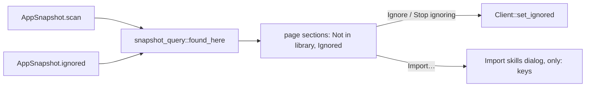

# Found skills and ignored skills on workspace and agent pages

ADR: [0036](../adr/0036-pages-list-their-found-and-ignored-skills.md), which partly supersedes [0007](../adr/0007-pages-list-active-skills.md), [0008](../adr/0008-import-from-scan-dialog.md), and [0033](../adr/0033-ignored-skills-are-remembered-per-slug.md). Design: [docs/design/found-skills-on-pages](../design/found-skills-on-pages/README.md) (decisions U1–U11). Glossary: [domain.md](../agents/domain.md). Its detected agent, ignored skill, and Import skills dialog entries change in the slices that ship them, since it documents shipped behavior. Builds on [ignore-found-skills](ignore-found-skills.md) and [scan-and-import](scan-and-import.md).

## Problem

A project often holds a skill made for it alone, which makes no sense in the library. The agent loads it, but the workspace's page lists only library skills that are on there. To stop Scan for skills offering and counting it, the user had to open the Import skills dialog, which mixes every place, and find the skill there. To undo that, they had to find the dialog's Ignored group.

## Outcome

The user opens the workspace, sees the project's own skill under Not in library, and clicks Ignore. Done. The same works on an agent's and Universal's page. We know it works when every found skill that is not in library, in a page's place, shows under Not in library or Ignored on that page, and a click moves it between them.

## Scope

In:
- The Not in library section on workspace, agent, and Universal pages, ignored skills marked in it, with search.
- Ignore, Ignore all, and Stop ignoring there.
- Import…, which opens the Import skills dialog narrowed to the place.

Out:
- Copies of library skills that sit where the skill is off (ADR 0036, rejected by the user).
- Plugin skills (ADR 0035) and the SkillBinder skill (ADR 0028).
- Other directories an agent reads, such as Universal's on Cursor's page.
- Sidebar counts, Scan for skills' count, the Add skill picker, Library.
- New command or MCP server actions: `ignore`, `unignore`, and `import` already cover these (ADR 0023).
- Changing any file on Ignore.

## Behavior

Decisions:

1. The pages let the user see these skills and act on them: ignore, stop ignoring, and import.
2. They list two groups besides the skills on there: found skills not in library, and ignored skills. They do not list library skills.
3. Importing from a page turns the skill on wherever it was found, as Scan for skills does (ADR 0008).
4. The layout is variant A, Sections (U1).
5. A workspace's page covers every agent workspace skill directory the scan walks in its folder, including those of agents the user did not choose. This matches the Import skills dialog's group for that workspace, and each row names its directory.
6. An agent's page covers only its own global skill directory, and Universal's covers `~/.agents/skills`.
7. Sidebar counts still count only the skills on there.
8. An ignore still names a slug everywhere (ADR 0033): ignoring on one page ignores the skill on every page and in the Import skills dialog.

### What each page lists

1. The latest completed scan decides which found skills belong to a page.
   - A found skill belongs to a workspace's page when one of its locations lists that workspace.
   - It belongs to an agent's or Universal's page when one of its locations is that page's global skill directory, which is one whose `global_agents` include the page's agents.
2. Each found skill that belongs to the page and is not in library shows once, keyed by its normalized slug. It shows under **Not in library**, marked **Ignored** if its slug is ignored. Found skills that are in library are not listed again.
3. With no completed scan yet, the section is absent. The pages refresh whenever a scan completes, which happens on focus and after every change that writes copies.

### Actions

4. **Ignore** and **Ignore all** call the same engine change as the Import skills dialog (ignore-found-skills behaviors 2–3). They are saved at once and need no new scan, and the rows are marked Ignored on every page.
5. **Stop ignoring** removes the ignore. The row loses its Ignored mark and flashes (U7).
6. **Import…** opens the Import skills dialog with only the page's not-in-library skills that are not ignored, or from a row only that skill (U6).
   - The dialog prepares a plan for just those slugs, with every version and location of each (ADR 0009).
   - Applying it is an ordinary import: each skill turns on wherever it was found.
7. While a blocking change, an import, Update all, or Sync runs, Ignore and Stop ignoring are refused like any other change (ignore-found-skills behavior 15).

## UX

The pages change as the prototype shows: [`docs/design/found-skills-on-pages/prototypes/place-pages.html`](../design/found-skills-on-pages/prototypes/place-pages.html), variant A "Sections".
- The user picked it over a filter beside the search (B) and one card with group headers (C).
- The rules are U1–U11 in [decisions.md](../design/found-skills-on-pages/decisions.md).
- The Import skills dialog keeps its look when narrowed (U6).
- No other surface changes.

## Design

- **No engine or proto change** (decisions 5–6).
  - `CandidateLocation` already carries `workspaces` and `global_agents`, which say whether a found skill belongs to a page.
  - Onboarding's summary already filters on `global_agents` (`onboarding/import/summary.rs`).
  - The directory each row names comes from the same label the Import skills dialog shows (`import_dialog/versions.rs` `location_label`), so the page and the dialog name it the same way.
- **One derivation** (behaviors 1–3; decision 8):
  - `crates/ui/src/native_view/snapshot_query/found_here.rs` derives the page's rows, each marked `ignored` or not, from `AppSnapshot.scan` and `AppSnapshot.ignored`.
  - It groups versions per normalized slug, as `import_dialog::versions::found_skills` does, and reuses `Candidate::in_library` and `matching` for search.
  - `snapshot_query` is where page derivations already live.
- **Section UI** (decisions 1, 4; U1–U9):
  - A new `crates/ui/src/native_view/found_section.rs`, with its rows in `found_section/rows.rs`, renders the section under `scoped_list`. Both `agent_page.rs` and `workspace_page.rs` call it.
  - A row has no `Skill`, so it is its own row built from design-system components: ghost and outline xs Buttons, the validation glyph, Kit's Tag for Ignored, and the disclosure chevron of the dialog's Ignored group.
  - No new tokens, artwork, or design-system component.
- **Ignoring** (behaviors 4–5, 7):
  - `ignore_found` (which both Ignore and Ignore all call with a list of rows) and `stop_ignoring` move out of `import_dialog/ignored.rs` into `native_view/ignore_actions.rs`, one seam around `Client::set_ignored` that the dialog and the pages share.
  - Stop ignoring's re-tick stays a no-op when no dialog is open, which `edit_import` already ensures.
- **Narrowed import** (behavior 6; decision 3):
  - `NativeView::open_import_dialog_for(keys)` creates the dialog with `only: Some(keys)`, and `open_import_dialog` passes `None`.
  - `prepare_found` sends only those keys' versions to `prepare_found_import`, and `list::groups` and `default_ticks` see only those skills.
  - So the 500 cap, versions, acknowledgement, and placement rules are unchanged.
- **Rollout**: UI only, with no stored data and no feature flag.

## Assumptions

- **A1:** found and ignored rows are not links, since a found skill has no page. *If wrong:* a read-only preview like a plugin skill's page (ADR 0035).
- **A2:** Import… sits on each row and on the section head. *If wrong:* only on the head.
- **A3:** the section starts open on every visit. *If wrong:* it would remember being folded per page.
- **A4:** no new command or MCP server output. *If wrong:* `scan --workspace <ws>` and `--agent <a>` filters, and the same for `find_skills`.
- **A5:** Ignore all also covers rows the search hides, as I3 does. *If wrong:* only the visible rows.
- **A6:** a row's directory label shares the dialog's known limit: a skill nested deeper inside a skill directory names its parent folder. *If wrong:* the scan would record each location's skill directory (a proto field).

## Acceptance

Fixture:
- Workspace `acme-web` (Universal and Claude Code directories) holds:
  - `vitest-runner` and `figma-sync` (invalid) in `.claude/skills`;
  - `acme-deploy` in `.agents/skills`;
  - `vendor-lint` in `.agents/skills`, also in `~/.agents/skills`;
  - `windsurf-only` in `.windsurf/skills`, with Windsurf not chosen;
  - library skills that are on there.
- `~/.claude/skills` holds `skill-creator`, and `anthropic-docs`, which is ignored.

1. **Groups.**
   - acme-web's page lists its skills on there, then Not in library: `acme-deploy`, `figma-sync`, `vendor-lint` ("Also found in Universal"), `vitest-runner`, and `windsurf-only` with `.windsurf/skills`.
   - Claude Code's page lists `anthropic-docs`, marked Ignored, and `skill-creator` under Not in library.
   - No library skill appears in either section.
2. **Ignore.** Ignore on `vitest-runner` in acme-web marks it Ignored. Scan for skills' count drops by one, and the Import skills dialog lists it under Ignored. Nothing changes on disk, and the state survives a relaunch.
3. **Per slug.** Ignore on `vendor-lint` in acme-web shows it marked Ignored on Universal's page too. Stop ignoring there restores it on both pages.
4. **Ignore all.** Ignore all on acme-web's Not in library, with the search set to `vit`, ignores all five skills.
5. **Import.**
   - Import… on acme-web opens the Import skills dialog with only acme-web's not-in-library skills, `figma-sync` unticked.
   - Importing `vendor-lint` turns it on in acme-web's `.agents/skills` and in `~/.agents/skills`.
   - Row Import… on `acme-deploy` opens the dialog with only `acme-deploy`.
6. **Search.** Searching `anthropic` on Claude Code's page shows only the Not in library section, open, with `anthropic-docs` marked Ignored.
7. **Empty.** A workspace with no directories and one found skill shows "No skills on in docs-site · No agents here yet", then the Not in library section.
8. **Unchanged.** Sidebar counts and Library are unchanged. Plugin skills never appear.
9. **Checks pass:** `cargo fmt --all --check`, workspace Clippy, `cccc .`, workspace tests, `cargo run -p xtask -- verify`, and a locked release build.

## Slices

1. **Pages list found and ignored skills, and ignore them.**
   - Delivers: `snapshot_query::found_here`, the Not in library section with search and ignored skills marked, and Ignore, Ignore all, and Stop ignoring through `ignore_actions.rs`.
   - Checks: 1–4, 6–9.
   - Tests:
     - derivation unit tests with a candidate builder in `snapshot_query/fixture.rs`;
     - a test that the dialog still ignores through the moved seam;
     - a native check of acme-web and Claude Code on a development world.
   - Docs:
     - `docs/features/native/workspaces-and-scanning.md` (workspace and agent pages);
     - `docs/features/native/ignored-skills.md`;
     - `docs/features/native/workspace-activation.md`;
     - the glossary's detected agent and ignored skill entries.
   - Depends on: nothing.
2. **Import from a page.**
   - Delivers: `open_import_dialog_for`, the dialog's `only` filter and narrowed preparation, and Import… on rows and the head.
   - Checks: 5, 9.
   - Tests: UI unit tests of `groups` and `default_ticks` with `only`, and a native check of the narrowed dialog.
   - Docs: `docs/features/native/imports.md`, and the glossary's Import skills dialog entry.
   - Depends on: 1.

## Open questions

None.
