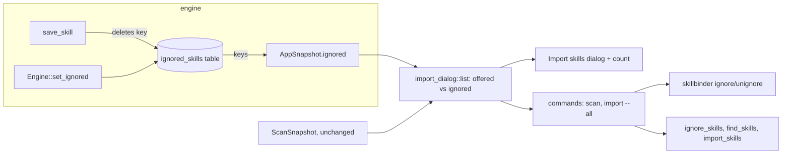

# Ignore found skills

ADR: [0033](../adr/0033-ignored-skills-are-remembered-per-slug.md), which partly supersedes [0008](../adr/0008-import-from-scan-dialog.md). Partly superseded by [unmanaged-skills-on-pages](unmanaged-skills-on-pages.md) (ADR 0036): decision 1 and the Out item on workspace and agent pages no longer hold, since those pages now list and un-ignore ignored skills. Design: [docs/design/ignore-skills](../design/ignore-skills/README.md) (decisions I1–I12). Glossary: [domain.md](../agents/domain.md) (ignored skill, Import skills dialog). Builds on [scan-and-import](scan-and-import.md).

## Problem

Every time the Import skills dialog opens, it offers every found skill that is not in library. Some of those skills the user never wants in the library: a project's vendored skills in a newly added workspace, or an agent's own skills. Today the user can only untick them. They come back ticked on the next Scan for skills, and they keep counting on the button, so the count never reaches zero (`docs/specs/scan-and-import.md` decisions 2–3, design L2). ADR 0008 rejected a remembered skip list because nobody had asked for one. Now the user has.

## Outcome

The user ignores a found skill once. From then on SkillBinder treats it as if it were not there: it is not offered, not ticked, and not counted, in the app, the command, or the MCP server. The user can see what they ignored and stop ignoring it from the same dialog. We know it works when ignoring every unwanted skill takes Scan for skills to no count, and that state survives a relaunch.

## Scope

In:
- Ignore, Ignore all, the Ignored group, and Stop ignoring in the Import skills dialog, from Scan for skills and from onboarding's Review list.
- Scan for skills' count and status line without ignored skills.
- The command's `ignore`, `unignore`, `scan`, and `import --all`.
- The MCP server's `ignore_skills`, `find_skills`, and `import_skills`.

Out:
- Changing any file: agents keep loading an ignored skill's copies.
- Showing found or ignored skills on workspace or agent pages (ADR 0007).
- A Settings list of ignored skills.
- Syncing ignores.
- Ignoring a library skill, an Explore result, or one version of a slug.
- Deleting library skills.

## Behavior

Decisions:

1. Ignored skills show, and stop being ignored, only in the Import skills dialog. Workspace and agent pages are unchanged.
2. Ignoring is an explicit action. Leaving a skill unticked still only skips it, and a skipped skill comes back ticked next time, as today.
3. An ignore names a slug and covers it everywhere: every global skill directory and workspace, including ones added later.
4. The control is variant C: Ignore on each row when it is hovered or focused, and Ignore all on each place's group header.
5. Ignored skills sit in a collapsed "Ignored" group at the end of the list.
6. An ignore is saved at once. Cancel does not undo it.
7. Stop ignoring brings the skill back ticked by the usual rules.

### Import skills dialog

The design rules are in [decisions.md](../design/ignore-skills/decisions.md): I2 for Ignore, I3 for Ignore all, I4 for saving at once, I5–I6 for the group and its rows, I7 for Stop ignoring, I8 for the status line and count, I9 for search, I10 for when everything is ignored, and I11 for copy.

1. Opening the dialog prepares its plan for every found skill that is not in library, the ignored ones included (ADR 0009). Stop ignoring therefore needs no new preparation, and ignoring never refuses or refreshes the plan.
2. **Ignore** on a row ignores that skill's slug.
   - The row moves to the Ignored group, and its tick is dropped.
   - The Import count, Select all, its group's checkbox and count, the status line, and Library's Scan for skills count update together.
   - If the group is left empty, its header goes too.
3. **Ignore all** on a place's header ignores every skill that group lists. That includes skills that cannot be ticked, such as blocked ones, and skills the search hides.
4. **Stop ignoring** removes the ignore. The skill returns to the group of its first location, ticked if its chosen version is valid and fewer than 500 skills are ticked.
5. Select all, the group checkboxes, and Import never include an ignored skill. To import an ignored skill, the user stops ignoring it first.
6. A background scan that completes while the dialog is open does not change it (scan-import D13). Ignore and Stop ignoring do change it, at once.
7. With nothing found at all, nothing changes from today ("No new skills found." with Close). When every found skill is ignored, the list reads "No new skills found." with the Ignored group under it.

### Onboarding

8. Review list opens the same dialog over onboarding with the same rows (scan-import O7). Each row has Ignore, and the Ignored group closes the list. With no group headers, there is no Ignore all.
9. The step's summary, "N skills found in <agents>", and its "Import N skills" count only skills that are not ignored. When every found skill is ignored, the step follows I12: the summary card reads "No new skills found in <agents> · K ignored", Review list stays under it, and Continue finishes onboarding in place of Import. With nothing found at all, O5's nothing-found state is unchanged.

### Library

10. Scan for skills counts the found skills that are not in library and not ignored, from the latest completed scan, and its accessible label says the same. With none, it shows no count even if ignored skills exist.

### Command line and MCP server

11. `skillbinder ignore <slug>…` ignores found skills that are not in library, and `skillbinder unignore <slug>…` stops ignoring them. Both take several slugs and change nothing unless every slug is accepted.
    - `ignore` accepts a slug that the latest completed scan found and that is not in library. It reads that scan and does not start one. A slug no scan found exits `not_found` with "No found skill named <slug>.". A slug in library exits `usage` with "<slug> is in your library.". Ignoring an ignored slug is accepted and changes nothing.
    - `unignore` accepts any ignored slug, whether or not a scan still finds it, such as one whose workspace was removed (behavior 16). It also accepts a found slug that is not ignored, as a no-op. Any other slug exits `not_found` with "No ignored skill named <slug>.".
12. `scan` prints the found skills that are not ignored as today, then "Ignored: <slug>, …" when any are ignored. With `--json`, a new field `ignored` holds every ignored slug on this device, sorted, including ones no scan finds now, so each one can be unignored. The count line counts only skills that are not ignored.
13. `import --all` imports what the dialog would tick, so ignored skills are left out. `import <slug>` of an ignored slug imports it, which ends the ignore: naming it is the user's choice.
14. The MCP server gains `ignore_skills`, which is idempotent and not destructive. Its input is `skills` (slugs) and optional `stop` (bool), and it follows the rules of `ignore` and `unignore`.
    - `find_skills` with `where: found` leaves ignored skills out of its rows and adds `ignored`, every ignored slug as `scan` lists them.
    - `import_skills` with `all` leaves them out.
    - The SkillBinder skill's text names `ignore_skills` (ADR 0028), if that skill has shipped by then (#210).
15. `ignore` and `unignore` are changes under the command's rule 2: while a blocking change, Update all, Sync, or an import runs, they refuse as busy, like any other change.

### Lifecycle

16. Ignores are kept on this device and never sync (ADR 0004). They survive relaunch, app updates, and the removal of the workspace where a skill was found.
17. When a slug enters the library by import, install, or Pull, its ignore is dropped in the same transaction. If that skill later leaves the library, it is offered again.
18. An ignore lasts whatever the content: an edited copy, or a new version of the slug, stays ignored.

## UX

The Import skills dialog changes as the prototype shows: [`docs/design/ignore-skills/prototypes/import-dialog.html`](../design/ignore-skills/prototypes/import-dialog.html), variant C with "Group at bottom". The user picked that over row-only Ignore (A), an always-visible Ignore (B), and a toolbar toggle that switches the list to ignored skills. The Library header's Scan for skills button keeps its look and only counts differently. Onboarding's Review list reuses the dialog. No other surface changes.

## Design

- **Storage** (decisions 3, 16; ADR 0033):
  - New Diesel migration `crates/engine/migrations/2026-11-25-000000_ignored_skills`, creating table `ignored_skills (key TEXT PRIMARY KEY NOT NULL, slug TEXT NOT NULL, ignored_at BIGINT NOT NULL)`.
  - `key` is `library::normalized(slug)`, the same NFKC and case-folded form that `Candidate.key` and the library use, so it matches any spelling the scan reports.
  - `slug` keeps the spelling the user ignored, for `scan`'s "Ignored:" line and `find_skills`' `ignored`, which list every row, including slugs no scan finds now.
  - It is a table rather than a device setting, so dropping one key can share a transaction with the skill insert (below).
- **Engine** (decisions 2, 6; ADR 0033):
  - New module `crates/engine/src/imports/ignored.rs` holds `State::set_ignored(&[String], bool)` and `State::ignored_keys()`.
  - `Engine::set_ignored(slugs, ignored)` is a plain worker call, like `mark_seen` (`worker/install.rs:51`). It is not an operation, so it gets no plan, no journal, no blocking, and no new scan. It validates every slug before writing any row (behavior 11): an ignore against the latest completed scan and the library, a stop against the table and the scan, then publishes a new snapshot.
- **Ending an ignore** (decision 17): `library_store::save_skill` (`library_store.rs:66`) deletes the slug's key from `ignored_skills` on the connection it was given. Both paths into the library already call it: commits of imports and installs (`persistence.rs:327`) and reconciliation after Pull (`reconcile.rs:118`). So no other path can leave a stale ignore behind.
- **Snapshot**: `proto::AppSnapshot` gains `ignored: BTreeSet<String>`, the ignored keys, filled where the engine assembles the snapshot. `ScanSnapshot`, `Candidate`, and `ImportPlan` stay as they are. A scan stays a pure observation, and ignoring needs no rescan or new preparation (behavior 1).
- **One derivation** (decisions 4, 5, 7; behaviors 5, 10, 12, 13):
  - In `crates/ui/src/native_view/import_dialog/list.rs`, `groups` takes the ignored keys and returns the place groups from offered skills only, plus the ignored rows separately. `default_ticks` sees only offered skills.
  - `NativeView::not_in_library` / `found_count` (`import_dialog.rs:144–156`) filter out ignored keys.
  - `crates/ui/src/commands/import.rs` already builds `scan` and `import --all` from `groups` and `default_ticks`, so the dialog, the count, the command, and the MCP server share this one rule.
- **UI** (decisions 4, 5; I2–I10):
  - The row's Ignore is a design-system ghost xs Button, shown on hover or focus as Library's Delete is. Ignore all sits at the group header's end.
  - The Ignored group is a disclosure header with the existing chevron glyph and a muted hint. Its rows have no checkbox and an outline xs "Stop ignoring".
  - No new artwork, tokens, or design-system component. The new pieces need app state, so they stay in `crates/ui/src/native_view/import_dialog/` as a new `ignored.rs` beside `rows.rs`.
  - The group's open state is dialog-local and resets each time the dialog opens.
- **Command line** (decisions 11–13, 15; ADR 0023):
  - `apps/cli/src/grammar/explore.rs` parses `ignore` and `unignore` into a new `Change::Ignore { slugs, stop }`, which `crates/ui/src/commands.rs` runs through `Engine::set_ignored`.
  - The `scan` JSON shape gains `ignored`, and `docs/specs/command-line.md` and its help text list both commands.
- **MCP** (decision 14; ADR 0025):
  - `ignore_skills` goes in `apps/cli/src/mcp/explore.rs`, with its input in `mcp/inputs/explore.rs`, annotated idempotent and not destructive.
  - `find_skills` results gain `ignored`.
  - `docs/specs/mcp-server.md`'s tool table gains the row, and the server's tool tests (`apps/cli/src/mcp/tests`) cover the new tool. `xtask mcp-smoke` drives the window through the GPUI MCP bridge, not this server.
- **Rollout**: one additive migration, with no data to carry over. Older builds never read the table. No feature flag.

## Assumptions

- **A1 (decision 18):** an ignore lasts whatever the content. *If wrong:* the key would be the `CandidateId` (content), and an edited copy would be offered again.
- **A2 (decision 16):** ignores are machine-local and never sync. *If wrong:* they would need a synced file beside `records/`, with merge rules on Pull.
- **A3:** ignored skills leave the count, Select all, the group checkboxes, and `--all`, and the status line gains "· K ignored". *If wrong:* the count would show ignored skills separately.
- **A4 (behaviors 8–9):** onboarding's Review list offers Ignore and the Ignored group, without Ignore all. *If wrong:* onboarding would offer skip only.
- **A5 (decision 17):** a slug's ignore ends when it enters the library, and naming an ignored slug in `import` imports it. *If wrong:* `import <ignored>` would refuse until `unignore`.
- **A6 (behaviors 11–14):** the command gains `ignore` and `unignore`, and the MCP server gains `ignore_skills`, so agents can ignore on the user's behalf. *If wrong:* ignoring would stay in the window only, which ADR 0023's parity argues against.
- **A7:** Ignore all also ignores rows that cannot be ticked, such as blocked, empty, or invalid ones, and rows hidden by the search. *If wrong:* it would cover only the visible, importable rows.
- **A8:** there is no Undo toast. The Ignored group and Stop ignoring serve as undo. *If wrong:* a "Ignored <slug>" toast with Undo, like Delete's.
- **A9 (behavior 15):** `ignore` refuses while busy, like every change. *If wrong:* it would be allowed during an import, being a local write.

## Acceptance

1. **Ignore on a row.** With 18 offered and 0 ignored, pressing Ignore on `storybook` drops the Import count by one and Scan for skills' count by one. The status line reads "17 found · 3 already in library · 1 ignored", and `storybook` is in the collapsed Ignored group.
2. **Survives Cancel and relaunch.** After 1, Cancel, then a relaunch, then Scan for skills: the count excludes `storybook`, which is in the Ignored group and not ticked.
3. **Skipping is not ignoring.** Unticking `tdd` and importing the rest leaves `tdd` offered and ticked on the next Scan for skills.
4. **Ignore all.** Ignore all on workspace `acme-web` moves every skill that group lists into Ignored. A slug from that group also found in Your agents is no longer offered there either.
5. **Stop ignoring.** Stop ignoring on a valid ignored skill returns it to its place, ticked, with a flash. On an invalid one, it returns unticked.
6. **Everything ignored.** With every found skill ignored, Scan for skills shows no count, and the dialog shows "No new skills found." above the Ignored group, with Import inactive.
7. **Search.** Searching `play` shows `e2e-playwright` in an expanded Ignored group. Clearing the search collapses it again.
8. **Content changes.** Editing an ignored skill's copy on disk and scanning keeps it ignored.
9. **Entering the library.** Importing an ignored slug with `skillbinder import storybook` imports it and drops its ignore in the same transaction. Installing a slug from Explore, or Pulling one, drops its ignore too.
10. **Onboarding.** The Review list shows Ignore on rows and an Ignored group, and no Ignore all. The summary and "Import N skills" exclude ignored skills. When every found skill is ignored, the card reads "No new skills found in <agents> · K ignored", with Review list and Continue (I12).
11. **Command line.**
    - `skillbinder ignore storybook tailwind-helper` ignores both.
    - `skillbinder ignore nope` exits `not_found` and ignores nothing.
    - `skillbinder ignore <library slug>` exits `usage`.
    - `skillbinder unignore storybook` restores it.
    - After the workspace where an ignored skill was found is removed, `scan` still lists it under "Ignored:", and `unignore` of it succeeds. `unignore nope` exits `not_found`.
    - `scan --json` lists `ignored`.
    - `import --all` leaves ignored skills out.
12. **MCP.** `ignore_skills` with `stop: true` mirrors `unignore`. `find_skills` with `where: found` excludes ignored rows and returns `ignored`. `import_skills` with `all` leaves them out.
13. **Files untouched.** Ignoring changes no file in any agent or workspace directory. A workspace's page and an agent's page are unchanged.
14. **Checks pass:** `cargo fmt --all --check`, workspace Clippy, `cccc .`, workspace tests, `cargo run -p xtask -- verify`, and a locked release build.

## Slices

1. **Ignore from Scan for skills.**
   - Delivers: the migration, `imports/ignored.rs`, `Engine::set_ignored`, the cleanup in `save_skill`, `AppSnapshot.ignored`, the filtered `groups`, `default_ticks` and `found_count`, and the dialog's Ignore, Ignore all, Ignored group, Stop ignoring, status line, and search.
   - Checks: 1–8, 9 (install and Pull paths), 13, 14.
   - Tests:
     - Engine tests: ignore persists across reopen, `save_skill` drops the key, and unknown and in-library slugs are refused.
     - UI unit tests: `groups`, `default_ticks`, and `found_count` with ignored keys.
     - A native check of the dialog states on an isolated test root.
   - Docs: `docs/features/native/imports.md`, and the "Superseded by ADR 0033" notes in `docs/specs/scan-and-import.md` and `docs/design/scan-import/decisions.md` (already added).
   - Depends on: nothing.
2. **Ignore from onboarding's Review list.**
   - Delivers: the onboarding summary and count without ignored skills, and Ignore and the Ignored group in Review list.
   - Checks: 10, 14.
   - Tests: a domain test that an ignored skill stays out of `complete_onboarding`'s import and out of Default, and a native first-boot check.
   - Docs: `docs/features/native/onboarding.md`.
   - Depends on: 1.
3. **Ignore from the command line and the MCP server.**
   - Delivers: `ignore`/`unignore`, the `scan` `ignored` field, `import --all` without ignored skills, explicit import of an ignored slug, `ignore_skills`, the `ignored` field in `find_skills`, and the SkillBinder skill text if #210 has shipped.
   - Checks: 9 (`import <slug>`), 11, 12, 14.
   - Tests: CLI grammar and command unit tests, and the MCP server's tool tests.
   - Docs: `docs/specs/command-line.md`, `docs/specs/mcp-server.md`, `docs/features/native/command-line.md`, and `docs/features/native/mcp-server.md`.
   - Depends on: 1.

## Open questions

None.
