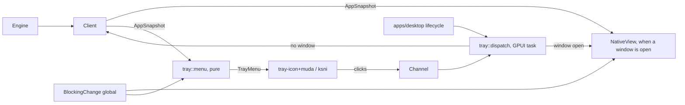

# Menu bar menu: design

Behavior: [menu-bar.md](../menu-bar.md). Decisions: [ADR 0020](../../adr/0020-stay-running-in-the-menu-bar.md), [ADR 0021](../../adr/0021-tray-through-tray-icon-and-ksni.md).

## Parts



| Piece | Crate | Job | Calls for it |
| --- | --- | --- | --- |
| `tray::menu` | `crates/ui` | `fn menu(snapshot, blocking, platform) -> TrayMenu`, pure | D5, D6, rules 7–14 |
| `tray::native` (`cfg(not(target_os = "linux"))`) | `crates/ui` | draws a `TrayMenu` with `tray-icon` + `muda`, updates in place | ADR 0021 |
| `tray::linux` (`cfg(target_os = "linux")`) | `crates/ui` | draws it with `ksni`, reports host availability | ADR 0020, rule 1 |
| `tray::dispatch` | `crates/ui` | turns a `TrayAction` into a view call or a client call | D3, A7 |
| `BlockingChange` global | `crates/ui` | the running blocking change's `Activity`, set by `block` and by dispatch | rule 12, A7 |
| `Client::update_all`, snapshot `updating`, `update_outcome`, `syncing` | `crates/client`, `crates/proto` | running work outside the view | rules 6, 9, 10, 13 |
| hourly source check | `crates/client` | `run_check(UPDATE_CHECK_INTERVAL)` on a timer | rule 11 |
| `Preferences.show_in_tray` | `crates/proto` | the switch, default `true` via `serde(default)` | D1, A8 |
| lifecycle | `apps/desktop` | quit mode, open window, activation policy, reopen, second launch | rules 1–5, D2, D8 |

## Model

```rust
pub struct TrayMenu { pub items: Vec<TrayItem>, pub dot: bool }
pub enum TrayItem {
    Action { id: TrayAction, label: String, enabled: bool, checked: Option<bool> },
    Label { id: &'static str, label: String },   // disabled text
    Separator,
}
pub enum TrayAction {
    ReviewCopies, UpdateAll, LibraryUpdates, ActivatePreset(PresetId),
    CheckAppUpdate, Restart, DownloadAppUpdate, OpenWindow, Quit,
}
```

The menu is derived only from the `AppSnapshot`, the `BlockingChange` global, and the platform (for the quit shortcut text). Each string and condition in rules 7–13 is a case in the module's tests, and no backend reads the snapshot itself. Item ids are stable strings derived from `TrayAction` (a preset's id comes from its `PresetId`). A backend compares the ids of the new model with the ones on screen: if they match, it calls `set_text`, `set_enabled`, and `set_checked` (muda) or `handle.update` (ksni); otherwise it rebuilds the menu. Presets are `CheckMenuItem`s, and the backend applies the model's checked state after every click, because muda has no radio items and toggles a check itself.

The model is recomputed on every snapshot publish and every change to `BlockingChange`. A `tray::Tray` entity in `crates/ui` holds the backend, subscribes to the client's watch channel, and draws only when the `TrayMenu` differs from the last one (`PartialEq`). During a switch, publishes arrive every 100 ms, so the menu redraws at most ten times a second.

## Events

The backend's callback (`MenuEvent::set_event_handler`, `TrayIconEvent` for the Windows left click, or ksni's `activate` and item callbacks) sends a `TrayAction` into a channel. A foreground task spawned with `cx.spawn` awaits it. The callback never touches `App`. Dispatch:

| Action | Window open | No window |
| --- | --- | --- |
| `ActivatePreset` | `view.set_active_preset(id)` | sets `BlockingChange::Switching`, runs `client.change_organization(ActivatePreset)` on the runtime, then clears it |
| `UpdateAll` | `client.update_all()`, whose progress the view reads from the snapshot | same |
| `ReviewCopies` | brings the window forward and opens the review list | opens the window, then the review list |
| `LibraryUpdates` | Library with the Updates filter | opens the window, then the same |
| `CheckAppUpdate` | `client.check_app_update()` | same |
| `Restart` | `view.restart` (unchanged path) | `client.request_restart()`, then `cx.quit()` |
| `DownloadAppUpdate` | `cx.open_url(notes_url)` | same |
| `OpenWindow` | brings it forward | opens it |
| `Quit` | `cx.quit()` | same |

"Window open" means that a `NativeView` entity exists. `apps/desktop` keeps it in a GPUI global, `MainWindow(Option<WindowHandle<Root>>, WeakEntity<NativeView>)`, set when the window opens and cleared in `on_window_closed`.

## Running work

- `BlockingChange(Option<Activity>)` is a GPUI global. The view's `block` sets it before it spawns and clears it when the change lands. `blocked()` reads it instead of view-local state, so a window opened while a menu switch runs shows the strip from its next render: the strip reads `snapshot.activation` for its percentage, as it does today.
- `AppSnapshot.updating: Option<(usize, usize)>` and `AppSnapshot.update_outcome: Option<UpdateOutcome>` replace `NativeView::updating` and `update_outcome`. `Client::update_all()` runs today's loop from `library_updates.rs` on the runtime. It publishes after each skill, scans once at the end, and refuses to start while one runs. The view keeps `busy` for its own buttons. The outcome clears when the next Update all starts or the next source check completes (A3).
- `AppSnapshot.syncing: Option<SyncAction>` replaces `NativeView::syncing`. `Client::synchronize` sets it for the length of the call. Restart's blockers read the snapshot, so the menu's Restart and Settings' Restart agree.
- The hourly source check is a timer in `Client::new`, beside `start_app_update_checks`. It calls `run_check(UPDATE_CHECK_INTERVAL)` and then `refresh_preserving_outcome`.

## Lifecycle (`apps/desktop`)

- `gpui_kit::application().with_quit_mode(QuitMode::Explicit)`.
- `open_main_window(cx, client)` is today's `open_window` body. On macOS it also calls `cx.set_activation_policy(Regular)` and `cx.activate(true)`. Launch, `OpenWindow`, `cx.on_reopen`, and the instance lock's activation watch call it. The watch currently only activates existing windows; it calls `open_main_window` when there are none.
- `on_window_closed`: when no window is left, if `tray.shown()` (the preference is on and the backend is available), set Accessory on macOS. Otherwise call `cx.quit()`.
- The tray is created after `skillbinder_ui::init`, on the main thread, from the preference read out of the first snapshot. It is created and destroyed again as `Preferences.show_in_tray` changes, and destroyed when Linux reports the host gone. If that happens with no window open, the app opens the window, so it is never invisible.
- `on_app_quit` is unchanged.

## Dependencies and policy

- `crates/ui`: `tray-icon = "0.26"` and `muda = "0.21"` under `[target.'cfg(not(target_os = "linux"))'.dependencies]`, and `ksni = { version = "0.3", default-features = false, features = ["blocking", "async-io"] }` under `cfg(target_os = "linux")`. Confirm the exact feature names against ksni 0.3.7's manifest when adding it.
- `xtask/src/graph.rs`: allow them for `skillbinder-ui` only. `THIRD_PARTY_NOTICES.md`: record the MIT/Apache-2.0 licenses (tray-icon, muda) and the Unlicense (ksni).
- Clippy policy: nothing changes. Neither crate needs a denied std API in our code; ksni's threads are its own.
- Icon assets: `assets/tray/` holds `tray-template.png`, `tray-template@2x.png`, `tray-template-dot*.png` (macOS), and light and dark 16/20/24/32 px PNGs (Windows and Linux), drawn from `assets/icon.png`'s mark. AGENTS.md's icon rule records the folder as an exception.

## Risks

- **Linux host detection:** KDE reports a host always. GNOME without the extension fails `spawn`, which is what we want. If some desktop reports a host but draws nothing, the user can turn the switch off, and the app then quits on close.
- **macOS policy flip:** switching to Accessory while a sheet or a Kit dialog is open is not possible, because the window is closed first. Switching back to Regular needs `activate`, or the window opens behind others.
- **muda updates while the menu is open** apply live on macOS and Windows. ksni re-sends the menu, and some hosts redraw it only when it reopens. That is acceptable.
- **Two writers of `BlockingChange`:** dispatch refuses a preset click while it is set, and `set_active_preset` already checks `blocked()`. One change at a time, as today.
- **The off-token ratchet** does not apply: the tray draws no GPUI.
