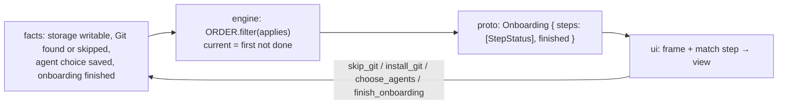

# Onboarding

ADRs: [0010](../adr/0010-onboarding-steps-derived-from-state.md), [0011](../adr/0011-git-is-optional.md), [0012](../adr/0012-chosen-agents.md); partly supersede [0006](../adr/0006-activation-writes-managed-copies.md) and [0007](../adr/0007-pages-list-active-skills.md). Design: [scan-import O7](../design/scan-import/decisions.md). Glossary: [domain.md](../agents/domain.md) (chosen agent, onboarding).

## Problem

A new user goes through five screens before Library: Check this computer, Keep sources separate, Sync is optional, Create your library, and Import your skills (`crates/ui/src/native_view/onboarding.rs:29-49`). Git 2.39 is a hard gate with no help installing it (`crates/engine/src/lifecycle.rs:71-128`), although after the library exists only Sync, update checks, Update, and Reinstall need it. SkillBinder manages every detected agent, so a user cannot keep one out of it. The import step's Review list expands under the summary card and stretches the column (`onboarding_import.rs:110-190`). The step is a stored cursor compared by variant number, so adding or removing a step breaks saved data.

## Outcome

A user with Git reaches Library in two screens, one without Git in three, and never meets a dead end. SkillBinder writes only into the agents the user chose. Steps can be added or removed by editing one list.

## Scope

In: the step list model; the Git step with install and skip; working without Git; the Your agents step; chosen agents across scan, activation, workspaces, the sidebar, and Settings; asking once about newly detected agents; Review list opening the Import skills dialog.

Out: connecting a Sync remote during onboarding; adding workspaces during onboarding; bundling Git; running onboarding again; agents whose global skill directory does not exist.

## Behavior

Decisions:

1. Onboarding has three steps: Git (only when missing), Your agents, Import your skills. Two skippable steps, installing the command and setting up your agents (MCP and the SkillBinder skill), later joined between Your agents and Import ([command-line/onboarding.md](command-line/onboarding.md), ADR 0027). Keep sources separate, Sync is optional, and Create your library are removed; the library is created without asking on the way into Import (ADR 0010).
2. Git is optional. Skipped, the library is a plain directory and the app works except Sync, Push, update checks, Update, and Reinstall, which say they need Git. When Git is found later, the library becomes a repository by itself (ADR 0011).
3. The Git step installs with one click where the system installer does the work: macOS Command Line Tools, Windows winget. Linux shows the command to copy. Every platform links to the download page, and the step rechecks by itself (ADR 0011).
4. Review list opens the Import skills dialog over onboarding (design O7).
5. The dialog's footer reads Done; Done, Escape, and closing keep ticks and versions and return to the step, whose Import is the only button that imports.
6. Newly detected agents are asked about once, in one notice that lists them all and stays until answered: "Found <agent>. Let SkillBinder manage its skills?" with Manage and Not now, or for several, Manage all and Review…, which opens Settings › Agents. Until managed, they stay off (ADR 0012, design N1–N4).
7. Turning an agent off leaves its copies in place, unmanaged (ADR 0012).
8. Settings lists only agents found on this computer.

### Step frame

Every step shows "SkillBinder", "Step N of M" counting only the steps that apply, the title, the lead, then the step's content and buttons. Back appears on every step but the first that applies and returns to the previous one, which shows its saved choice. Quitting and relaunching opens the first step that applies and is not done.

### Data location

When application data is not writable, a step titled "SkillBinder can't save its data" reads "<path> isn't writable." with Check again, and no Skip. It drops out once writable. (Kept from today's prerequisites check; assumption.)

### Git

1. Applies when no usable Git 2.39 or newer is found. Title "Install Git"; lead "Git syncs your library between computers and updates skills from their sources. Everything else works without it, and you can install it later in Settings."
2. macOS: primary "Install Git" runs `xcode-select --install`; the step reads "Finish in Apple's installer." with a spinner. Install Git stays available while waiting, so a cancelled installer can be started again.
3. Windows: with winget available, primary "Install Git" runs winget, which asks for permission; the step waits the same way. Without winget, or if it fails, the primary is "Download Git".
4. Linux: the step shows the command for the package manager named by `/etc/os-release` (`sudo apt install git`, `sudo dnf install git`, `sudo pacman -S git`, `sudo zypper install git`) with Copy, or only "Download Git" when none matches.
5. Every platform shows "Download Git", opening `https://git-scm.com/downloads`, and Skip. While the step is open the app checks for Git every 3 seconds and on focus; once found, the step reads "Git <version> is ready" and moves on by itself after a moment.
6. A Git older than 2.39 titles the step "Update Git" and reads "Git <version> is too old. SkillBinder needs 2.39 or newer." with the same actions.

### Your agents

1. Title "Choose your agents"; lead "SkillBinder adds and removes skills only in the agents you choose. You can change this later in Settings."
2. One tile per Agents-section row, in a three-column grid (design P3, P6): Universal first, spanning all three columns with its members' logos and naming its agents in muted text, then each other detected agent alphabetically. Each tile has the agent's logo, a round check, its name, and its global skill directory in muted text; a chosen tile is outlined. All start chosen.
3. Continue saves the choice; zero ticked is allowed. With no agent detected it reads "No agents found on this computer. SkillBinder will ask when it finds one." with Continue.
4. Continue creates the library if it does not exist, then opens Import.

### Import your skills

As today (design O1, O2, O4, O5), scanning only your agents' global skill directories, so the summary names chosen agents only. Review list (O7) opens the Import skills dialog, titled "Import skills", with no status line or group header, and a footer with the acknowledgement or cap note and a primary Done (decision 5). Import and Skip finish onboarding into Library. With zero chosen agents the step reads the nothing-found message.

### Without Git

1. Sync shows "Sync needs Git." with Install Git, and no remote controls.
2. Library's update control and a skill's Reinstall and Update are unavailable with the tooltip "Install Git to check for updates" or "Install Git to reinstall".
3. Settings' Git row shows "Not installed" with Install Git, which behaves as the step's primary action and shows its waiting state in Settings.
4. When Git is found, the library becomes a repository; everything stays uncommitted until Sync or Push.

### Chosen agents after onboarding

1. Only chosen agents: are scanned; appear in the sidebar's Agents section and have pages; count in All your agents; receive copies; give a workspace its skill directories; show in Library rows' agent marks and the Add skill picker. A route to an unchosen agent's page opens Library.
2. Settings gains an Agents section above Application, listing the same agents as rows, each with a Kit Switch (design P4). Turning one on applies the active preset to it under the progress strip, adopting copies with the library's content and raising conflicts for others, as any change that writes copies. Turning one off saves at once and leaves its copies unmanaged; the row reads "Its skills stay in place."
3. Detected agents whose global skill directories are not chosen and were never asked about show the decision 6 notice, after onboarding and never while the progress strip blocks the app. Manage or Manage all turns them on as above; Not now, Review…, and closing leave them off. Every answer is remembered for every agent it lists.
4. A preset or workspace that holds a skill for specific agents keeps an unchosen one in its list and writes nothing for it until it is chosen again.

## UX

Surfaces: the onboarding frame and its steps; the Import skills dialog with a Done footer; Settings (Agents section, Git row); Sync's no-Git state; Library's update control and Reinstall tooltips; the new agent notice. The approved design is [docs/design/onboarding](../design/onboarding/README.md): frame A "Counter eyebrow", Git A "Primary action", agents C "Logo tiles", Settings A "Switch list", notice A "Corner card". Its [decisions.md](../design/onboarding/decisions.md) holds the rules (ids F, T, A, S, N, P), and its README holds the states, component map, copy, and interactions; where they are more specific than this spec, they hold. The Review list dialog follows [scan-import O7](../design/scan-import/decisions.md). Sync's no-Git state and the Library tooltips have no prototype and follow existing patterns.

## Design

- **Step list** (ADR 0010): `proto::OnboardingStep { DataLocation, Git, Agents, Import }` replaces the cursor enum. The engine's `onboarding` module holds `ORDER` and two exhaustive `match`es, `applies(step, &Facts)` and `done(step, &Facts)`, and publishes `Onboarding { steps: Vec<StepStatus>, finished }` in `Bootstrap`. `set_onboarding` and `create_library` are removed; `skip_git`, `install_git`, `choose_agents`, and `finish_onboarding(Option<ImportSelection>)` each settle one fact and are idempotent. `finish_onboarding` refuses while an earlier step that applies is not done. Adding a step: a variant, a place in `ORDER`, two match arms, a UI view arm.
- **Facts storage**: `device_settings` keys `onboarding_finished` and `git_skipped` (booleans) and `agents` (`AgentChoices { chosen, asked }`, sets of global skill directories; `choose_agents` marks every directory the step showed as asked, ticked or not, and a Settings switch marks its directory, so chosen implies asked). No migration: the table is key-value. The old `onboarding` key is read once: `Complete` sets `onboarding_finished` and chooses and marks asked every detected agent; then the key is deleted.
- **Library without Git** (ADR 0011): `ensure_library` stages and publishes `skills/` without Git; `ensure_repository` runs the existing `git.initialize` whenever Git is found (open, bootstrap, the step's check) and the library has no `.git`. Sync, source checks, Update, and Reinstall already report or skip without Git; their snapshot fields gain the reason so the UI can say "needs Git".
- **Finding Git**: `Git::discover` keeps walking `PATH` but tries every candidate instead of stopping at the first, adds `/opt/homebrew/bin`, `/usr/local/bin`, `%ProgramFiles%\Git\cmd`, and `%LocalAppData%\Programs\Git\cmd`, and on macOS uses `/usr/bin/git` only when `xcode-select -p` names a directory holding `usr/bin/git`.
- **Installing Git**: `engine::git::install` returns `GitInstall { AppleInstaller, Winget, Command(String), DownloadOnly }` for the snapshot and runs the first two as detached processes. The UI opens the download URL through GPUI's `open_url`.
- **Chosen agents** (ADR 0012): `AgentOption` gains `chosen` and `asked`. One engine function, `chosen_agents()`, replaces detected-agent filtering in `scan/registry.rs` (`locations`, `agent_options`), `activation/targets.rs`, `activation/adoption.rs`, and `workspaces/activation.rs`; `detected_agents()` in the UI becomes `your_agents()`. Turning an agent off drops the copy records of its global skill directory, and of each workspace skill directory that no other chosen agent reads, which makes those copies unmanaged; a workspace keeps the directory in its list but writes nothing there while no chosen agent reads it. Turning the agent back on uses those directories again, adopting copies with the library's content and raising conflicts for others, as adding a workspace does.
- **Review dialog**: `ImportDialog` gains an end mode, `Import` or `Done`; onboarding opens it in a Kit dialog over its own `FirstImport.list`, so ticks need no copying.
- **UI layout**: `native_view/onboarding.rs` is the frame; `onboarding/` holds `data_location.rs`, `git.rs`, `agents.rs`, and the moved `import.rs`. Settings gains `settings/agents.rs`.
- **Tests and tooling**: engine tests replace `onboarding_requires_each_step_and_survives_restart`; `tests/support/imports.rs::onboard`, the client `ready()` helper, `apps/desktop/src/native_test.rs::prepare`, and `xtask/src/mcp_smoke.rs` walk the new steps; the onboarding baselines in `fixtures/baseline/` are recaptured.

Docs each slice updates: `docs/features/native/onboarding.md` (split from `setup-and-shell.md`), `imports.md` (First boot), `sync-and-durability.md`, `activation.md`, `workspace-activation.md`, `application-shell-continued.md`, `docs/architecture/native.md`, `README.md`, the `fixtures/contracts/ui-copy.md` superseded notes, and the glossary markers that point here.

## Assumptions

- Agents whose directory does not exist are not offered in the step either (Settings: decision 8).
- Zero chosen agents is allowed. If wrong: Continue disabled at zero.
- Back moves between steps; "Step N of M" counts only steps that apply.
- The data location check stays as a step that applies only when storage is not writable.
- Turning an agent on or off needs no confirmation; a managed agent turned off shows "Its skills stay in place."
- Closing the new-agent notice counts as Not now.
- "Its skills stay in place." shows for an agent turned off since the app started; after a restart the row shows its folder again. If wrong: persist a set of turned-off directories.
- The notice names the universal agents Universal, as the sidebar and Settings do.
- Developer data at `Complete` keeps every detected agent chosen; anything earlier restarts onboarding, keeping an existing library directory.
- The Git step polls every 3 seconds while open. If wrong: only Check again and focus.

## Acceptance

1. With Git, a first launch shows "Step 1 of 2 · Choose your agents", then Import; no other screen appears.
2. Without Git, it shows "Step 1 of 3 · Install Git"; Skip leads to Your agents, and onboarding finishes with a library that has no `.git`.
3. Installing Git while the step is open moves to Your agents without a click; on macOS with no Command Line Tools, checking never opens Apple's prompt.
4. Without Git, Sync shows "Sync needs Git."; Update and Reinstall are unavailable with their tooltips; Settings shows Install Git. After Git is installed and the app regains focus, the library is a repository and Sync works.
5. Unticking Cursor in Your agents: the import summary and dialog list no skill found only in Cursor, the sidebar has no Cursor row, and no copy is written to `~/.cursor/skills`.
6. Universal is one row; choosing it chooses every agent that reads `~/.agents/skills`.
7. Settings turns Cursor on: the active preset's skills for all your agents are written there under the progress strip. Turning it off leaves the files and later preset changes do not touch them.
8. A new agent's directory appearing after onboarding shows the notice once; Not now leaves it off across restarts. An agent unticked in Choose your agents, or turned off in Settings, never gets the notice.
9. Review list opens the Import skills dialog; unticking a skill and pressing Done or Escape updates "Import N skills" on the step; Import imports only the ticked ones.
10. Quitting on any step and relaunching resumes at the first unsettled step; repeating any step action is harmless.
11. Developer data saved at `Complete` opens Library with every detected agent chosen.
12. `cargo fmt --all --check`, workspace Clippy, `cccc .`, workspace tests, `cargo run -p xtask -- verify`, and a locked release build pass.

## Slices

1. **Onboarding is a derived step list with two steps.** The step model, facts, and legacy mapping; Keep sources separate, Sync is optional, and Create your library removed; the library created on the way into Import; Git and data location as steps that apply only when missing (Git still required here, no Skip); Your agents not yet present. Checks: 10, 11, 12; engine tests for applies/done and idempotency; mcp smoke and baselines updated. Depends on: nothing.
2. **Review list opens the Import skills dialog.** End mode Done; O7. Checks: 9, 12; native interaction check. Depends on: nothing (touches the import step after slice 1 if both are open).
3. **Git is optional.** Skip, plain library, `ensure_repository`, the safe macOS probe and extra locations, the no-Git states in Sync, Library, skill pages, and Settings. Checks: 2, 4, 12; domain tests for a library created without Git and made a repository later. Depends on: 1.
4. **Install Git from the step.** macOS installer, winget, Linux command with Copy, download link, polling. Checks: 3, 12; native check per platform where available, recorded as such. Depends on: 3.
5. **Choose your agents.** The step, `AgentChoices`, `chosen_agents()` across scan, activation, adoption, workspaces, and UI. Checks: 1, 5, 6, 12; domain tests that unchosen directories are neither scanned nor written. Depends on: 1.
6. **Change agents later.** Settings Agents section with switches and the new-agent notice. Checks: 7, 8, 12. Depends on: 5.

## Open questions

None.
