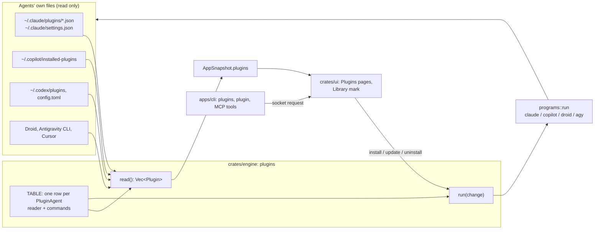

# Plugins: design

Companion to [the Plugins spec](../plugins.md). Decision ids (P, U, A) are the spec's.

## Shape

Plugins is a supporting part of SkillBinder, built light: no new crate, no stored state, no new dependency. It follows Connect's pattern (ADR 0026, `crates/engine/src/mcp_clients.rs`): one engine table says, per agent, where its plugin records are and which program changes them. Each agent's records are an outside model with an undocumented or loosely documented format, so each row's reader is the translator: it turns that agent's files into the same `PluginInstall`, and nothing outside the row knows the agent's format.

## Technical decisions

- **T1. An engine module `plugins` with a per-agent table** (P1, P2, ADR 0026). `crates/engine/src/plugins.rs` plus `plugins/` holds `TABLE: [Row; 6]`, one per `PluginAgent`: the registry id it serves, its reader, its program name, and argument builders for marketplace add, install, update, and uninstall, or `None` for Codex and Cursor. Its tests cover each row's arguments, as `mcp_clients/tests.rs` does with fake programs on a temporary `PATH`.
- **T2. Readers translate each agent's records into `PluginInstall`** (P2, P4, P7). A row's reader returns the user-scope installs: plugin name, marketplace name and source (repository or Git URL) when known, version, Off, and install path. Claude Code's reads `installed_plugins.json` (version 2; entries with `scope: "user"` only), `known_marketplaces.json` for sources, and `enabledPlugins` in `settings.json` for Off, honoring `CLAUDE_CONFIG_DIR` and `CLAUDE_CODE_PLUGIN_CACHE_DIR`. The other rows read the folders in the table below. A missing folder is no plugins; an unreadable or malformed record is that agent's read error, shown on the list (Plugins list 3) and logged with its cause (ADR 0032), never "no plugins".
- **T3. Manifests and skills come from the install path** (A7, U2, U3). The reader opens the manifest (`.claude-plugin/plugin.json`, root `plugin.json`, `.codex-plugin/`, `.cursor-plugin/`, `.factory-plugin/`, `.antigravity-plugin/`, in that order) for description, version, and repository, and lists skills from `skills/*/SKILL.md` plus any `skills` paths the manifest names, reading each skill's front matter with the payload module's parser. Reads are bounded like the scan's walk: depth, entries, and file size, so a huge plugin can't stall the read.
- **T4. `PluginId` is name plus marketplace** (A5). `PluginId { name, marketplace: Option<String> }` merges installs across agents; a local plugin (`marketplace: None`) is also keyed by its agent, so two agents' local plugins of one name stay apart.
- **T5. Plugins ride the snapshot; bodies load on demand** (U1, P3, Lifecycle 1). `AppSnapshot.plugins: PluginsSnapshot { plugins: Vec<Plugin>, errors: Vec<(PluginAgent, AppError)>, reading: bool }`, where `Plugin` holds its id, description, repository, skills (slug, description), and one `PluginInstall` per agent. The client reads it in `refresh_app` beside the scan (launch, focus), after `set_agents_chosen`, and after each plugin command. README and SKILL.md bodies come from `client.preview_plugin(id)` and `client.preview_plugin_skill(id, slug)`, capped like `preview_skill`. Nothing is written to the database or the library (ADR 0004).
- **T6. Commands run through `programs`** (P1, P6, A3). `client.change_plugin(PluginChange { plugin, agent, action: Install { add_marketplace } | Update | Uninstall })`. The engine finds the program as Connect does (PATH, then usual locations), runs it with a 120-second timeout and the shutdown signal, one command per agent at a time, and maps a non-zero exit to an error carrying the program's last stderr line, with the full output logged. Install runs `marketplace add <source>` first when `add_marketplace` and the agent's records lack the marketplace; without the flag in that case it fails with `MarketplaceMissing { name, source }`, which the UI turns into P6's dialog and the command line into its refusal (A12). The source comes from any agent that records it; with none, Install is not offered (A2).
- **T7. Behind is a semver comparison across installs** (P8, A10). `Plugin::behind(agent)` is true when that install's version and a higher one both parse as semver (leading `v` allowed). No network.
- **T8. Overlap is derived in the UI** (P3, ADR 0035). `snapshot_query` gains `plugins_sharing(slug)`, comparing slugs the way the library does; Library rows and the plugin skill page read it.
- **T9. Routes and pages** (U1–U3). `Route::Plugins`, `Route::Plugin(PluginId)`, `Route::PluginSkill(PluginId, String)` in `crates/ui/src/native_view/route.rs`; a nav row under Library in `sidebar.rs`; pages in `crates/ui/src/native_view/plugins/` (list, page, agent rows, skill page) built from the design crate's components and `untrusted_markdown`. A route whose plugin is gone falls back to `Route::Plugins` (`navigation.rs`).
- **T10. Command line and MCP** (A12, ADR 0023, 0025). `Query::Plugins { plugin: Option<String> }` and `Change::Plugin(PluginChange)` in `proto/src/command_line/request.rs`, dispatched through `ui/src/commands`; grammar `plugins [<plugin>]` and `plugin install|update|uninstall <plugin> --agent <id> [--add-marketplace]`; MCP tools `list_plugins`, `get_plugin`, `install_plugin`, `update_plugin`, `uninstall_plugin`.
- **T11. Test worlds** (AGENTS.md verification). The development world and native-test synthetic home gain a `~/.claude/plugins` with three plugins (one Off, one with a library-overlapping skill, one local) and a `~/.copilot/installed-plugins` with one behind; engine tests use fake `claude` and `copilot` scripts that record their arguments and edit the fixture records, so a command's effect shows on the next read.
- **T12. Icon** (A11). The sidebar row and plugin glyphs use retained Hugeicons `PuzzleIcon.svg`, added to the asset source's map.

## Per-agent table

| `PluginAgent` | Registry id | Reads (user scope) | Program | Install | Update | Uninstall |
| --- | --- | --- | --- | --- | --- | --- |
| ClaudeCode | `claude-code` | `installed_plugins.json`, `known_marketplaces.json`, `settings.json` `enabledPlugins` | `claude` | `plugin install 
@<m> --scope user` | `plugin update 
@<m>` | `plugin uninstall 
@<m> --scope user` |
| GitHubCopilot | `github-copilot` | `~/.copilot/installed-plugins/<m>/
/` and its manifest | `copilot` | `plugin install 
@<m>` | `plugin update 
@<m>` | `plugin uninstall 
@<m>` |
| Droid | `droid` | its plugin cache under `~/.factory` (confirmed in S5) | `droid` | `plugin install 
@<m> --scope user` | confirmed in S5 | confirmed in S5 |
| AntigravityCli | `antigravity-cli` | `~/.gemini/config/plugins/
/` | `agy` | `plugin install …` (confirmed in S6) | confirmed in S6 | `plugin uninstall 
` |
| Codex | `codex` | `~/.codex/plugins/cache/<m>/
/<version>/`, `[plugins."
@<m>"] enabled` in `config.toml` | none | hint | — | — |
| Cursor | `cursor` | `~/.cursor/plugins/cache/<m>/
/<hash>/`, `~/.cursor/plugins/local/
/` | none | hint | — | — |

Marketplace add is `plugin marketplace add <source>` for each program with an installer. Sources: [Claude Code plugins](https://code.claude.com/docs/en/discover-plugins), [loading](https://code.claude.com/docs/en/plugins/loading.md), [Copilot CLI plugin reference](https://docs.github.com/en/copilot/reference/copilot-cli-reference/cli-plugin-reference), [Droid plugins](https://docs.factory.com/cli/configuration/plugins), [Antigravity plugins](https://antigravity.google/docs/plugins.md), [Codex plugins](https://developers.openai.com/codex/plugins/build), [Cursor plugins](https://cursor.com/docs/plugins); Cursor's cache layout is observed, not documented. Each slice that adds a row records its sources in the row's doc comment and checks the commands against the agent's current `--help`.

## Risks

- **Undocumented records.** Claude Code's JSON schemas, Cursor's cache, and Droid's cache can change without notice. A changed format shows as a read error for that agent, not as missing plugins (T2), and the readers' tests pin the formats seen.
- **Installers that prompt.** A program waiting for input would hang; programs run with stdin closed and a timeout (T6), and a prompt shows as that error.
- **A shared marketplace name.** Two marketplaces with one name merge their plugins (A5).
- **More agents, more rows.** VS Code's agent plugins and others can join only as new table rows with their own readers; the page needs no change.
- **Third-party code.** Install and Update put a plugin's hooks, scripts, and MCP servers into an agent. The user acts per agent and plugin, and P6 names the marketplace before it is added.
