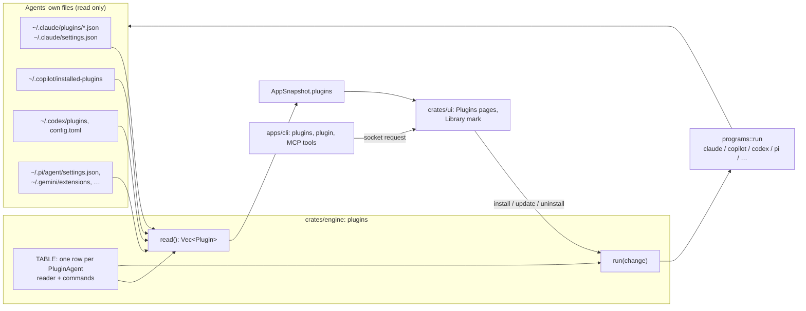

# Plugins: design

Companion to [the Plugins spec](../plugins.md). Decision ids (P, U, A) are the spec's.

## Shape

Plugins is a supporting part of SkillBinder, built light: no new crate, no stored state, no new dependency. It follows Connect's pattern (ADR 0026, `crates/engine/src/mcp_clients.rs`): one engine table says, per agent, where its plugin records are, which plugin formats it takes, and which program changes them. Each agent's records are an outside model with an undocumented or loosely documented format, so each row's reader is the translator: it turns that agent's files into the same `PluginInstall`, and nothing outside the row knows the agent's format.

## Technical decisions

- **T1. An engine module `plugins` with a per-agent table** (P1, P2, P9, ADR 0026). `crates/engine/src/plugins.rs` plus `plugins/` holds one `Row` per `PluginAgent`: the registry id it serves, the agent's own word for a plugin, its reader, the formats it takes, its program name, and argument builders for marketplace add, install, update, and uninstall, each `None` where the installer lacks it. Rows are added a few per slice ([Agents](plugin-agents.md)); each row's file names its sources and has tests for its reader and its arguments, as `mcp_clients/tests.rs` does with fake programs on a temporary `PATH`.
- **T2. Readers translate each agent's records into `PluginInstall`** (P2, P4, P7). A row's reader returns the user-scope installs: plugin name, source (T4) when known, version, Off, and install path. Claude Code's reads `installed_plugins.json` (version 2; entries with `scope: "user"` only), `known_marketplaces.json` for each marketplace's repository, the plugin's entry in that marketplace's `marketplace.json` for where the plugin itself lives, and `enabledPlugins` in `settings.json` for Off, honoring `CLAUDE_CONFIG_DIR` and `CLAUDE_CODE_PLUGIN_CACHE_DIR`; Pi's reads `packages` in `~/.pi/agent/settings.json`, whose entries are the sources themselves (`git:…`, `npm:…`). The other rows read the records in [Agents](plugin-agents.md). A missing folder is no plugins; an unreadable or malformed record is that agent's read error, shown on the list (Plugins list 3) and logged with its cause (ADR 0032), never "no plugins".
- **T3. Manifests and skills come from the install path** (A7, U2, U3). The reader opens the manifest (`.claude-plugin/plugin.json`, root `plugin.json`, `.codex-plugin/`, `.cursor-plugin/`, `.factory-plugin/`, `.antigravity-plugin/`, in that order) for description and version, and the counts of its hooks, MCP servers, and commands for P11's dialog, notes which formats the plugin has (`PluginFormats`: Claude, Agent Plugins, Codex, Gemini extension, Pi package, …), and lists skills from `skills/*/SKILL.md` plus any `skills` paths the manifest names, reading each skill's front matter with the payload module's parser. Reads are bounded like the scan's walk: depth, entries, and file size, so a huge plugin can't stall the read.
- **T4. A plugin is identified by name and where it lives** (A5). Two repositories are kept apart: the marketplace's, which `marketplace add` takes, and the plugin's own location, `PluginLocation { repository, path, git_ref }`, which identity and repository installs use. `PluginSource` is `Marketplace { name, repository: Option<Repository>, plugin: Option<PluginLocation> }`, `Git(PluginLocation)`, `Npm(String)`, or `Local`. A marketplace entry gives the plugin's location in one of three shapes, all on the owner's machine in `claude-plugins-official`: a folder of the marketplace's repository (`frontend-design` at `./plugins/frontend-design`), another repository's root (`mattpocock-skills` at `mattpocock/skills`), or another repository's folder (`expo` at `expo/skills`, `plugins/expo`). Two installs are one plugin when their names and locations match, or, where an agent records no location, their names and marketplace names; a local plugin is also keyed by its agent, so two agents' local plugins of one name stay apart.
- **T5. Plugins ride the snapshot; bodies load on demand** (U1, P3, Lifecycle 1). `AppSnapshot.plugins: PluginsSnapshot { plugins: Vec<Plugin>, errors: Vec<(PluginAgent, AppError)>, reading: bool }`, where `Plugin` holds its id, description, repository, skills (slug, description), and one `PluginInstall` per agent. The client reads it in `refresh_app` beside the scan (launch, focus), after `set_agents_chosen`, and after each plugin command. README and SKILL.md bodies come from `client.preview_plugin(id)` and `client.preview_plugin_skill(id, slug)`, capped like `preview_skill`. Nothing is written to the database or the library (ADR 0004).
- **T6. Commands run through `programs`; the row picks the install form** (P1, P6, P9, A3). `client.change_plugin(PluginChange { plugin, agent, action: Install { add_marketplace } | Update | Uninstall })`. The row's `install_from(&Plugin)` answers `Marketplace(name)`, `Repository(url)`, `Npm(pkg)`, or `CantUse(reason)` from the plugin's formats and source and the formats the row takes: Copilot installs `fstack@fedemas`, Pi `git:github.com/mastro993/fstack` from the plugin's location, Gemini CLI can't use a Claude plugin (P9). An installer that takes only a repository's root (Pi, Gemini CLI) can't use a plugin that lives in a folder of its repository, such as `frontend-design`, or whose location no agent records (P9). The engine finds the program as Connect does (PATH, then usual locations), runs it with stdin closed, a 120-second timeout, and the shutdown signal, one command per agent at a time, and maps a non-zero exit to an error carrying the program's last stderr line, with the full output logged. A marketplace install whose marketplace the agent lacks runs `marketplace add <marketplace repository>` first when `add_marketplace`; without it, it fails with `MarketplaceMissing { name, repository }`, which the UI turns into P11's dialog and the command line into its refusal (A12). A local plugin, or one whose marketplace the agent lacks with that marketplace's repository known from no agent, shows Install disabled with "No source to install from" (A2). Flags that skip an agent's own trust prompt (`--trust`, `--yes`) are passed because P11's dialog has asked instead; stdin is closed, so the prompt could not be answered anyway.
- **T7. Behind is a semver comparison across installs** (P8, A10). `Plugin::behind(agent)` is true when that install's version and a higher one both parse as semver (leading `v` allowed). No network. Update runs the row's own per-plugin update (`plugin update`, Pi's `pi update <source>`); a row whose only update acts on a whole marketplace, as Codex's `plugin marketplace upgrade <m>` appears to, has no Update (A8) unless S4 finds a per-plugin form.
- **T8. Overlap is derived in the UI** (P3, ADR 0035). `snapshot_query` gains `plugins_sharing(slug)`, comparing slugs the way the library does; Library rows and the plugin skill page read it.
- **T9. Routes and pages** (U1–U3). `Route::Plugins`, `Route::Plugin(PluginId)`, `Route::PluginSkill(PluginId, String)` in `crates/ui/src/native_view/route.rs`; a nav row under Library in `sidebar.rs`; pages in `crates/ui/src/native_view/plugins/` (list, page, agent rows, skill page) built from the design crate's components and `untrusted_markdown`. A route whose plugin is gone falls back to `Route::Plugins` (`navigation.rs`).
- **T10. Command line and MCP** (A12, ADR 0023, 0025). `Query::Plugins { plugin: Option<String> }` and `Change::Plugin(PluginChange)` in `proto/src/command_line/request.rs`, dispatched through `ui/src/commands`; grammar `plugins [<plugin>]` and `plugin install|update|uninstall <plugin> --agent <id> [--add-marketplace]`; MCP tools `list_plugins`, `get_plugin`, `install_plugin`, `update_plugin`, `uninstall_plugin`.
- **T11. Test worlds** (AGENTS.md verification). The development world and native-test synthetic home gain a `~/.claude/plugins` with three plugins (one Off, one with a library-overlapping skill, one local) and a `~/.copilot/installed-plugins` with one behind; engine tests use fake `claude` and `copilot` scripts that record their arguments and edit the fixture records, so a command's effect shows on the next read.
- **T12. Icon** (A11). The sidebar row and plugin glyphs use retained Hugeicons `PuzzleIcon.svg`, added to the asset source's map.

## Per-agent table

The rows, what each reads and runs, the formats each takes, and the slice that adds it are in [Agents](plugin-agents.md).

## Risks

- **Undocumented records.** Claude Code's JSON schemas and the caches of Droid, OpenClaw, Kode, Deep Agents, and others can change without notice. A changed format shows as a read error for that agent, not as missing plugins (T2), and the readers' tests pin the formats seen.
- **Installers that prompt.** A program waiting for input would hang; programs run with stdin closed and a timeout (T6), and a prompt shows as that error.
- **A shared marketplace name.** Two marketplaces with one name merge their plugins (A5).
- **Many rows to keep current.** 24 agents' installers change on their own schedules. Each row is small and tested alone, and an agent that breaks shows a read or command error without affecting the others; app-only agents can join later as rows with a hint and no commands, with no page change.
- **Format guesses.** Whether an agent can use a plugin is decided from manifests on disk (P9); an agent that accepts more than its docs say is shown as can't use until its row learns the format.
- **Third-party code.** Install and Update put a plugin's hooks, scripts, and MCP servers into an agent, some agents' trust prompts skipped (T6). Every Install confirms first, naming the plugin, its source, what it adds, and the commands (P11); Update installs a newer version of a plugin the user already trusted there, so it does not ask.
