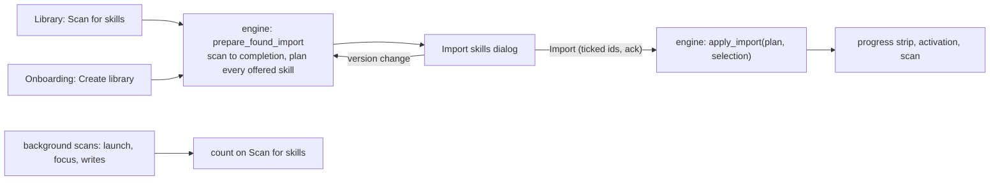

# Scan and import

ADRs: [0008](../adr/0008-import-from-scan-dialog.md), [0009](../adr/0009-prepare-once-apply-selection.md); partly supersedes [0007](../adr/0007-pages-list-active-skills.md). Glossary: [domain.md](../agents/domain.md) (Import skills dialog, scan).

## Problem

Importing found skills lives in two places that work differently. Onboarding's last step offers an all-or-nothing import of your agents' skills (`OnboardingStep::Import`, `crates/engine/src/imports/first.rs`). Everything else goes through Discovery, a sidebar page with its own selection, a separate Review import dialog, and a persistent result banner (`crates/ui/src/native_view/discovery.rs`, `dialogs.rs:113`). Library's header already has an Import button, but it only navigates to Discovery (`library_updates.rs:70`). Library has no empty state: with no skills it renders nothing (`library_filters.rs:203`), so a user who skipped onboarding's import has no visible way back to it.

## Outcome

Import happens in exactly two places, which show one Import skills dialog: onboarding, when the library is new, and Library's Scan for skills button. Discovery and its sidebar row are gone. Users notice new found skills through the count on Scan for skills. Activation, copy retries, and source learning behave exactly as today.

## Scope

In: the Import skills dialog; Scan for skills with its count; Library's empty state; onboarding using the dialog; removing Discovery, its route, sidebar row, fallbacks, and result banner; renaming the `discovery` code modules to `scan`.

Out: install from a source; a remembered list of skipped skills; deleting library skills; any change to activation, managed copies, plan expiry, or import refusals; when background scans run.

## Behavior

Decisions:

1. Only importing changes. Background scans keep running on launch, on focus, and after every change that writes copies; Discovery and its sidebar row are removed (ADR 0008).
2. When the dialog opens, every importable skill whose chosen version is valid is ticked, up to 500. Skills the user skipped before come back ticked.
3. Scan for skills shows a count of the found skills that are not in library, from the latest completed scan, counting a skill with several versions once. Skipped skills keep counting until imported; the user chose this over counting only skills not yet seen. With none, it shows no count.
4. Selection and review are one dialog, used by onboarding and by Scan for skills alike (ADR 0009).
5. A search field above the list filters rows by slug and description. Select all and the Import count cover every ticked skill, including rows the search hides.

### Scan for skills

1. Library's header shows Scan for skills where Import is today: a ghost button with the Hugeicons folder-search glyph and the tooltip "Scan for skills", followed by a quiet muted count from decision 3 (design L1–L3). It is unavailable while another operation runs, like the update control beside it.
2. Clicking it starts a scan, replacing a running one, and opens the dialog at once in its loading state: "Scanning…" with a spinner. When the scan completes, the engine prepares the plan and the dialog shows the list.
3. A scan that finds nothing to import shows "No new skills found." with Close.
4. A failed scan or preparation shows its error in the dialog with Retry and Close.

### Import skills dialog

1. Title "Import skills". The status line reads "N found · M already in library", as Discovery's did. A search field sits above the list (decision 5).
2. Rows are grouped by place: "Your agents" first, then each workspace in sidebar order, each group with a tri-state checkbox and a count; a skill found in several places is listed once, under its first location's place (design D3). Each row has a checkbox labelled with the slug and the chosen version's description, then, for one version, its locations as "path · readers", "N files · B bytes", and validation messages; for several versions, the "N versions" disclosure that opens one Kit Radio per version, as in Discovery today. Each row also lists "Replaces the copy in <place>." for each replacement its version makes.
3. Blocked skills and skills whose versions all lack files are listed with a disabled checkbox. Invalid skills start unticked; ticking one shows the acknowledgement checkbox, and Import stays inactive until it is checked.
4. Select all ticks every importable skill, up to 500. With more than 500 found, the rows after the first 500 importable ones start unticked, and ticking past 500 shows "Import at most 500 at a time." and disables Import.
5. Choosing another version prepares the plan again and keeps every tick; the row shows that version's replacements.
6. The primary button reads "Import N skills" for N ticked, and is inactive at zero. Cancel, Escape, or closing the dialog imports nothing.
7. Import closes the dialog and runs the import under the progress strip, which ends with "Imported N skills" (unchanged). When the plan has expired, the dialog stays open, prepares the plan again with the same ticks, and shows the refreshed rows; the user presses Import again.
8. A background scan that completes while the dialog is open does not change it; the dialog shows its own plan.

### Onboarding

1. "Create library" goes to the "Import your skills" step. After its scan, a summary card shows the agents' avatars and "N skills found in <agents>"; a collapsed "Review list" disclosure expands the dialog's list inline, with one place and so no group header, and no status line (design O1–O5). Loading, empty, and error states match the dialog's. Before any workspace exists, the scan covers your agents' global skill directories alone.
2. The step offers Skip and the primary "Import N skills". Import applies the ticked skills into the Default preset and finishes onboarding; Skip finishes it without importing. With nothing found it reads "No skills to import were found in your agents." with Continue.
3. The lead reads "Importing copies these skills from your agents into your library, each staying active for the agents that have it. You can import others later with Scan for skills in Library." The source boundaries step, which names Discovery today, reads "SkillBinder reads your agents' skills and your workspaces. Importing a skill copies it into your private library."
4. Onboarding now also offers skills it would make active nowhere, such as one found only through a link or in a Git checkout; ticked, they import inactive.

### Library empty state

A library with no skills, with no folder or filter narrowing it, shows "No skills in your library yet" with a primary "Scan for skills" button that behaves as the header's. Nothing opens by itself.

### Removing Discovery

1. The sidebar has no Discovery row; Library is the first row. The app's starting route is Library.
2. A removed workspace's page, the page of an agent no longer detected, and Universal's page with no universal agent left open Library instead of Discovery.
3. The persistent "Import finished: N copied, M already in library" banner and its Dismiss are removed, with the engine's stored import outcome behind them.

## UX

Surfaces: Library header (Scan for skills replaces Import), Library empty state, the Import skills dialog (new, replacing the Discovery page and the Review import dialog), onboarding's last step, and the sidebar (Discovery row removed). The approved design is [docs/design/scan-import](../design/scan-import/README.md): Library entry B "Inline count", Import dialog C "Grouped by place", Onboarding B "Summary first". Its [decisions.md](../design/scan-import/decisions.md) holds the rules (ids L, D, O), and its README holds the component map, copy, and interactions. Where they are more specific than this spec, they hold.

## Design

- One engine preparation, `prepare_found_import`, serves both entry points: it runs a scan to completion, replacing a running one, then plans every offered skill from it, holding invalid ones marked (ADR 0009, decisions 2 and 4). It replaces `prepare_first_import` and its synchronous `scan_global`, and `prepare_import`'s selection-based path.
- `apply_import` takes the plan id, the ticked skills, and the invalid acknowledgement, and refuses a skill not in the plan, more than 500, or an unacknowledged invalid one; it keeps every existing refusal and idempotent replay (ADR 0009). `complete_onboarding` takes the same selection.
- A plan expired at Import is prepared again by the dialog and shown before applying, so replacements are never applied unseen (ADR 0006, ADR 0009).
- The selection state (`selected_skills`, `version_choices`, `expanded_skills`, `acknowledge_invalid` in `native_view.rs`) moves into the dialog's own state, created when it opens and dropped when it closes, replacing the reset in `navigation.rs::leave_page` and the pruning in `updates.rs::receive` (decision 4).
- The count on Scan for skills reuses the sidebar's existing computation, `found_skills(&not_in_library()).len()` over `snapshot.scan` (decision 3); background scans are untouched (decision 1).
- Removed: `Route::Discovery`, `discovery.rs`, the `import_plan_dialog`, `render_import_outcome`, `dismiss_import`, the `import_outcome` setting, and the Discovery sidebar row; the fallbacks in `updates.rs`, `navigation.rs`, and `agent_page.rs` target `Route::Library`. The native test step that opens Discovery opens Scan for skills instead.
- Renamed, with no behavior change: the engine's and proto's `discovery` modules become `scan`, and the scan thread `skillbinder-scan`, so code no longer names the retired view (glossary).
- Module layout: `crates/ui/src/native_view/import_dialog.rs` with an `import_dialog/` folder for rows (from `discovery.rs`), versions (from `discovery_versions.rs`), and review lines (from `import_review.rs`); onboarding renders the same list component. Each stays under the `cccc` limits and the 5,000-token hook.

Docs each slice updates: `docs/features/native/discovery-and-imports.md` (becomes "Scanning and imports", and the file is renamed `imports.md` with its links), `setup-and-shell.md`, `application-shell-continued.md`, `library-and-organization.md`, `workspaces-and-scanning.md`, `workspace-activation.md`, `acceptance-evidence-ui.md`, `docs/architecture/native.md`, `README.md`, the `fixtures/contracts/ui-copy.md` "Superseded" notes, the root `AGENTS.md` approved scope, and the glossary markers that point here.

## Assumptions

- Removed workspace and agent pages fall back to Library. If wrong: they would need another target, since Discovery is gone.
- Skipped skills reappear, ticked, on every Scan for skills; there is no ignore list. If wrong: a remembered skip list per slug, machine-local.
- A scan with nothing to import says "No new skills found." with Close.
- An empty library shows an empty state with Scan for skills; nothing opens by itself. If wrong: the dialog would open on each launch with an empty library.
- Past 500, the first 500 importable skills are ticked and the rest wait for the next Scan for skills.
- The persistent import result banner is dropped; the progress strip's "Imported N skills" confirms an import.
- Onboarding offers skills it would make active nowhere, as Discovery did; they import inactive.

## Acceptance

1. Library's header shows Scan for skills with a count equal to the found skills not in library; with none, no count.
2. Scan for skills shows "Scanning…", then the list with every importable valid skill ticked; Import imports exactly the ticked skills and activates them where found.
3. Unticking a skill imports the others and leaves it in the next scan's list, ticked.
4. Choosing another version updates that row's replacements and keeps every tick.
5. An invalid skill imports only with the acknowledgement checked; a blocked one cannot be ticked.
6. With more than 500 importable skills, 500 start ticked and ticking a 501st disables Import with "Import at most 500 at a time."
7. An Import after the plan expired shows the refreshed list instead of importing; a second Import imports.
8. A scan with nothing to import shows "No new skills found."
9. Onboarding shows the summary of your agents' skills; Review list expands the same rows; unticking one leaves it out of the library and out of Default.
10. A library with no skills shows "No skills in your library yet" with Scan for skills.
11. The sidebar has no Discovery row; the app starts on Library; a removed workspace's page and an undetected agent's page open Library.
12. Background scans still retry unapplied copies and learn sources: a copy deleted by hand is written again on focus, with no Scan for skills clicked.
13. No "Import finished" banner appears; the progress strip ends with "Imported N skills".
14. `cargo fmt --all --check`, workspace Clippy, `cccc .`, workspace tests, `cargo run -p xtask -- verify`, and a locked release build pass.

## Slices

1. **Import skills from Library's Scan for skills.** Engine `prepare_found_import` and `apply_import` with a selection; the Import skills dialog; Scan for skills with its count replacing Import in Library's header; Library's empty state. Discovery still exists and keeps working through the new engine calls. Checks: 1–8, 10, 12, 14; domain tests for selection refusals, expiry, and a selection that leaves skills out; native interaction check of the dialog states. Depends on: nothing.
2. **Onboarding imports through the same dialog.** The "Import your skills" step embeds the list; `complete_onboarding` takes the selection; `prepare_first_import` and `scan_global` are removed. Checks: 9, 14; domain test that an unticked skill stays out of the library and Default; native check of a first boot on an isolated test root. Depends on: 1.
3. **Retire Discovery.** Remove the page, route, sidebar row, review dialog, result banner, and stored import outcome; retarget fallbacks; starting route Library; update copy, docs, the `ui-copy.md` notes, `AGENTS.md`'s approved scope, and remove this spec's glossary markers. Checks: 11, 13, 14; route and sidebar unit tests. Depends on: 1, 2.
4. **Rename the `discovery` code modules to `scan`.** Engine and proto modules, thread name, comments; no behavior change. Checks: 14 with an unchanged test count. Depends on: 3.

## Open questions

None.
