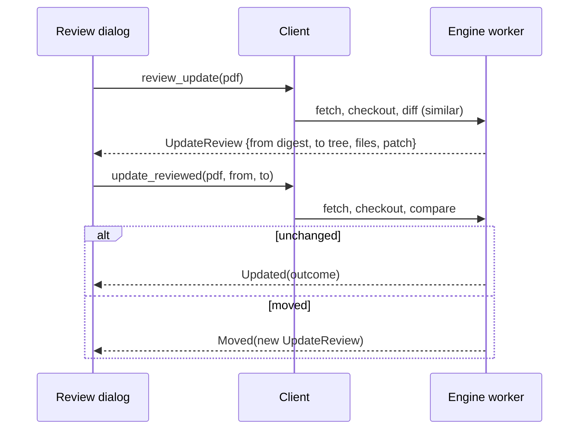

# Review a skill's changes before updating it

ADR: [0037](../adr/0037-updating-one-skill-shows-its-changes-first.md), which reverses "Update and Update all apply at once, without review" for one skill's Update. Design: [docs/design/skill-update-diff](../design/skill-update-diff/README.md) (decisions R1–R13). Glossary: [domain.md](../agents/domain.md). Builds on ADR 0005 (records and sources) and the command line's updates ([command-line-updates](../features/native/command-line-updates.md)).

## Problem

Update replaces a library skill's content with its source's current content at once. The user sees what changed only after it has landed. A skill is instructions that agents follow, so an unseen update is a supply-chain risk.

## Outcome

The user clicks Update on `pdf` and sees, before anything is written, that its update changes `SKILL.md` and `scripts/extract.py`, adds `scripts/fill_form.py`, and removes `reference.md`, line by line. They click Update, and exactly those changes land, or they click Cancel and nothing changes. We know it works when every file the update would change shows in the dialog, and what lands always equals what was shown.

## Scope

In:
- A review dialog behind Update on one skill: its card, its page header, and its row's context menu.
- Reloading the review when the source or the library content moved before Update.
- `skillbinder update <slug>… --diff` and the MCP server's `update_skills` `diff` action, both read-only.

Out:
- Update all, wherever it runs, which stays unreviewed.
- Choosing or editing individual changes.
- Reinstall, which restores recorded content and has nothing new to review.
- Screens for editing a source.

## Decisions

1. Update on one skill always opens the review, and nothing is written until Update is clicked in it (user).
2. Update all stays unreviewed, from Library's header, the menu bar menu, `update --all`, and the MCP server (user).
3. `update <slug>… --diff` and MCP `update_skills` `diff` show the changes and write nothing. `update <slug>` keeps applying without asking (user).
4. The layout is variant A "Stacked files": every changed file in one scrolling list, unified lines (user; R1).
5. When the source or the library content moved between the review and Update, the dialog shows the newest changes and the user clicks Update again (user; R9).

## Assumptions

- **A1** The review compares the skill's current library content with the fetched content, so a drifted skill's local edits show as removed lines, under a warning (R8). *If wrong:* compare the recorded content, and warn without showing the edits.
- **A2** Every entry point keeps the label "Update" (R13). *If wrong:* "Update…" on the context menu and buttons.
- **A3** A binary file, and a text file over 128 KiB on either side (the skill page's preview limit), show one line instead of their lines. All changes together are capped at 4 MiB of patch, and files past the cap are listed without lines (R5). *If wrong:* other limits.
- **A4** Renames show as a removed file and an added file. *If wrong:* detect renames.
- **A5** After Update, the dialog closes and the page shows today's "Updated 1 · 0 failed" or "Couldn't update: <reason>" (R11). *If wrong:* keep the dialog open with the error.
- **A6** `update <slug>… --diff` prints, for each named skill with an update, a header line (`pdf: github.com/anthropics/skills · skills/pdf · 5 files changed, +29 −8`) and then its patch, in plain text. With `--json` it prints the reviews. A named skill without an update gets "<slug> has no update.". The flag conflicts with `--all`. *If wrong:* other output.
- **A7** `--diff` and the `diff` action need Git (command line rule 5). They answer while a change runs, and the engine runs them after it.
- **A8** A file's executable bit is part of its content in the patch (`old mode`, `new mode`), and the dialog shows it as Kit renders extended headers.

## Behavior

1. **Open.** Update on one skill opens the review dialog in its Fetching state (R7). The engine fetches the source into the update cache, checks the skill's folder out into staging, and inspects it as Update does.
2. **Refusals.** Content an update would refuse (blocked, invalid skill metadata, no files, a submodule, over 5,000 entries, the source no longer holding the skill) shows the update's own text in the Couldn't fetch notice, without Retry (R10). A fetch failure shows Git's reason with Retry.
3. **Changes.** The dialog lists every added, changed, and removed file, sorted by path, with the summary under the title (R2–R5). An unchanged file is not listed.
4. **Drift.** When the skill has drifted, the warning notice shows above the files (R8, A1).
5. **Update.** Update fetches the source again and checks it out.
   - When the fetched tree equals the reviewed tree and the library content's digest equals the reviewed digest, it replaces the skill exactly as Update does today: one journal, the new record, managed copies rewritten, and a scan.
   - Otherwise it writes nothing and returns the new review from that checkout. The dialog shows it with the source-moved notice (R9).
6. **Cancel.** Cancel, Escape, the backdrop, and the close button discard the review. The staging checkout is removed when the review is built, so nothing is left behind.
7. **Busy.** While a blocking change, an import, Update all, or a Git operation runs, the card's, page's, and menu's Update stay inactive, as today. In an open review, Update is inactive while one of these runs, and it becomes active again when the change ends.
8. **Command line.** `update <slug>… --diff` and `update_skills` `diff` build the same reviews and print them (A6). They hold nothing and change nothing.

## Design

- **Proto** (decisions 1, 5): `UpdateReview { id, source, from, to, files: Vec<ReviewedFile>, patch }` where `from` is the library content's digest and `to` is the fetched tree. `ReviewedFile { path, change: Added | Changed | Removed, additions, deletions, shown: Lines | Binary { before, after } | TooLarge | PastCap }`. `ReviewedUpdate { id, from, to }`, and `ReviewedOutcome::{Updated(UpdateOutcome), Moved { moved: Source | Library, review }}`, `moved` choosing R9's notice. These are typed contracts with no I/O, in `crates/proto/src/update_review.rs`.
- **Engine** (behaviors 1–5): a new `crates/engine/src/sources/review.rs`.
  - `State::review_update(id)` reuses `update_skill`'s fetch, `checkout`, and `refusal`, and returns the review.
  - `State::update_reviewed(reviewed)` refactors `apply.rs`'s `update_skill` so that the checkout is compared with `from` and `to` before `replace`. A mismatch builds the review from the same checkout, with no second fetch.
  - The patch is built in-process with `similar` (`TextDiff::from_lines`, each text file's whole text as context so `DiffView` can unfold every stretch it folds past three lines, `diff --git a/<path> b/<path>` headers), and `DiffFile::parse` in Kit reads it. A file with a NUL byte in its first 8,000 bytes, or one that is not UTF-8, is binary, as Git decides. Paths are relative to the skill folder, with `/` separators.
  - Logs under `Area::Update`: `review built` with slug, files, and bytes, and `review moved`.
  - Workspace dependency `similar = "2.7"` (already locked through GPUI Kit), added to the engine's row in `xtask/src/graph.rs` (ADR 0037).
- **Client**: `Client::review_update(id)` and `Client::update_reviewed(reviewed)` on the runtime, like `update_skills`. `update_reviewed` publishes `Effect::Updated` on `Updated`.
- **Design system** (R3–R4): a new organism `crates/design/src/diff_view.rs`, `DiffView`. It wraps Kit's `Diff` over a caller-owned `Entity<DiffState>` in `DiffMode::Unified` with line numbers, the change background, folded context, and token colors. It has a test-window test, a gallery entry, and a README catalog row. It is domain-free, so it holds no slug or source.
- **UI** (R1–R13):
  - `crates/ui/src/native_view/update_review.rs` (with `update_review/` submodules if it grows) adds `DialogState::UpdateReview`, whose state is `Fetching`, `Ready { review, diff: Entity<DiffState>, notice }`, `Failed { message, retry }`, or `Updating`.
  - `library_updates.rs`'s `update_button` and the context menu's `update-skill` item open it, in place of `update(vec![id])`. `update(...)` stays for Update all's per-skill path, if nothing else calls it.
  - The footer uses `DialogFooter`, and the notices use `Notice`.
- **Command line and MCP** (behavior 8): `update` gains `--diff` (clap `conflicts_with = "all"`), a `Find` request that answers `Output::Reviews(Vec<UpdateReview>)`. `apps/cli/src/mcp/inputs/updates.rs` gains `diff`, with `skill_slugs`, which returns `reviews`.
- **Rollout**: no stored data, schema, or flag. Update's behavior changes in one release.

## Acceptance

Fixture: a local bare repository holds `skills/pdf`. The library's `pdf` records commit 1. Commit 2 changes `SKILL.md` and `scripts/extract.py`, adds `scripts/fill_form.py` and the binary `assets/form-sample.pdf`, and removes `reference.md`.

1. **Review.** Update on `pdf`'s page opens "Update pdf" with five files sorted by path, statuses A, M, and D, the right +/− figures, and "Binary file changed" for the PDF. Nothing in the library folder changes, and no staging folder is left.
2. **Apply.** Update in the dialog lands commit 2's content and record, rewrites `pdf`'s managed copies, and shows "Updated 1 · 0 failed".
3. **Cancel.** Cancel, then Escape after reopening, leave the library, its record, and its copies unchanged.
4. **Drift.** After a line is added to the library's `pdf/SKILL.md` outside SkillBinder, the review shows that line as removed, under the R8 warning.
5. **Source moved.** Commit 3 is pushed after the review opens. Update writes nothing and shows commit 3's changes with the R9 notice, and a second Update lands commit 3.
6. **Library moved.** A Pull changes `pdf` after the review opens. Update writes nothing and shows the changes now, with R9's library notice.
7. **Refusal.** A commit that breaks `SKILL.md`'s metadata shows the update's refusal text, without Retry, and Update inactive.
8. **Fetch failure.** With the remote moved away, the dialog shows "Couldn't fetch pdf's source: …" with Retry.
9. **Limits.** A 200 KiB text file shows "Too large to show (over 128 KiB)". A skill whose changes pass 4 MiB lists the rest as not shown.
10. **Update all.** Library's header, the menu, and `update --all` update without any dialog.
11. **Command line.** `skillbinder update pdf --diff` prints the header line and a patch that `git apply --check` accepts against the library's `pdf` folder, and changes nothing. `--json` returns the review. `update pdf --diff --all` is a usage error. MCP `update_skills` `diff` returns the same reviews.
12. **Checks pass:** `cargo fmt --all --check`, workspace Clippy, `cccc .`, workspace tests, `cargo run -p xtask -- verify`, and a locked release build.

## Slices

1. **Review before Update in the window.**
   - Delivers: the proto types, `sources/review.rs` with the patch builder, `update_reviewed`, the client calls, the design system's `DiffView`, and the review dialog behind every single-skill Update.
   - Checks: 1–10, 12.
   - Tests:
     - engine tests in `crates/engine/tests/updates.rs` against local bare remotes: the files and patch, binary and too-large entries, the cap, the source and library moving, refusals, and no staging left;
     - patch-builder unit tests that Kit's `DiffFile::parse` reads every shape back;
     - `DiffView`'s test-window test;
     - a native check on a development world: open, Update, Cancel, and drift.
   - Docs: `docs/features/native/library-and-organization.md` (Skill updates), `library-rows.md` (the card and menu Update), the glossary's update entry, `docs/architecture/native.md` if state flow changes, and the design system README.
   - Depends on: nothing.
2. **Review from the command line and the MCP server.**
   - Delivers: `update <slug>… --diff`, `Output::Reviews`, and `update_skills` `diff`.
   - Checks: 11, 12.
   - Tests: `commands::tests` for the plan and output, `apps/cli` grammar tests, and `mcp::tests::tools` for the `diff` action's request and result.
   - Docs: `docs/features/native/command-line-updates.md`, `docs/features/native/mcp-server.md`, `docs/specs/command-line.md`'s table, and the command line skill's reference if it lists `update`.
   - Depends on: slice 1.
