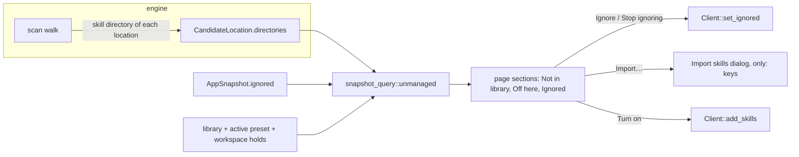

# Skills SkillBinder does not manage, on workspace and agent pages

ADR: [0036](../adr/0036-pages-list-what-skillbinder-does-not-manage.md), which partly supersedes [0007](../adr/0007-pages-list-active-skills.md), [0008](../adr/0008-import-from-scan-dialog.md), and [0033](../adr/0033-ignored-skills-are-remembered-per-slug.md). Design: [docs/design/unmanaged-skills](../design/unmanaged-skills/README.md) (decisions U1–U12). Glossary: [domain.md](../agents/domain.md), whose found skill, ignored skill, detected agent, and Import skills dialog entries change, and which gains **unmanaged copy**, in the slices that ship them (it documents shipped behavior). Builds on [ignore-found-skills](ignore-found-skills.md) and [scan-and-import](scan-and-import.md).

## Problem

A workspace's page and an agent's page list only the library skills that are on there. The agent also loads everything else in those folders: a project's vendored skills, skills an agent installed itself, hand-copied copies of library skills, and skills the user ignored. To audit what a project or agent really loads, the user had to open Scan for skills, whose dialog mixes every place, and could not see unmanaged copies anywhere (ADR 0007's Consequences).

## Outcome

Opening a workspace's, an agent's, or Universal's page shows every skill in that place's skill directories: what is on, what is not in library, which library skills sit there switched off, and what is ignored. The user can import, ignore, stop ignoring, or turn on right there. We know it works when a project's page shows each skill folder its directories hold in exactly one of its four groups.

## Scope

In:
- The Not in library, In library off here, and Ignored sections on workspace, agent, and Universal pages, with search.
- Ignore, Ignore all, Stop ignoring, Import… (the Import skills dialog narrowed to the place), and Turn on from those sections.
- Recording the skill directories that hold each scan location.

Out:
- Plugin skills (ADR 0035) and the SkillBinder skill (ADR 0028).
- Other directories an agent reads, such as Universal's on Cursor's page.
- Sidebar counts, Scan for skills' count, the Add skill picker, Library.
- New command or MCP server actions: `import`, `ignore`, `unignore`, `enable`, and `workspace enable` already cover every action here (ADR 0023).
- Changing any file on Ignore. Deleting found skills or unmanaged copies.

## Behavior

Decisions:

1. The pages let the user see these skills and act on them.
2. They list three groups besides the skills on there: found skills not in library, unmanaged copies of library skills, and ignored skills. Each page turns an unmanaged copy on with its own control: a workspace's page for the project's agents the user ticks, and an agent's page for that agent only, in the active preset.
3. Importing from a page turns the skill on wherever it was found, as Scan for skills does (ADR 0008).
4. The purpose is an audit: a page lists everything the scan found in its skill directories.
5. The layout is variant A, Sections (U1).
6. A workspace's page covers every agent workspace skill directory that the scan walks in its folder, including those of agents the user did not choose. Each row names its directory, and only the chosen agents' directories can be turned on.
7. An agent's page covers only its own global skill directory, links resolved, and Universal's covers `~/.agents/skills`, as its list of skills on there does (ADR 0007).
8. Sidebar counts still count only the skills on there.
9. An ignore still names a slug everywhere (ADR 0033): ignoring on one page ignores the skill on every page and in the Import skills dialog.

### What each page lists

1. A page's place is the set of its skill directories. For an agent's or Universal's page, that is its global skill directory. For a workspace's page, it is every directory the scan walks in the workspace's folder.
2. Each found skill in the latest completed scan with a location in the place lands in exactly one group, keyed by its normalized slug:
   - **On here**: the library holds the slug and the place has it on for that location's directory. These skills are the existing list, unchanged.
   - **In library, off here**: the library holds the slug, but the place does not have it on for at least one directory that holds a copy. That copy is an unmanaged copy, whether its content matches the library or not. A skill on in `.claude/skills` with a stray copy in `.agents/skills` is in both groups, and the off-here row names only `.agents/skills`.
   - **Not in library**: the library does not hold the slug, and it is not ignored.
   - **Ignored**: the library does not hold the slug, and it is ignored.
3. With no completed scan yet, the sections are absent. The pages refresh whenever a scan completes, which happens on focus and after every change that writes copies.

### Actions

4. **Ignore** and **Ignore all** call the same engine change as the Import skills dialog (ignore-found-skills behaviors 2–3). They are saved at once and need no new scan. The rows move to Ignored on every page.
5. **Stop ignoring** removes the ignore, and the row returns to Not in library and flashes (U8).
6. **Import…** opens the Import skills dialog with only the page's not-in-library skills, or from a row only that skill (U6). The dialog prepares a plan for just those slugs, with every version and location of each (ADR 0009). Applying it is an ordinary import: each skill turns on wherever it was found, and its copies elsewhere are adopted or replaced as the dialog states.
7. **Turn on** makes the same change as Add skill for that one skill (U7). On an agent's page, the active preset gains the page's global skill directory, and the page names the preset. On a workspace's page, the workspace holds the skill for the directories ticked in the menu, or for all agents. A copy with the library's content is adopted. A different copy is a conflict that the Skill copies dialog asks about (ADR 0006). While a blocking change, an import, Update all, or Sync runs, Turn on is refused like any other change.

## UX

The pages change as the prototype shows: [`docs/design/unmanaged-skills/prototypes/place-pages.html`](../design/unmanaged-skills/prototypes/place-pages.html), variant A "Sections". The user picked that over a filter beside the search (B) and one card with group headers (C). The rules are U1–U12 in [decisions.md](../design/unmanaged-skills/decisions.md). The Import skills dialog keeps its look when narrowed (U6). No other surface changes.

## Design

- **Where a copy sits** (behaviors 1–2; decisions 6–7):
  - `proto::CandidateLocation` gains `directories: Vec<PathBuf>`. These are the resolved skill directories, the walk's roots, whose walk reached the location, sorted and merged like `workspaces` when one physical folder is reached twice.
  - The engine already knows each walk's root, so `scan/traversal.rs` fills the field. A skill nested deeper in a root still names that root, which the parent of `display_path` could not.
  - Pages compare these paths with the resolved directories they already use: `AgentRow.resolved` and the workspace's `paths`. Links therefore resolve the same way they do in the list of skills on there.
- **One derivation** (behaviors 1–3; decisions 4, 6, 7, 9):
  - `crates/ui/src/native_view/snapshot_query/unmanaged.rs` derives `Unmanaged { off_here, not_in_library, ignored }` for a page from `AppSnapshot.scan`, `AppSnapshot.ignored`, the library, the active preset, and the workspace's holds. That is the seam where page derivations already live.
  - It groups versions per normalized slug, as `import_dialog::versions::found_skills` does, and reuses `Candidate::in_library` and `matching` for search.
  - It does not read `global_agents`, so agent and workspace pages share one rule: a location belongs to the place when one of its `directories` does.
- **Sections UI** (decisions 1, 5; U1–U10):
  - A new `crates/ui/src/native_view/unmanaged_sections.rs`, with `found_rows.rs` and `off_rows.rs` under `unmanaged_sections/`, renders the three sections under `scoped_list`. Both `agent_page.rs` and `workspace_page.rs` call it.
  - Off-here rows are `SkillItem`s with a new `RowEnd::TurnOn` variant, so the existing exhaustive matches (`dimmed`, `row_end`, `frame`, `name_marks`) must handle it. Clicking one opens the skill's page.
  - Found and ignored rows have no `Skill`, so they are their own row built from design-system components: ghost and outline xs Buttons, the validation glyph, and the disclosure chevron the Import dialog's Ignored group uses.
  - No new tokens, artwork, or design-system component.
- **Ignoring** (behaviors 4–5): `ignore`, `ignore_all`, and `stop_ignoring` move out of `import_dialog/ignored.rs` into `native_view/ignore_actions.rs`, a single seam the dialog and the pages share around `Client::set_ignored`. Stop ignoring's re-tick stays a no-op when no dialog is open, as `edit_import` already behaves.
- **Narrowed import** (behavior 6; decision 3):
  - `NativeView::open_import_dialog_for(keys)` creates the dialog with `only: Some(keys)`, and `open_import_dialog` passes `None`.
  - `prepare_found` sends only those keys' versions to `prepare_found_import`. `list::groups` and `default_ticks` then see only those skills, so the 500 cap, versions, acknowledgement, and placement rules are unchanged.
- **Turn on** (behavior 7; decision 2): `Client::add_skills` with the same `AddSkills` the picker builds for one skill. For an agent's page that is the page's agent ids. For a workspace's page it is the ticked directories or all agents. Conflicts, progress, and the Skill copies dialog come from the existing activation path.
- **Rollout**: one additive proto field, with no migration or stored data. The command's and MCP server's JSON that carry `CandidateLocation` gain the field additively. Bump `PROTOCOL` if the socket protocol versions that shape. No feature flag.

## Assumptions

- **A1:** found and ignored rows are not links, since a found skill has no page. *If wrong:* a read-only preview like a plugin skill's page (ADR 0035).
- **A2:** Import… sits on each row and on the section head. *If wrong:* only on the head.
- **A3:** the Ignored section starts collapsed on every visit. *If wrong:* it would remember being open per page.
- **A4:** Turn on asks about a different copy through the Skill copies dialog after the change, as Add skill does, not with a confirmation first. *If wrong:* a new "Replace the copy?" confirmation, as the prototype draws it.
- **A5:** a managed copy edited where its skill is off, which Skill copies already lists, also shows in In library, off here. *If wrong:* it would show only in Skill copies.
- **A6:** no new command or MCP server output. *If wrong:* `scan --workspace <ws>` and `--agent <a>` filters, and the same for `find_skills`.
- **A7:** Ignore all also covers rows the search hides, as I3 does. *If wrong:* only the visible rows.

## Acceptance

Fixture: workspace `acme-web` (Universal and Claude Code directories) holds `vitest-runner` and `figma-sync` (invalid) in `.claude/skills`, `acme-deploy` in `.agents/skills`, `vendor-lint` in `.agents/skills` (also in `~/.agents/skills`), library `a11y-audit` (same content) in `.claude/skills`, library `data-viz` (different content) in `.agents/skills`, and `windsurf-only` in `.windsurf/skills` with Windsurf not chosen. `~/.claude/skills` holds `skill-creator` and library `sql-helper` (same content), which the active preset does not hold for Claude Code. `anthropic-docs` in `~/.claude/skills` is ignored.

1. **Groups.** acme-web's page lists its skills on there, then Not in library: `acme-deploy`, `figma-sync`, `vendor-lint`, `vitest-runner`, and `windsurf-only` with `.windsurf/skills`. In library, off here lists `a11y-audit` and `data-viz` with "Different copy". Claude Code's page lists `skill-creator` under Not in library, `sql-helper` under In library, off here, and a collapsed Ignored with `anthropic-docs`. Every scanned folder appears in exactly one group per directory.
2. **Ignore.** Ignore on `vendor-lint` in acme-web moves it to Ignored there and on Universal's page, and the Import skills dialog lists it under Ignored. Stop ignoring on Universal's page restores both. Nothing changes on disk.
3. **Ignore all.** Ignore all on acme-web's Not in library, with the search set to `vit`, ignores all five skills.
4. **Import.** Import… on acme-web opens the Import skills dialog with only acme-web's five not-in-library skills, `figma-sync` unticked. Importing `vendor-lint` turns it on in acme-web's `.agents/skills` and in Universal's `~/.agents/skills`. Row Import… on `acme-deploy` opens the dialog with only `acme-deploy`.
5. **Turn on, agent.** Turn on for `sql-helper` on Claude Code's page adds Claude Code to the active preset's `sql-helper`, adopts the copy without writing, and moves the row to the list above.
6. **Turn on, workspace.** Turn on ▾ for `data-viz` lists All agents, Universal ("copy here"), and Claude Code. Picking Universal opens the Skill copies dialog for the different copy. Replace makes it managed and on, and Skip leaves it kept. `windsurf-only` offers no Windsurf directory.
7. **Search.** Searching `anthropic` on Claude Code's page shows only Ignored, expanded, with `anthropic-docs`.
8. **Empty.** A workspace with no directories and one found skill shows "No skills on in docs-site · No agents here yet", the Not in library section, and Turn on disabled on any off-here row.
9. **Unchanged.** Sidebar counts, Scan for skills' count, and Library are unchanged. Plugin skills never appear.
10. **Checks pass:** `cargo fmt --all --check`, workspace Clippy, `cccc .`, workspace tests, `cargo run -p xtask -- verify`, and a locked release build.

## Slices

1. **Pages list what SkillBinder does not manage, and ignore from there.**
   - Delivers: `CandidateLocation.directories`, `snapshot_query::unmanaged`, the Not in library and Ignored sections with search, and Ignore, Ignore all, and Stop ignoring through `ignore_actions.rs`.
   - Checks: 1 (except In library, off here), 2, 3, 7, 8 (except Turn on), 9, 10.
   - Tests:
     - An engine scan test showing `directories` for a nested skill and for a folder reached through a link and a workspace.
     - Derivation unit tests with a candidate builder in `snapshot_query/fixture.rs`.
     - A native check of acme-web and Claude Code on a development world.
   - Docs: `docs/features/native/workspaces-and-scanning.md` (workspace and agent pages), `docs/features/native/ignored-skills.md`, `docs/features/native/workspace-activation.md`, and the glossary's detected agent and ignored skill entries.
   - Depends on: nothing.
2. **Import from a page.**
   - Delivers: `open_import_dialog_for`, the dialog's `only` filter and narrowed preparation, and Import… on rows and the head.
   - Checks: 4, 10.
   - Tests: UI unit tests of `groups` and `default_ticks` with `only`, and a native check of the narrowed dialog.
   - Docs: `docs/features/native/imports.md`, and the glossary's Import skills dialog entry (a page can open it with only that place's found skills).
   - Depends on: 1.
3. **Turn on unmanaged copies.**
   - Delivers: the In library, off here section, `RowEnd::TurnOn`, Turn on for agent and Universal pages, and the workspace menu.
   - Checks: 1 (In library, off here), 5, 6, 8 (Turn on), 10.
   - Tests: derivation tests for copies on in one directory and off in another, an engine test that Turn on adopts an identical copy and records a conflict for a different one, and a native check.
   - Docs: `docs/features/native/activation.md`, `docs/features/native/workspace-activation.md`, and a glossary entry: "An unmanaged copy is a copy under a library skill's slug in a skill directory where that skill is not active. Agents still load it. Pages list it under 'In library, off here'; turning the skill on there adopts it or asks to replace it (ADR 0036). Avoid 'stray'." The glossary is at its size limit, so trim or split it in the same change.
   - Depends on: 1.

## Open questions

None.
